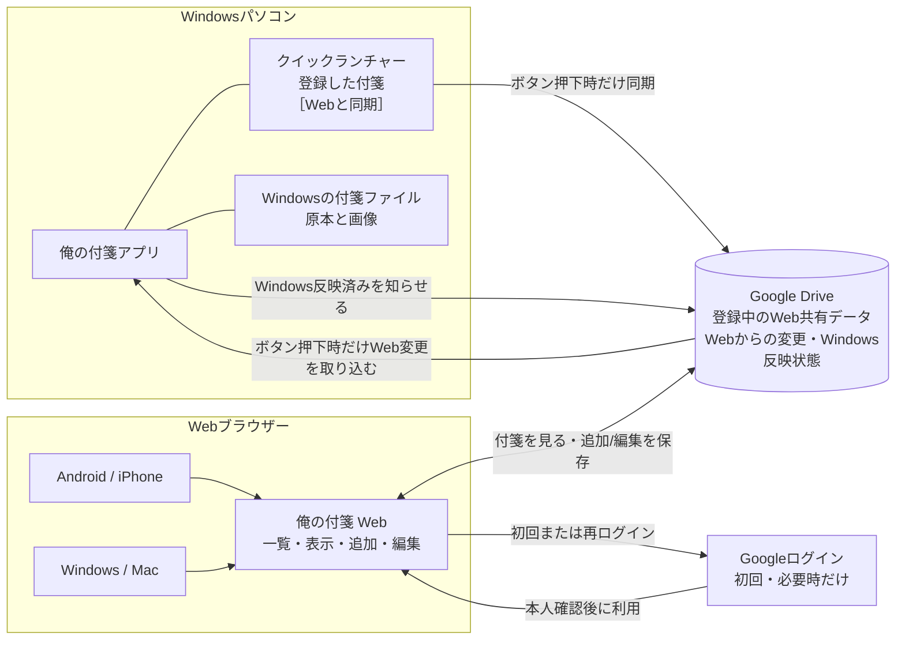
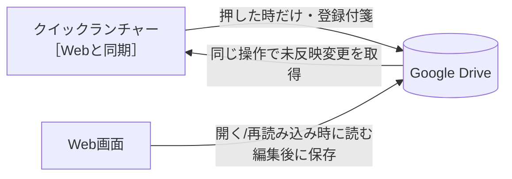
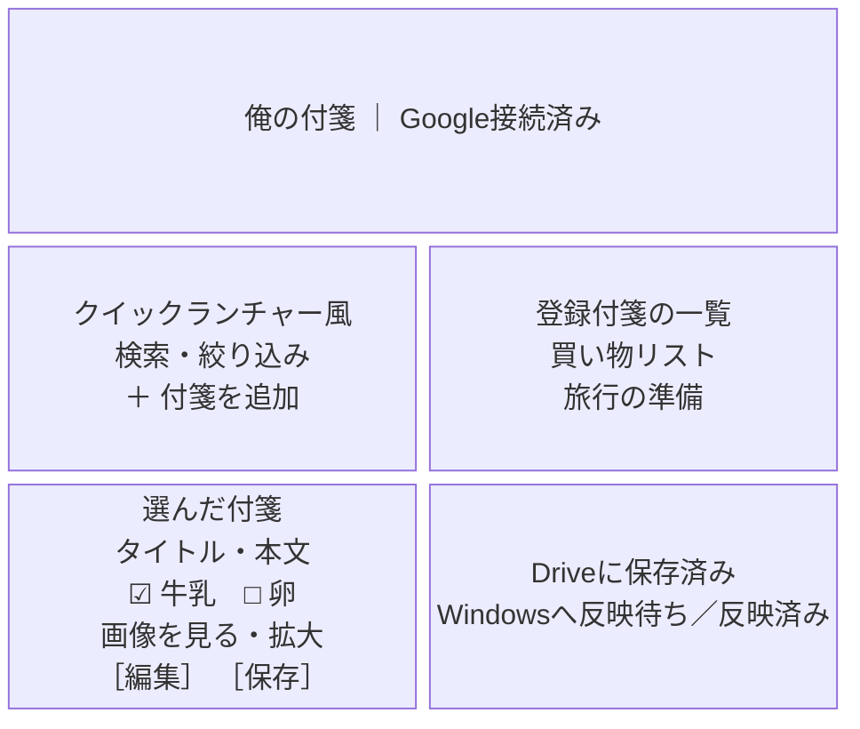
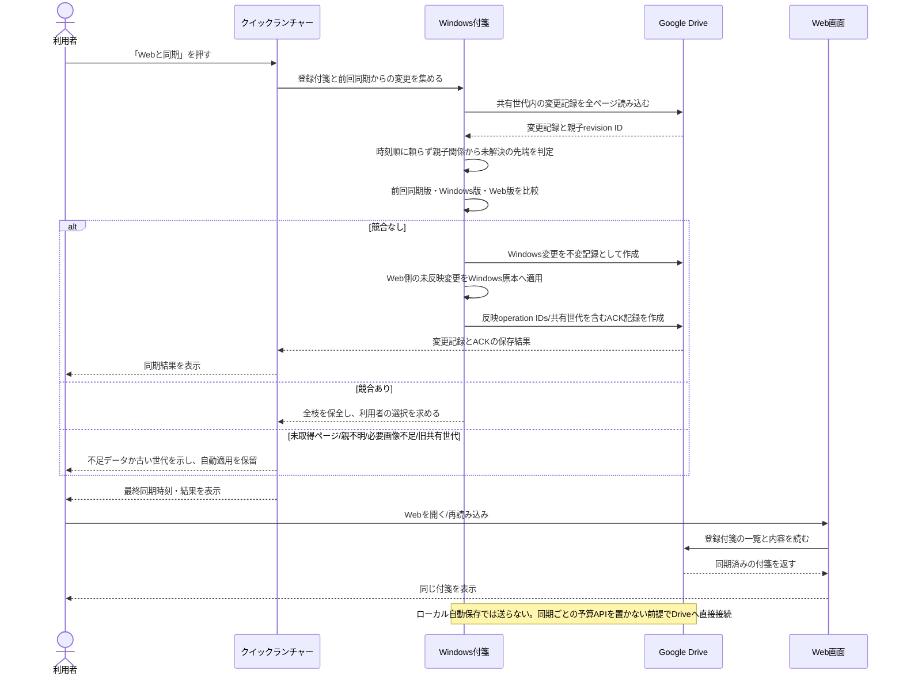
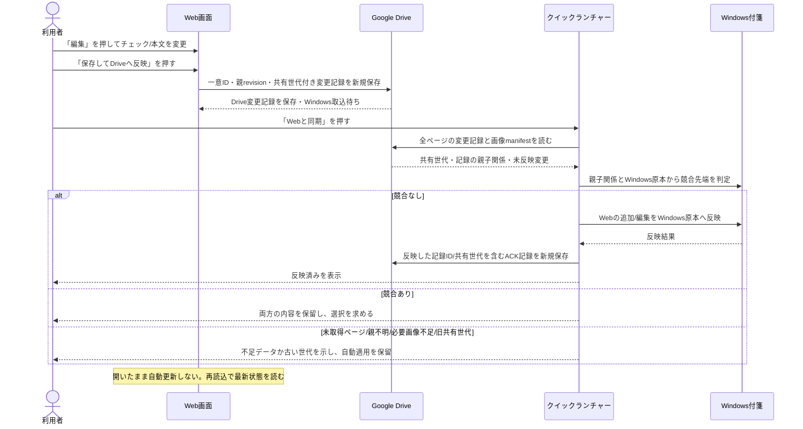
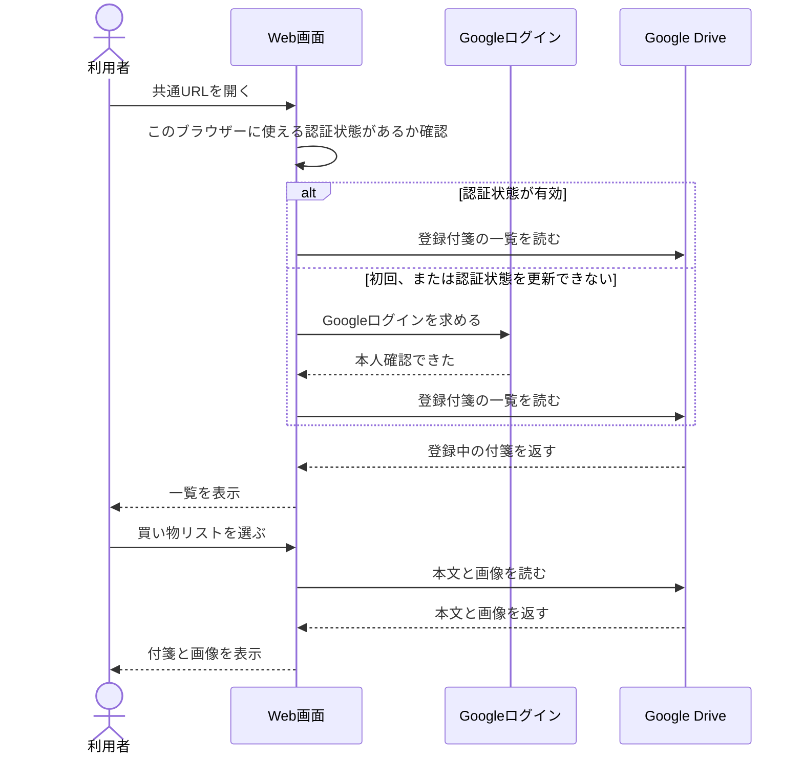
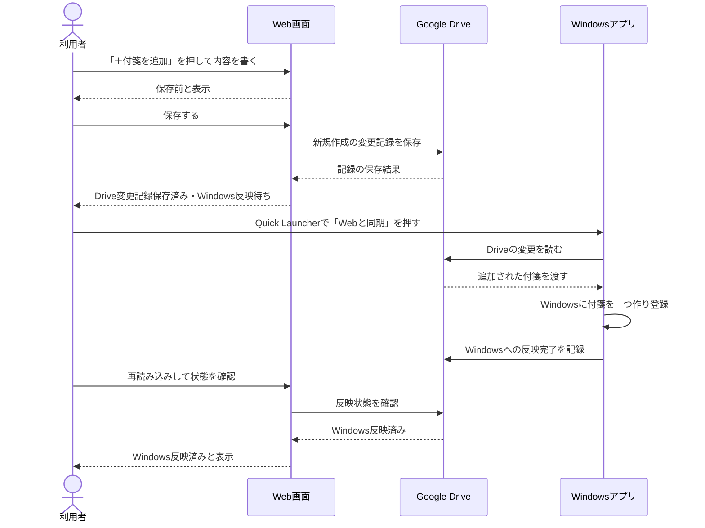
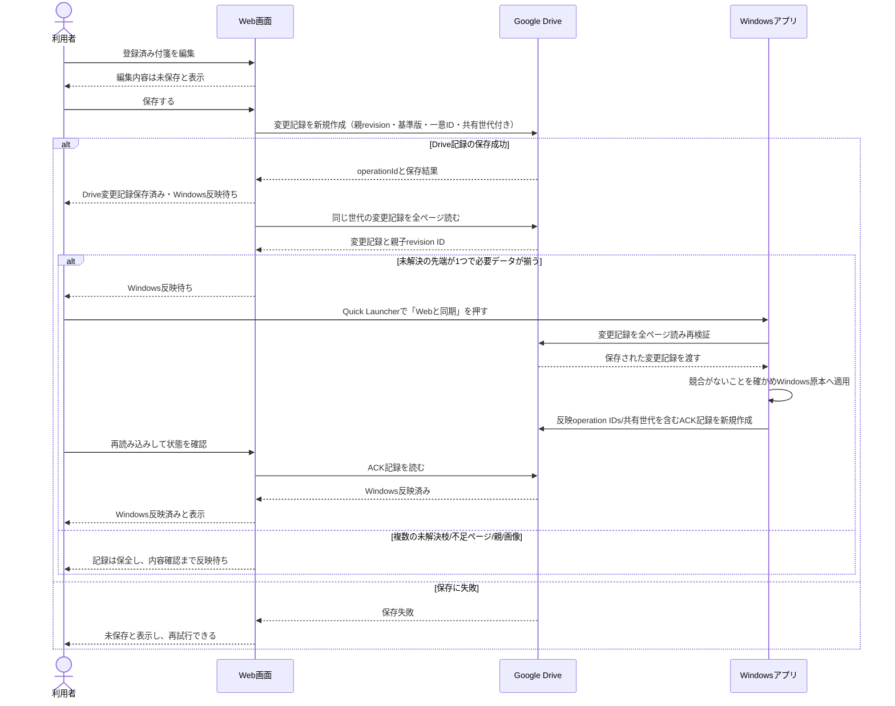
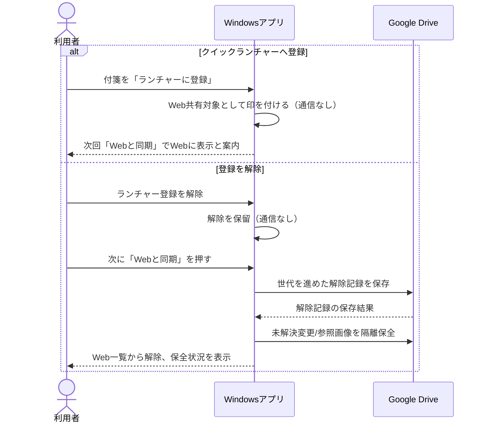
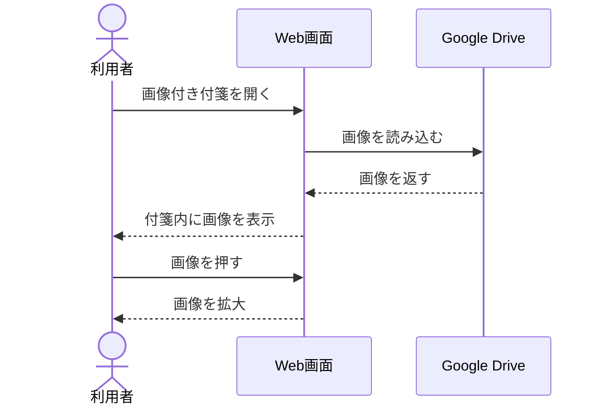

# クイックランチャー付箋 — 全体図と操作の流れ

2026-10-14 / 計画確認用。まだ製品に実装していない図です。

**図の読み方:** 全体図は「どの画面・保存場所がつながるか」を示します。各操作図は上から順に読み、矢印は情報のやり取りを表します。

## 全体図 — どこに何があり、どうつながるか



**この図が表す機能:** Windowsのクイックランチャーで「Webと同期」を押すと、登録中の付箋だけをDriveへ送り、DriveにあるWeb側の変更もWindowsへ取り込みます。WebはDriveを開く/再読み込みした時に読み、Web編集は「保存」を押してDriveへ送ります。Windowsからの送信は自動ではありません。

**原本はWindowsです。** Driveはバックアップでも正本でもなく、登録中だけ使うWeb共有の一時置き場です。「一時」といっても、登録を続ける間はWebで見られるよう共有データを置きます。Webで編集した時点ではまだWindows原本を更新していません。Windowsが同期して原本へ反映するまでは「Windowsへ反映待ち」です。Windowsが取り込んだ後も、登録が続く間はWeb用の共有データをDriveに置きます。登録解除後は通常のWeb一覧/取得から外し、未解決変更・参照画像は隔離保全します。初版は自動でゴミ箱へ移しません。Windows原本は残します。Webブラウザー自体には付箋本文を保存し続けない計画です。Windows側とWeb側で編集が食い違ったら、自動で混ぜたり上書きしたりせず、いったん止めて確認します。

iPhone PWAも「Driveを正本にせず、受け渡しに使う」考え方は共通です。ただしPWAでは、届いた付箋をiPhoneのIndexedDBに保存してからDriveの未処理キューや添付を片付けます。今回のWebでは、登録中の共有用データをDriveに置き続け、ブラウザーには付箋を永続保存しません。したがってDriveに置く期間と、端末での保存方法はPWAと異なります。

**実装方針（暫定）:** Driveのメタデータ取得で版番号は得られましたが、ETagによる条件付き更新は確認できず、版番号だけを原子的更新の保証として使いません。既存本文を上書きせず、不変の変更記録を保存する方向で実装を進めます。Drive実接続では架空操作8件の保存/再取得とページ送りを確認しましたが、小規模試験であり、同一ID再送・長期オフライン・欠落画像/容量停止は未検証です。未検証項目を理由に純粋モデルや画面実装を止めず、Windows原本への適用は安全試験が完了するまで無効にします。

**未確認の停止条件:** 同一IDの異なる内容の拒否、ACK/解除記録を本文先端から除外する検証、noteIdの再起動後の冪等取込、長期オフライン・欠落画像・容量停止、iPhone予算を先に確保したunits評価を実装・試験します。満たすまでWindows原本への適用と利用者向け配信は有効にしません。

## 同期のタイミング — 「Webと同期」ボタンを押した時だけ

**方針:** iPhone連携と同じくWindows→Webも手動です。Windowsのクイックランチャーに「Webと同期」ボタンを置き、押した時だけクイックランチャー登録済みの付箋をGoogle Driveと同期します。付箋のローカル自動保存ではDriveへ送りません。同期対象外の付箋は送らず、PC/Webどちらもバックグラウンド定期確認はしません。



**画面のイメージ（Windows）:**

```text
クイックランチャー　　[ Webと同期 ]
登録中 12件　　最終同期 10:42　　Web変更は同期時に確認
```

Drive通信は既存のWindows→iPhone送信と同様にアプリから直接行う想定です。同期ごとの予算APIを置かない場合は、同期ボタン1回ごとのVercel Functionは0回です。Webは開いた時または利用者が再読み込みした時にDriveを読み、Webで編集した場合は利用者が「保存」を押してDriveへ保存します。PCボタンを押しても、すでに開いているWeb画面へ即時通知はしません。Web側は再読み込み/開き直しまで表示が古い場合があります。Googleログインのコード交換や期限切れtokenの更新は必要時に既存Vercel APIを使うため、同期操作そのものとは分けて計上します。全利用者合算の予算を同期ごとに強制判定する場合はFunction 0回の前提を外して再計算します。

**同期の流れ（のぼり/くだり）:** のぼりはボタン押下時のWindows変更送信、くだりは同じボタン押下時のWeb側変更取得です。編集ごとの通知・HTTPS受信先・常時接続中継・30秒などの定期pollingは使いません。登録付箋数や画像数でDrive API要求数は変わるため、Vercel回数とは別に試作計測します。未同期の内容や競合があれば両方を残し、利用者の選択前に上書きしません。
## Web画面のイメージ



**この図が表す機能:** Windows母艦側にはクイックランチャーと「Webと同期」ボタンがあります。iPhone・Android・Windowsで見るのは、それとは別の共通Web画面です。Webの「表示を更新」はDriveから最新内容を読み直すだけで、Windows付箋への同期ではありません。付箋詳細ではチェック状態も含め、変更前にまず「編集」を押します。編集画面でチェックや本文を直し、「保存してDriveへ反映」を押すとDriveへ変更記録を新規保存します。既存の変更記録は直接上書きしません。Windows母艦側で「Webと同期」を押すとWindows原本へ取り込まれます。Web画面にWindowsへの同期ボタンはありません。PCでは左側に一覧、右側に選んだ付箋を表示し、スマホでは一覧と付箋の内容を切り替えます。画面デザインの具体例は[画面モック](QUICK-LAUNCHER-WEB-MOCK.html)です。端末ごとの表示切替と各ボタンはモック上の動作例で、製品実装ではありません。

**本文の編集操作:** Windows付箋のように、普通の文章は黄色い付箋面の大きな本文欄へそのまま書き、Enterで改行します。文章1行ごとに別の入力欄を並べません。チェックリスト行だけはチェック欄と項目入力欄で編集し、「チェック項目を追加」で増やします。保存後は本文の改行を保ち、チェック項目は表示時にチェックボックスで見せます。

**タイトルの表示:** Windows付箋のタイトルが本文先頭にも同じ文字で入っている場合、閲覧時は見出しと本文先頭の重複を避けます。編集欄および保存するMarkdownからは元の行を取り除かず、Windows原本の本文を保ちます。

## 操作の流れ

### 同期の流れ（のぼり／くだり）

ここでは **のぼり＝WindowsからWebへ**、**くだり＝WebからWindowsへ** と呼びます。iPhone連携の枠を先に確保し、Webは残りの枠で動く補助機能です。

#### のぼり：Windows → Web

**機能:** Quick Launcherに登録した付箋を、利用者が「Webと同期」を押した時だけWindowsからDriveへ送り、Webで見られるようにする。

**タイミングと件数の想定:** Windowsで編集した時はローカル保存だけ。利用者が同期ボタンを押した時に、ランチャー登録付箋のうち前回同期後に変わったものだけを送ります。初回だけ登録中の全付箋・必要画像を送ります。中心ケースはWeb共有対象1万人中3,000人/日が1日1回＝月90,000回の同期操作、上限寄りの仮定は1万人全員が1日1回＝月300,000回です。1日2回ならそれぞれ180,000回・600,000回です。これらは同期操作数で、Drive API要求数ではありません。1操作で何要求/units/bytes使うかは登録数・差分数・画像によって変わるため、実現性試作で計測します。利用者が押した分だけ発生し、毎秒・毎分の自動同期はありません。



**タイミング:** 付箋編集時はWindowsへローカル保存のみ。Drive送信は同期ボタンを押した時だけ行います。初回同期では登録中の付箋/画像を共有領域へ送り、2回目以降は差分だけを送る案です。変更なしならDriveへ本文・画像を再送しません。実際のDrive要求数/unitsは試作で測ります。

#### くだり：Web → Windows

**機能:** Webで保存した変更を、利用者がQuick Launcherの「Webと同期」を押した時にWindows原本へ取り込む。

**タイミングと件数の想定:** Webで「保存」を押すとDriveの共有データが更新されます。Windows原本へは、利用者が次にQuick Launcherの「Webと同期」を押した時だけ反映します。PCが停止中なら反映は次の起動後にボタンを押すまで待ちます。人数と月間同期操作数の上限寄り仮定は、上のぼりと同じです。Web側の保存回数・Drive要求数は別途発生し、同期操作数と同じ数とは限りません。



**タイミング:** Webの保存操作でDriveに保存します。Windows原本への反映はPCで「Webと同期」を押した時だけ行います。Webで作った付箋はそのボタンからWindowsに取り込み、Quick Launcherの登録対象へ加えます。本文/チェック項目の競合は両方を保全し、利用者確認前に上書きしません。
### 1. 登録した付箋を見る

**機能:** Googleログイン後、クイックランチャーに登録した付箋をWebで探して読む。付箋内の画像も表示する。



**この図の結果:** Android、iPhone、Windows、Macのどれでも、同じURLから同じ登録付箋を見られます。各ブラウザーでは初回にGoogleログインします。以後は認証状態を再利用し、毎回ログイン画面を出さない計画です。認証の期限切れは自動更新を試し、許可取り消し・更新失敗・ログアウト・ブラウザー情報の消去時に再ログインを求めます。別の端末やブラウザーでは初回ログインが必要です。

### 2. Webから新しい付箋を追加する

**機能:** Webで新しい付箋を書き、Driveへ保存する。Windowsアプリは次回同期でWindowsにも付箋を作る。



**この図の結果:** Webで保存した時点ではWindowsへの追加はまだ完了していません。Windowsアプリが同期した後に反映済みになります。Windowsで二重に付箋を作らない仕組みは実装前に試作します。

### 3. Webで付箋を更新する

**機能:** Webでタイトル・本文・チェック項目を直して保存し、Windowsアプリの次回同期でWindowsの付箋にも反映する。



**この図の結果:** Driveへの変更記録の保存とWindowsへの反映を別々に表示します。世代内の取得済みDAG全体、Windows適用済み先端、未送信のWindows変更から競合を判定し、ACKを探索の切断点にしません。未解決の先端が複数なら両方を保全し、Windows同期時に競合として選択を求めます。初版は自動整理せず、隔離保全と容量上限時の停止・再試行を追加試作で確認します。

Drive保存済みは変更記録の永続化を指し、Windows原本への反映完了とは別です。同じoperationId・正規化payload hashの再送は1操作として扱い、IDが同じで内容が異なれば拒否します。hash対象はaccount subject、noteId、世代、親ID集合、本文/チェック、画像manifestです。deviceSequenceは診断情報に限り、因果順には使いません。競合判定は世代内DAG全体とWindowsの適用済み先端/未送信変更を合わせ、ACKを探索の切断点にしません。全ページを読み切れない・親記録がない・共有世代が異なる・画像manifestが不足する場合は自動適用しません。競合解決は全競合先端IDを親に含む新しい解決記録として保存します。解除後の旧世代書込み、遅延した旧枝、解決済み枝の遅延子、参照中画像は一覧から隠すだけでなく保全/隔離します。初版は自動整理を無効にし、容量上限で新規保存を停止します。

### 4. Windowsで登録・登録解除する

**機能:** Windowsのクイックランチャーへの登録・解除で、Webに出す付箋を選ぶ。



**この図の結果:** 登録/解除操作だけではDriveとWebに反映しません。次の「Webと同期」で反映します。Windowsの元付箋は残り、解除記録が保存された後は通常のWeb一覧/取得から外します。未解決変更・遅延操作・参照画像の隔離保全は非表示化と別に行い、初版では自動でゴミ箱へ移しません。すでに画面に表示された内容を遠隔で消せない点は、画面でも説明します。

### 5. Webで付箋内の画像を見る

**機能:** Windows付箋の画像をDriveから読み込み、Webで表示・拡大する。



**この図の結果:** Windowsが終了中でも、ネット接続があれば画像を表示できます。初版ではWebから画像を追加・差し替えず、Windowsで変更します。

## この計画でまだ試すこと

- WebとWindowsが同時に同じ付箋を直した場合、どちらの変更も失わないこと。
- Webで作った付箋がWindowsで一度だけ作られ、アプリ再起動後も二重にならないこと。
- 本文を編集しても画像やチェック項目の順番、他の文章が壊れないこと。
- 登録解除後にこのアプリの一覧から消え、再取得できなくなること。Drive所有者がDriveから復元できることとは区別する。
