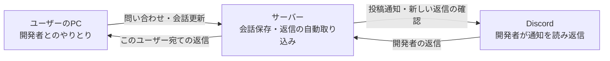
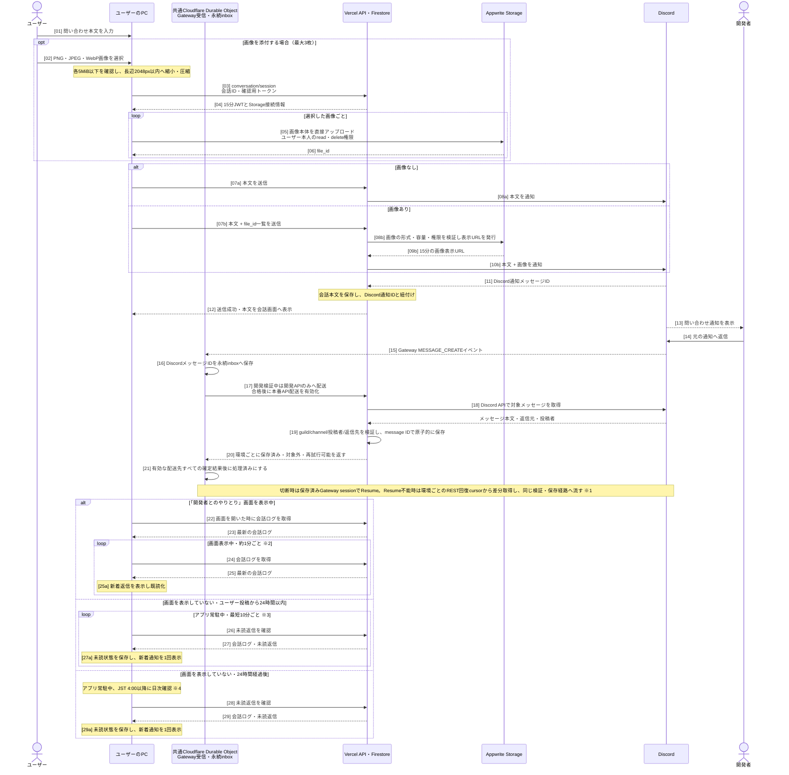
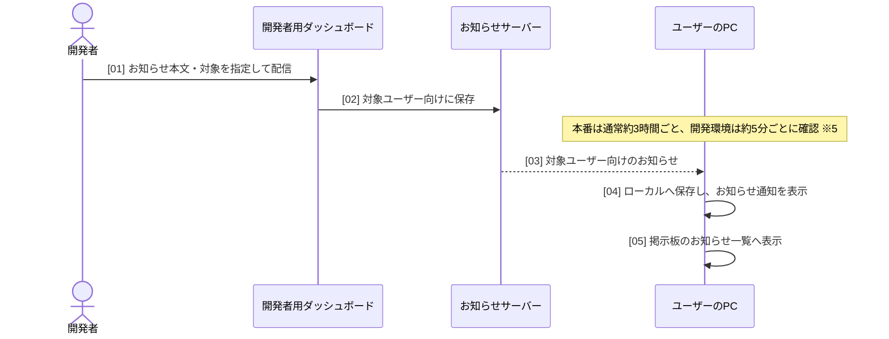

# 007 コミュニケーション設計

<p class="lead-text">
ユーザーと開発者が、連絡先を交換せずに 1 対 1 の掲示板としてやりとりするための UI とデータフローを定義します。
</p>

<p class="version-info">
コミュニケーション設計 v3.12 / 2026-10-17
</p>

---

## 1 目的

これまでのフィードバック機能は、ユーザーから開発者へ一方向に届く仕組みでした。  
前案では、開発者からの返信を付箋としてユーザーの画面に出す案を検討しましたが、これは体験として強すぎます。ユーザーの作業空間に開発者の返信が突然現れるため、誤配信時の心理的な負担も大きくなります。

本章では、返信を付箋として出すのではなく、設定画面内に「開発者とのやりとり」掲示板を作ります。ユーザーは必要なときだけ設定画面を開いて会話を確認します。

<Note type="info">
この仕組みは、ユーザーの既存付箋、既存付箋の添付画像・動画、Google Drive 内の同期ファイル、Google Drive トークンを自動送信するものではありません。ユーザーが掲示板へ入力した本文と、掲示板で明示的に選択した画像だけを送信対象にします。
</Note>

### 1.1 登場人物と用語

実装上の役割は次の名前で区別します。図4-1では会話の流れを読みやすくするため、Cloudflare Worker、Vercel API、Firestoreを「サーバー」にまとめます。図6-1はGateway・API・Firestoreを分けて示します。

<p class="table-caption">表 1.1-1　登場人物と責務</p>

| No | 名前 | 役割 | 保持してよい情報 |
|:---|:---|:---|:---|
| 1 | PCアプリ | ユーザーが投稿し、自分の会話ログを表示する | `conversation_id`、生の `secret_token`、最終確認時刻 |
| 2 | Vercel API | PCアプリ、Firestore、DiscordをつなぐAPI処理 | Firebase Admin SDK認証情報、Discord Bot Token、ingest secret |
| 3 | Firebase / Firestore | 会話データの正本を保存するDB | `secret_token_hash`、会話本文、開発者返信、Discord通知ID |
| 4 | Discordサーバー | 開発者がユーザー投稿を確認し、同じ通知に返信する場所 | Discord通知メッセージ、開発者返信 |
| 5 | Discord Webhook | Vercel APIからDiscordサーバーへ通知を投稿する入口 | Webhook URL |
| 6 | Discord Bot | Discordサーバー上の返信をVercel APIへ取り込むために読む主体 | Bot Token |
| 7 | Appwrite Storage | ユーザーが掲示板で明示的に添付した画像本体を保存する | 画像ファイル、所有者を示す読取・削除権限 |
| 8 | Cloudflare Worker | 作者PCを経由せず定期的に返信取り込みを起動する | ingest secret、サーバーの最終確認ID、失敗時の再試行時刻 |

---

## 2 方針

<p class="table-caption">表 2-1　方式の決定</p>

| No | 案 | 採否 | 理由 |
|:---|:---|:---|:---|
| 1 | 開発者返信を付箋として出す | 不採用 | ユーザーの作業空間に突然表示され、体験として踏み込みすぎる |
| 2 | Discord チャンネルをユーザー数分作る | 不採用 | チャンネル数、権限、API制限、削除、運用管理が重すぎる |
| 3 | 設定画面内に 1 対 1 掲示板を作る | 採用 | ユーザーが見に行く形なので自然で、誤表示時の影響範囲も設定画面内に閉じる |
| 4 | ユーザーごとに会話ファイルを作って自前同期する | 将来候補 | 考え方は近いが、初期実装では Vercel API + Firebase / Firestore で会話データを管理する方が単純 |
| 5 | 作者PCの起動・設定を返信配送の必須条件にする | 不採用 | Discordで返信しても作者PCの状態で配送が止まる。返信取り込みはサーバーの責務とする |

---

## 3 ユーザー体験

設定画面に「開発者とのやりとり」を追加します。見た目は、シンプルな掲示板またはチャットログです。

<p class="table-caption">表 3-1　ユーザー側 UI</p>

| No | 画面・状態 | 表示 | 操作 |
|:---|:---|:---|:---|
| 1 | 設定画面 | 「開発者とのやりとり」メニュー | ユーザーが開く |
| 2 | 初回表示 | まだやりとりがない旨、本文入力欄、画像選択、送信ボタン | 必須の本文を書き、必要ならPNG・JPEG・WebP画像を最大3枚選ぶ |
| 3 | 送信後 | 自分の投稿本文が会話ログに追加される。送信済み画像は会話ログへ再表示しない | Discordで開発者が本文と画像を確認する。必要なら続けて投稿する |
| 4 | 返信あり | 「アプリ開発者」名義の返信が会話ログに表示される | 読む、必要なら返信する |
| 5 | 未読返信あり | 右クリックメニューの「開発者とのやりとり」に `● 新着あり` を付ける | 開いて確認する |
| 6 | 返信なし | 何も割り込んで表示しない | 通常利用を続ける |
| 7 | 通信失敗 | 設定画面内に控えめな再試行表示 | 付箋や通常操作には影響しない |

<p class="table-caption">表 3-2　会話ログの表示例</p>

| 発言者 | 表示例 |
|:---|:---|
| ユーザー | こんにちは |
| アプリ開発者 | こんにちは |
| ユーザー | 付箋の色を増やしてほしいです。 |
| アプリ開発者 | ありがとうございます。検討します。 |

---

## 4 全体構成

ユーザー側は設定画面だけを使います。開発者はDiscordで通知を読み、その通知に返信します。Discord返信の取り込みはサーバー側で約1分ごとに行います。作者PCの起動、アプリ、管理者設定には依存しません。ローカル会員ダッシュボードは一斉・宛先指定のお便り配信に使い、個別会話には使いません。Discord はユーザーに直接見せません。



<p class="mermaid-caption">図 4-1　1 対 1 掲示板方式の全体構成</p>

<p class="table-caption">表 4-1　責務</p>

| 領域 | 責務 |
|:---|:---|
| PCアプリ | 匿名会話IDの保持、掲示板UI表示、投稿、画面表示中は約1分ごとの会話更新、投稿後24時間は常駐中に約10分ごとの新着確認、それ以外は日次確認 |
| Vercel API | secret token 照合、Firestore保存、Discord通知、Discord返信取り込み |
| Cloudflare Workers | 約1分ごとの返信取り込み起動、サーバー上の確認位置保存、失敗時の再試行。作者PCを経由しない |
| Firebase / Firestore | 会話本文、開発者返信、既読状態、Discord通知との対応を永続保存 |
| Appwrite Storage | 掲示板で明示的に選択した画像本体とファイル権限を保存する。会話本文の正本にはしない |
| Discord | ユーザー投稿を開発者へ知らせ、開発者が同じ通知に返信する裏側 UI |
| 開発者 | Discordの対象通知に返信する。会員ダッシュボードではお便りを配信する |

---

## 5 データモデル

ユーザーをメールアドレスや Discord ID で識別しません。アプリがローカルに保持する匿名の `conversation_id` と、本人確認用の `secret_token` で会話を守ります。

<p class="table-caption">表 5-1　ローカルに保存する情報</p>

| No | 情報 | 保存場所 | 用途 |
|:---|:---|:---|:---|
| 1 | `conversation_id` | PCローカル設定 | このアプリの掲示板を識別する |
| 2 | `secret_token` | PCローカル設定 | 他人が会話を読めないようにする |
| 3 | `last_message_check_at` | PCローカル設定 | 従来の確認時刻を保持する |
| 4 | `has_unread_developer_reply` | PCローカル設定 | 右クリックメニューの新着表示に使う |
| 5 | `last_unread_check_date` | PCローカル設定 | JST 4:00 頃の自動確認を同じ日に重複実行しない |
| 6 | 投稿後24時間の期限・前回確認時刻 | PCローカル設定 | 会話中だけ常駐確認を約10分間隔にする |
| 7 | 通知済みの返信ID | PCローカル設定 | 同じ返信の小窓を繰り返し出さない |
| 8 | サーバーのingest secret | Cloudflare WorkerのSecrets | 返信取り込みAPIを認証する。ユーザーPCへ渡さない |
| 9 | Discord最終確認ID | Cloudflare Durable Object | 次回は新しい投稿だけを確認する。作者PCの停止・再起動に依存しない |

<p class="table-caption">表 5-2　Firebase / Firestore に保存する情報</p>

| No | 情報 | 用途 |
|:---|:---|:---|
| 1 | `conversation_id` | 会話スレッドの識別 |
| 2 | `secret_token_hash` | PCアプリからの読取・送信権限確認 |
| 3 | `messages[]` | ユーザー投稿と開発者返信の本文 |
| 4 | `discord_message_id` | Discord通知と会話の紐付け |
| 5 | `author_type` | `user` または `developer` |
| 6 | `read_by_user` | 開発者返信をユーザーが見たかどうか |
| 7 | `status` | shadow accepted、ignored など |

<Note type="warning">
`secret_token` の生値は Firebase / Firestore に保存しません。Vercel API は、PCアプリから受け取った `secret_token` をハッシュ化し、Firestore に保存済みの `secret_token_hash` と照合します。
</Note>

<p class="table-caption">表 5-3　`secret_token` の発行と更新</p>

| No | 項目 | 仕様 |
|:---|:---|:---|
| 1 | 発行タイミング | PCアプリが開発者とのやりとりを初めて使い、ローカルに `secret_token` がないときに発行する |
| 2 | 更新タイミング | 通常は自動更新しない。ローカル保存が消えた、別環境を使った、または値が欠けた場合に新しく発行する |
| 3 | 長さ | 32バイトの乱数を base64url 文字列にするため、通常は43文字になる |
| 4 | 生成方法 | 暗号用途の乱数生成器で32バイトを作り、URLに含められる base64url 形式へ変換する |
| 5 | Firestore保存 | 生の `secret_token` は保存せず、`secret_token_hash` だけを Firestore に保存する |

<p class="table-caption">表 5-4　会話データの分離ルール</p>

| No | ルール | 理由 |
|:---|:---|:---|
| 1 | Firestore の会話正本は `feedback_conversations/{conversation_id}` 単位で分離する | ユーザーごとの掲示板をDB上でも別スレッドとして扱う |
| 2 | `conversation_id` だけで本人確認しない | IDが見えたり推測された場合でも、会話を読ませない |
| 3 | 読み取り、投稿、既読更新は `secret_token_hash` が一致した場合だけ許可する | 別ユーザーの会話ログが返る事故を防ぐ |
| 4 | Discord返信は元の通知メッセージまたは通知内の会話IDから対象会話を確定できた場合だけ保存する | Discord内の無関係な投稿がユーザーの掲示板に混入しないようにする |
| 5 | 対象会話を確定できない、token が一致しない、または重複している場合は保存せず拒否する | 判断できないものは表示しない fail closed にする |
| 6 | 右クリックメニュー表示時は Firestore へ問い合わせない | メニュー表示を遅くせず、通信失敗で右クリックが効かなくなる事故を防ぐ |
| 7 | 掲示板を開いて表示できた開発者返信だけを既読化する | 見ていない返信を既読にしない |

Firestore は Vercel の中にある保存領域ではなく、Firebase が提供する外部の永続データベースです。Vercel API は、Vercelの環境変数に設定した Firebase Admin SDK 認証情報を使って Firestore を読み書きします。PC アプリや iPhone PWA に Firebase の管理用認証情報を配布しません。

```txt
feedback_conversations/{conversation_id}
  secret_token_hash
  created_at
  updated_at
  discord_message_id
  delivery_enabled

feedback_conversations/{conversation_id}/messages/{message_id}
  author_type: user | developer
  body
  created_at
  discord_message_id
  read_by_user
  shadow_only
```

<p class="table-caption">表 5-5　掲示板へ添付した画像の保存情報</p>

| No | 情報 | 保存場所 | 用途 |
|:---|:---|:---|:---|
| 1 | 画像本体 | Appwrite Storage | Discordで開発者が画像を直接確認する |
| 2 | `file_id` | PCアプリからVercel APIへ送信 | 本文送信時に添付画像を指定する |
| 3 | MIME形式・容量・権限 | Appwrite Storageのファイルメタデータ | Vercel APIが形式、5MiB以下、会話所有者の読取・削除権限を確認する |
| 4 | 15分間の表示トークン | Appwrite Storage | Discordが非公開画像を短時間だけ表示する |

画像バイトはVercel APIやFirestoreへ保存しません。送信途中で失敗した場合、PCアプリは今回アップロードした画像の削除を試みます。送信成功後の30日自動削除は今回の最小版には含めず、別対応とします。

---

## 6 シーケンス

### 6.1 ユーザーからの問い合わせ（送信・返信受信方式の変更案）

このユースケースでは、ユーザーの問い合わせが開発者へ届き、Discordでの開発者返信が同じユーザーへ戻ります。返信受信は、サーバーからDiscordへの通常時の定期確認をやめ、Cloudflare Durable ObjectでGatewayイベントを受け取る変更案です。まだ未実装で、現在はサーバーが約1分ごとにDiscordを確認します。画像を添付する場合だけStorage経由の処理が加わります。画像なしの場合は本文をそのままAPIへ送ります。



<p class="mermaid-caption">図 6-1　ユーザーからの問い合わせと開発者返信（画像添付は任意）</p>

**図 6-1 の注記**

- 番号は図 6-1 内の通信・処理番号です。画像あり/なしの分岐番号は `a` / `b` で区別します。番号のないNoteは補足です。以後「図6-1の[14]」のように指定できます。
- 図は変更後の目標案で、まだ未実装です。現行動作と料金・稼働条件は第7章に記載します。
- [15]以降はGateway受信の推奨構成です。常時接続するGateway Durable Objectはアカウント全体で1つだけにします。初期検証では開発API配送だけを有効にし、本番は既存のREST定期取り込みを継続します。開発往復検証と無課金条件の確認に合格後、本番API配送を有効にし、本番往復検証に合格してから本番のREST定期取り込みを停止します。任意URLへの配送や本番へのfallbackは禁止します。
- 環境ごとに独立したinbox配送状態を保持します。未有効環境は配送済みと扱わず保留状態にし、有効化時に保存済みのDiscord回復cursorから差分回復してからライブ配送を開始します。一方のAPIが「対象外」と返しても、他方への配送が未確定ならイベント全体を処理済みにしません。元通知IDの対応表が書き込まれる前に返信イベントが着いた場合は「対象外」で確定せず、一定時間inboxで再試行します。
- Durable ObjectはイベントIDとGateway再開用sequenceを整合する永続transactionで保存し、未保存イベントを越えて再開位置を進めません。受信sequence、永続化済みGateway checkpoint、環境別REST回復cursorを別々に管理します。古い接続callbackは接続世代を検査して破棄します。
- [19]のAPI保存は `環境 + Discord message ID` をキーに原子的に行い、イベント再送・REST回復との競合で二重保存しないことが必要です。
- [24]のユーザー画面側の会話取得は、画面表示中の約1分ごとのままです。Discordからサーバーへの受信を速めても、画面への反映はユーザーPCの次回確認時になります。
- ※1 Gatewayの通常受信では定期REST走査を行わず、切断・Resume不能時などの欠落回復だけREST差分取得を使います。Gateway接続・再接続・安全な回復に加え、常時接続に伴う無課金条件を確認する必要があります（§6.1.1）。

REST回復は1回20件・全体12秒以内で小分けにし、before/high-water/floor・環境・channelを継続位置として保存します。途中で環境全体cursorを進めず、全件完了後にhigh-waterへ進めます。継続位置とcursorは同じstorage transactionで確定します。APIの通信期限は本文読取まで含め、書込の無条件再送を行いません。

Gatewayの未送信走査は環境別cursorと時間予算を持ち、保留証拠100件が先頭に残っても後続へ進みます。401/403では当該配送先だけを停止し、secret変更または認証付き再開操作で再開します。429はRetry-Afterを守ります。失敗によって成功済み環境をやり直しません。

### 6.1.1 Gateway受信の実装・運用条件

- Gateway Identifyでは `GUILD_MESSAGES` Intentだけを使い、`MESSAGE_CREATE` の本文は扱わず、Durable Objectには対象channel/guild、author ID、message ID、reply reference、Gateway sequenceだけを永続inboxへ記録します。本文のREST取得にも `MESSAGE_CONTENT` の制限が適用されます。BotのDeveloper PortalでMessage Content accessが有効であることと、対象Botに必要な承認があることを事前確認します。右クリック返信をBotへのmentionとみなす設計にはしません。
- HELLO heartbeat interval、初回jitter、ACK欠落、Opcode 7/9、close code別のResume/Identify、session start limit、429/backoffを扱います。無効なBot token・Intent拒否など恒久設定エラーでは自動再接続を続けず停止・記録し、再試行可能な切断・HTTP 429/5xxはbackoff後に再開します。
- Gatewayイベントの取得・転送が確認できるまでイベントinboxとcheckpointを同一のDurable Object storage transactionで確定します。配送先URLは本番・開発のコード固定値、secretは環境別Cloudflare Secretsとします。受信本文・token・secretをログへ出しません。
- 開発Workerを本番とは別の常時Gatewayにしません。初期は1つのGatewayから開発APIだけへ配送し、本番APIは既存REST取り込みを使います。開発検証後に本番API配送を有効にし、本番検証後に本番REST取り込みを止めます。各環境のinbox処理結果は独立して保存し、有効な全配送先が確定するまでイベントを完了扱いにしません。切替中は未有効環境の状態を保留し、環境別REST回復cursorから差分を処理して重複は冪等保存で抑えます。
- 通知元メッセージ自体の削除などで返信本文をREST取得できない場合は、無限再試行せず取得不能として記録します。Discord側の保持・削除や停止時間による欠落ゼロは保証しません。
- Cloudflare Durable Objectの外向きWebSocketはhibernationできず、常時接続中は実行時間の料金対象になります。Workers Freeの13,000 GB-s/日では常時1個でも概算約11,059 GB-s/日を使い、他のDO使用量を含めると無料範囲内と保証できません。Free枠での運用、プラン変更・自動課金なし、無料枠不足時はGatewayを停止して配送遅延を許容しinbox/cursorを保持する方針とします。アカウントプラン・他用途を含む利用量が確認でき、無課金で動くと確認できるまでデプロイ・有効化しません。
- ※2 ユーザーが会話を見ている間に返信を自動反映し、手動更新を不要にするためです。画面を開いた時点でも取得します。
- ※3 直近24時間にユーザー投稿があった場合、画面外でも通知を保ちつつ、会話中より問い合わせ頻度を下げるためです。対象はアプリ常駐中です。
- ※4 直近24時間の対象期間を過ぎた後も未読を知らせながら、短間隔の問い合わせを避けるためです。JST 4:00以降、アプリ常駐中に日次で確認します。

**画像の有無による違い**

画像の有無で会話の往復方向や開発者の返信方法は変わりません。画像ありの場合だけ、PCからAppwrite Storageへ画像本体を直接アップロードし、APIが画像を検証してDiscord通知へ添付します。画像なしの場合は本文だけをAPIとDiscordへ送ります。会話ログに保存・表示するのは本文で、送信した画像を会話履歴へ再表示しません。開発者からユーザーへ画像を返信する経路はありません。

### 6.2 開発者からのお知らせ（配信）

開発者のお知らせは、ダッシュボードからユーザーへ届ける一方向の配信です。PCは間隔を空けてサーバーへ新着確認を送りますが、図ではお知らせ本文の流れを見やすくするため取得要求を省略し、ユーザー側からの返信データがないことを示します。ユーザーがお知らせへ返信する場合は独立した新規投稿ではなく、図 6-1 の問い合わせユースケースに入ります。



<p class="mermaid-caption">図 6-2　開発者からユーザーへのお知らせ配信（下りのみ）</p>

**図 6-2 の注記**

- 番号は図 6-2 内の処理番号です。以後「図6-2の[03]」のように指定できます。
- ※5 図では省略していますが、実装ではユーザーPCが定期的に新着確認を要求し、応答としてお知らせを受信します。ユーザーから開発者への返信本文はこのユースケースに含みません。お知らせは会話画面を開かなくても受け取れるようにし、問い合わせを常時短間隔にせず、本番は通常約3時間ごとに確認します。開発環境は検証を早く行うため約5分ごとです。確認失敗時は約15分後に再試行します。

---

## 7 Discord連携

Discordは、開発者の作業場所としてだけ使います。ユーザーごとのDiscordチャンネルは作りません。
開発者は、1つの開発者用チャンネルに届く通知を見て、対象通知に返信を書きます。
会話の正本は Firestore に保存します。現行はCloudflare Workerが約1分ごとにVercel APIへ返信取り込みを依頼し、作者PCを停止していても動作します。今後は第6章の段階移行により、開発検証中は開発環境だけGatewayイベント配送を使い、本番は現行REST取り込みを継続します。開発・本番の往復検証に合格後、本番もGateway配送へ切り替えます。移行中のREST取り込みは環境ごとに管理し、会員ごとに取り込みタイマーを増やしません。日次Vercel Cronは無状態の継続位置破棄を防ぐため廃止し、欠落回復も環境別Durable Objectで管理します。

図6-1ではCloudflare Gateway Durable Object、Vercel API、Firestoreを別参加者として示します。現行のDiscord返信取り込みは全会話共通で約1分ごとです。Gateway方式への移行後は通常時にイベント配送を使い、REST走査は欠落回復用にします。ユーザーPCは、会話画面を表示中なら約1分ごと、画面を表示していなくてもユーザー投稿から24時間以内なら常駐中に最短10分ごと、それ以外はJST 4:00以降に日次で未読確認します。会話画面を表示中の正常時は、現行は返信がサーバーへ取り込まれてから画面に反映されるまで最大約2分が目安です。移行後はサーバー取り込み待ちを短縮しますが、画面側は引き続き次回の約1分確認を待つため即時プッシュではなく、障害時の時間保証もしません。

「開発者とのやりとり」画面を表示している間は、約1分ごとに新しい返信を取得し、会話本文へ自動反映して既読化します。ユーザーが更新ボタンを押す必要はありません。画面を表示していない間は別の未読確認が動作し、ユーザー投稿後24時間以内は常駐中に最短10分ごと、それ以外はJST 4:00以降に日次で確認します。アプリ側の未読確認タイマーは1分ごとに期限を判定しますが、サーバーへの問い合わせ自体は上記の間隔に達した場合だけです。

この改訂のサーバー方式は2026年10月5日に本番で有効化しました。CloudflareのCron登録と本番の定期実行成功を確認済みです。対象会話の返信保存・別PCでの表示と、作者PCの旧自動取り込み停止後の往復確認は未完了のため、移行完了とは扱いません。

### 7.1 開発環境で先に検証する

開発版アプリはdevelopのVercel Previewへ接続します。初期検証では共通Gatewayを開発API配送だけで有効にし、本番は現行のREST定期取り込みを継続します。開発用の常時Gatewayを別に作らず、API secretと会話対応表は環境ごとに分離します。取り込み先は環境ごとに固定し、任意のURLや本番へのフォールバックは認めません。

Vercelの`VERCEL_ENV=production`の場合だけ既存の本番会話・Discord対応表の保存場所を使用します。Previewとローカル開発は`feedback_environments/development`配下へ保存し、本番の会話、既読、削除、Discord返信の重複判定と分離します。同じFirebaseプロジェクト・データベース設定でも混ざりません。既存の本番会話は移動・削除しません。旧Previewで共有場所に保存した履歴を開発側へ自動コピーしないため、検証では新しい問い合わせを送ります。

開発用Workerは取り込み前にPreview APIが開発環境を宣言することを確認します。分離対応前のPreview、認証画面、別環境へのリダイレクトでは取り込みを実行しません。Discord通知には「環境: 開発（検証用）」を表示し、開発者はその通知へ返信します。Discordチャンネルを共有していても、返信先の対応表は環境別の会話だけを解決します。

開発通知の識別欄は「開発会話ID」とし、既存本番取り込みの「会話ID」による補完対象にはしません。開発側は保存済みの通知ID・スレッドID対応表だけを使い、本文の会話IDから返信先を補完しません。開発版と本番版のPCが同じ会話IDを保持していても、互いの通知への返信を取り込みません。

検証は、開発版の会話画面から問い合わせを送る → Discordの開発通知へ返信する → 更新ボタンを押さずに会話へ表示される、の順で行います。作者PCの手動取り込み・旧自動取り込みを使わず、共通Gatewayから開発APIへの配送、対象返信の保存と表示を照合します。本番の会話へ同じ検証返信が入らないことも確認します。単体テストだけでは往復成功としません。開発の往復検証と無課金条件の確認に合格後、本番API配送を有効化します。本番の対象会話で往復検証に合格してから、本番REST定期取り込みを停止します。切替時は環境別REST回復cursorから差分を確認し、未処理イベントを欠落させず冪等保存で重複を防ぎます。

<p class="table-caption">表 7-1　Discordをユーザー数分作らない理由</p>

| No | 理由 | 内容 |
|:---|:---|:---|
| 1 | 運用負荷 | ユーザー数分のチャンネル、権限、削除、検索を管理できない |
| 2 | API制限 | 大量チャンネル作成・更新はDiscord側の制限を受けやすい |
| 3 | 誤操作リスク | 開発者がチャンネルを間違えると、別ユーザーの会話に返信しやすい |
| 4 | プライバシー | Discord側の構造にユーザー数や会話単位が露出しやすい |

<p class="table-caption">表 7-2　開発者側の確認方法</p>

| No | 項目 | 内容 |
|:---|:---|:---|
| 1 | 確認場所 | Discord の新着通知と返信スレッド |
| 2 | 会話単位 | 会員番号と会話IDで対象を確認する |
| 3 | 返信方法 | 開発者はDiscordの対象通知へ返信する |
| 4 | 正本 | Firestore の `conversation_id` 単位の会話データ |
| 5 | Discordの役割 | 新着投稿の通知と開発者返信。ユーザーに直接見せる画面ではない |
| 6 | 過去ログ | Discord通知に直近5件のやりとりを添える。久しぶりの相手にも最低限の文脈を持って返せる |
| 7 | 100人規模 | チャンネルは増やさず、通知とスレッドで扱う。未対応・対応済み・重要などの管理が必要になったら Firestore を読む管理画面を追加する |

<p class="table-caption">表 7-3　開発者返信の取り込み条件</p>

| No | 条件 | 対策 |
|:---|:---|:---|
| 1 | 元の会話通知に紐付いている | `discord_message_id -> conversation_id` の対応表で確認する |
| 2 | 開発者として許可されている | `ALLOWED_DISCORD_USER_IDS` に含まれる `author_id` だけを受け付ける |
| 3 | Bot自身ではない | Bot投稿は取り込まない |
| 4 | 空本文ではない | 空文字、空白だけの返信は取り込まない |
| 5 | 未取り込みである | 同じDiscord返信IDは一度だけ保存する |
| 6 | shadow mode を通過している | 初期運用では保存してもユーザーには返さない |

<Note type="info">
100人のユーザーがいても、Discordチャンネルを100個作る設計にはしません。初期実装では1つの開発者用チャンネルに通知を集め、会話単位は `conversation_id` と Discord の通知メッセージIDまたはスレッドIDで結びます。Discord上の見通しが悪くなった場合は、Firestoreを読む開発者用管理画面を追加します。
</Note>

### 7.1 過去ログの確認

開発者が返信するときは、直近の投稿だけでなく、その `conversation_id` の直近5件のやりとりを確認できるようにします。  
これにより、以前やりとりした相手に「お久しぶりです」と自然に返せます。

<p class="table-caption">表 7.1-1　過去ログ確認の方針</p>

| No | 項目 | 内容 |
|:---|:---|:---|
| 1 | 保存先 | Firestore の `feedback_conversations/{conversation_id}/messages` |
| 2 | 並び順 | `created_at` 昇順でユーザー投稿と開発者返信を表示する |
| 3 | 開発者の確認方法 | Discord通知に直近5件の会話ログを含める |
| 4 | Discord上の限界 | Discordの過去表示だけを正本にしない。削除・流れ・検索性の問題があるため Firestore を正本にする |
| 5 | ユーザー側 | 設定画面の掲示板で、自分の会話履歴を確認できる |
| 6 | 全履歴 | 初期実装では開発者向けに全履歴UIは作らない。必要になったら管理画面で追加する |

---

## 8 安全要求と距離感

この機能で特に守る安全要求は4つです。加えて、ユーザーと開発者の距離感を守ります。  
開発者から返信できることは便利ですが、ユーザーの作業空間へ突然入り込む体験にはしません。ユーザーが必要なときに設定画面を開き、自分の意思で確認できる関係にします。

<p class="table-caption">表 8-1　安全要求と対策</p>

| No | 要求 | 失敗した場合 | 対策 |
|:---|:---|:---|:---|
| 1 | 返信は元のユーザーだけに届く | 別ユーザーの掲示板に返信が表示される。これはセキュリティ事故として扱う | `conversation_id + secret_token` が一致した場合だけ返す。`conversation_id` だけでは返さない |
| 2 | 開発者の返信だけが届く | Discord内の無関係な投稿が表示される | 許可済みDiscordユーザーID、返信元メッセージID、重複状態をすべて検証する |
| 3 | DB上で他人の会話と混ざらない | Firestoreから別ユーザーの `messages` を取得または保存する | `feedback_conversations/{conversation_id}` 単位で保存し、読み書きのたびに `secret_token_hash` を照合する |
| 4 | 判断できない返信は表示しない | 対象会話が不明なDiscord投稿がユーザーの掲示板に出る | 会話IDを確定できない返信は保存せず、`ignored` または `rejected` として扱う |

<p class="table-caption">表 8-2　ユーザーとの距離感を守る制約</p>

| No | 制約 | 理由 |
|:---|:---|:---|
| 1 | 付箋として自動表示しない | 開発者の返信本文が付箋の作業空間に混ざらない |
| 2 | 小窓で新着を知らせ、本文は会話画面で見る | 普段の常駐利用で気づけて、内容は本人が開いて確認する |
| 3 | 会話中だけ高頻度に確認する | 会話の応答速度と通常利用時の通信量を両立する |
| 4 | 返信がない日は何も出さない | 通常利用の流れを邪魔しない |
| 5 | kill switch を持つ | 問題があれば Vercel API 側で即停止できる |
| 6 | shadow mode から始める | 実配信前にDiscord返信分類を確認できる |

---

## 9 API設計

<p class="table-caption">表 9-1　API一覧</p>

| No | API | 用途 |
|:---|:---|:---|
| 1 | `POST /api/feedback/conversation/messages` | ユーザー投稿を保存し、Discordへ通知する |
| 2 | `POST /api/feedback/conversation/poll` | 設定画面が会話ログ・未読返信を取得する |
| 3 | `POST /api/feedback/conversation/ack` | ユーザーが見た返信を既読にする |
| 4 | `POST /api/feedback/conversation/delete` | secret tokenを照合し、会話・メッセージ・Discord対応表を完全に削除する |
| 5 | `POST /api/feedback/discord/ingest` | Cloudflare Workerが約1分ごとに新着Discord返信を取り込む。管理者の手動実行は障害調査用 |
| 6 | `GET /api/feedback/discord/cron` | 廃止入口。認証後410、未認証401 |
| 7 | `POST /api/feedback/conversation/session` | 会話を認証し、PCがAppwrite Storageへ直接画像を送るための15分JWTを発行する |

公開POST APIはJSON本文と各文字列の長さを検証する。`/api/feedback` と `conversation/messages` は本文32KB以内、`conversation/poll` は4KB以内、`conversation/ack` は16KB以内とする。Discord Webhookへの送信は10秒で中止し、応答待ちによるVercel実行枠の占有を防ぐ。

2 の `conversation/poll` は、PC アプリが「自分の掲示板を見せる」ために呼びます。右クリックメニュー表示時には呼びません。  
PC アプリは通常 JST 4:00 頃に1日1回 `conversation/poll` を呼びます。ユーザーの投稿成功後24時間は常駐中に約10分ごとに確認します。「開発者とのやりとり」を開いている間は約1分ごとに取得します。未読返信はローカルの `has_unread_developer_reply` を true にし、新しい返信IDごとに小窓を1回表示します。掲示板に表示できた返信だけ `conversation/ack` で既読化します。
5 の `discord/ingest` はCloudflare Workerが約1分ごとに呼びます。前回確認IDはサーバーのDurable Objectに保持し、取り込みを直列化します。成功時だけ確認位置を進め、新着がなければFirestoreへはアクセスしません。失敗時は5分待って再試行し、確認位置を進めません。認証secretはWorkerのSecretsに保存します。公開HTTP要求からWorkerの取り込みを起動する経路は設けません。初回は既存APIの直近50件を確認するため、それより古い未達返信の調査は別途行います。
6 の `discord/cron` は廃止します。CRON_SECRET認証後は410、未認証は401です。スケジュールを削除し、環境別Durable Objectが継続位置を保持するREST取込へ集約します。
7 の `conversation/session` は画像添付時だけ呼び、Vercel APIが画像バイトを中継しない直接アップロードに使います。

作者PCの管理者ツールは障害調査時の手動取り込みだけに使います。通常の返信配送に作者PCのsecret保存・自動取り込み設定は不要です。既存版の作者PCによる自動取り込みは移行中の互換経路であり、新しいサーバー方式の必須条件ではありません。Worker有効化を確認した後に作者PCの自動取り込みをオフにします。ユーザー側へ管理用secretを渡しません。

<p class="table-caption">表 9-2　環境変数</p>

| No | 環境変数 | 用途 |
|:---|:---|:---|
| 1 | `FEEDBACK_CONVERSATION_ENABLED` | 掲示板機能の有効・無効 |
| 2 | `FEEDBACK_CONVERSATION_SHADOW_MODE` | 返信を保存するがユーザーへ返さない運用 |
| 3 | `FEEDBACK_CONVERSATION_INGEST_SECRET` | Discord取り込みAPIの認証 |
| 4 | `DISCORD_BOT_TOKEN` | Discord返信の読み取り |
| 5 | `DISCORD_FEEDBACK_CHANNEL_ID` | 監視対象チャンネル |
| 6 | `ALLOWED_DISCORD_USER_IDS` | 返信を許可する開発者ID |
| 7 | `FIREBASE_PROJECT_ID` | Firestore のプロジェクト識別子 |
| 8 | `FIREBASE_CLIENT_EMAIL` | Vercel API が使う Firebase サービスアカウント |
| 9 | `FIREBASE_PRIVATE_KEY` | Firestore 読み書き用の秘密鍵 |
| 10 | `FIREBASE_DATABASE_ID` | Firestore のデータベースID。通常は `(default)` |

<Note type="warning">
Firebase のサービスアカウント情報は Vercel の環境変数にだけ置きます。PC アプリ、iPhone PWA、公開リポジトリには入れません。
</Note>

---

## 10 実装境界

<p class="table-caption">表 10-1　今回実装するもの・しないもの</p>

| 区分 | 内容 |
|:---|:---|
| 実装する | 設定画面内の掲示板、匿名会話ID、secret token、Firestore保存、本文＋最大3枚の画像をDiscordへ送信、サーバー側でのDiscord返信自動取り込み、会話中の短い間隔の確認、新着小窓 |
| 実装しない | 返信付箋、ユーザー数分のDiscordチャンネル、自動プッシュ通知、Google Drive内の会話ファイル同期、Discordからユーザーへの画像返信、送信済み画像の会話ログ再表示、30日自動削除 |
| 将来検討 | 開発者からの画像返信、画像の自動削除、既読表示、サポート対応ステータス |

---

## 11 リリース手順

<p class="table-caption">表 11-1　リリース手順</p>

| No | 手順 | 確認 |
|:---|:---|:---|
| 1 | `FEEDBACK_CONVERSATION_ENABLED=false` でデプロイ | 既存フィードバック送信が壊れない |
| 2 | Discord通知だけ有効化 | 開発者に投稿が届く |
| 3 | shadow mode で返信分類 | 誤分類がない |
| 4 | 自分のテスト会話だけで取得確認 | 正しい会話にだけ返信が出る |
| 5 | public delivery 有効化 | 設定画面内に返信が表示される |
| 6 | 監視 | rejected理由、重複、誤配信ゼロを確認する |

既存版からサーバー取り込みへ移行する場合は、`workers/discord-replies/README.md`の有効化手順を使用します。Workerの定期実行を確認し、作者PCで手動取り込みを行わずに、Discord返信が本番の対象会話へ保存され別PCで表示されることを確認します。確認後に作者PCの旧自動取り込みをオフにします。失敗時はWorkerの定期実行だけを停止し、確認位置や会話を削除せず原因を調査します。

---

## 12 改版履歴

<div class="history-table">
<p class="table-caption">表 12-1　改版履歴</p>

| No | バージョン | 日付 | 変更内容 |
|:---|:---|:---|:---|
| 1 | 1.0 | 26-06-01 | ユーザーと開発者の 1 対 1 会話、ありがとう付箋、開発者返信付箋、日次確認、安全制約を定義 |
| 2 | 1.1 | 26-06-01 | 返信が元ユーザーだけに届くこと、開発者返信だけが届くことの安全要求を追加 |
| 3 | 2.0 | 26-06-01 | 返信付箋方式を廃止し、設定画面内の 1 対 1 掲示板方式へ変更 |
| 4 | 2.1 | 26-06-01 | 会話ストアを Firebase / Firestore 前提に変更し、API図と環境変数を更新 |
| 5 | 2.2 | 26-06-01 | 「怖くないための制約」を「ユーザーとの距離感を守る制約」に変更し、開発者が作業空間へ割り込まない意図を明確化 |
| 6 | 2.3 | 26-06-01 | 開発者がDiscordで会話を確認する方法、100人規模でもチャンネルを増やさない運用、管理画面追加の判断基準を追加 |
| 7 | 2.4 | 26-06-01 | 開発者が直近5件の過去ログを確認して返信できる方針を追加し、Firestoreを会話履歴の正本と明記 |
| 8 | 2.5 | 26-06-02 | `secret_token` の発行仕様と、Firestore上で他人の会話を混在させない分離ルールを追加 |
| 9 | 2.6 | 26-06-02 | 登場人物の用語を定義し、曖昧な「サーバー」表現を Vercel API、Firebase / Firestore、Discordサーバーに分解 |
| 10 | 2.7 | 26-06-04 | Vercel Cron は JST 3:00、PCアプリは JST 4:00 頃に1日1回確認する運用を追加。右クリックメニューは通信せずローカル未読状態だけで新着表示し、掲示板表示時に既読化する仕様を追加 |
| 11 | 2.8 | 26-06-05 | 管理者ツールの手動 ingest 用に、開発者PCの localStorage へ `FEEDBACK_CONVERSATION_INGEST_SECRET` を保存できる仕様を追加。`CRON_SECRET` は保存対象外と明記。 |
| 12 | 2.9 | 26-07-31 | 公開フィードバックAPIのJSON本文・文字列上限と、Discord Webhook通信の10秒タイムアウトを追加。 |
| 13 | 3.0 | 26-09-21 | 掲示板の必須本文と最大3枚の画像を、15分JWTでPCからAppwrite Storageへ直接アップロードし、Vercel APIのメタデータ検証後にDiscordへ本文と画像を送る最小版シーケンスを追加。画像返信、会話ログへの画像再表示、30日自動削除は対象外とした。 |
| 14 | 3.1 | 26-09-28 | 会話表示中の約1分更新、投稿後24時間の常駐中約10分確認、新着返信の通知小窓を追加。 |
| 15 | 3.2 | 26-09-28 | 開発者返信をDiscordに一本化し、作者PCで約1分ごとに新着だけを自動取り込みする方式を追加。会員ダッシュボードはお便り配信専用とする。 |
| 16 | 3.3 | 26-09-28 | 重複したシーケンス図を6章へ集約。ユーザーからの問い合わせ、画像添付、開発者からのお便りと返信を分け、Discord通知成功後に会話へ保存する順序を実装と一致させた。9章はAPIと実行間隔の説明に限定。 |
| 17 | 3.4 | 26-10-04 | 作者PCの手動・自動取り込み先をアプリ版と独立して本番／開発から選択。切替時のsecretと自動設定の解除、接続先ごとのカーソル保持を明記。 |
| 18 | 3.5 | 26-10-04 | 返信取り込みを作者PCからサーバーへ移行する設計に変更。図6-1・図6-3をユーザーPC・サーバー・Discordの3参加者に整理。約1分の取り込みと会話更新の待ち、本番有効化前の状態を明記。 |
| 19 | 3.6 | 26-10-05 | 開発Worker・確認位置・会話とDiscord対応表を本番から分離。開発Previewの確認を取り込み前に行い、開発での実往復検証を本番反映の前提とする。 |
| 20 | 3.7 | 26-10-17 | 図6-1に画面を開いた直後と表示中の約1分確認、画面を表示していない間の投稿後24時間・日次確認、Discord返信の約1分サーバー取り込みを区別して記載。実装の未読確認周期と整合させた。 |
| 21 | 3.8 | 26-10-17 | シーケンス図をユースケース別の2図に整理。問い合わせの画像有無を1図内の分岐に統合し、お知らせ配信は返信を含まない下り配信として明確化。 |
| 22 | 3.9 | 26-10-17 | 図6-1に開発者を独立した参加者として追加し、Discord通知の受信と元通知への返信を明示。 |
| 23 | 3.10 | 26-10-17 | 図6-1の変更案として、サーバーのDiscord定期確認をGatewayイベント受信へ置き換え。ユーザー画面側の約1分確認は維持し、未実装であることを明記。 |
| 24 | 3.11 | 26-10-17 | Gateway Durable Object、永続inbox、環境別配送、原子的冪等保存、Resume/REST差分回復、無料枠条件を図6-1と運用条件へ追記。 |
| 25 | 3.12 | 26-10-17 | Astraレビューを反映。MESSAGE_CONTENT要件と開発先行の段階移行を明記し、現行REST取り込みと目標Gateway方式を区別。 |
| 26 | 3.13 | 26-10-26 | REST継続位置の原子的保存・日次Cron廃止・通信予算・Gateway環境別走査とエラー別再開を追記。 |

</div>
