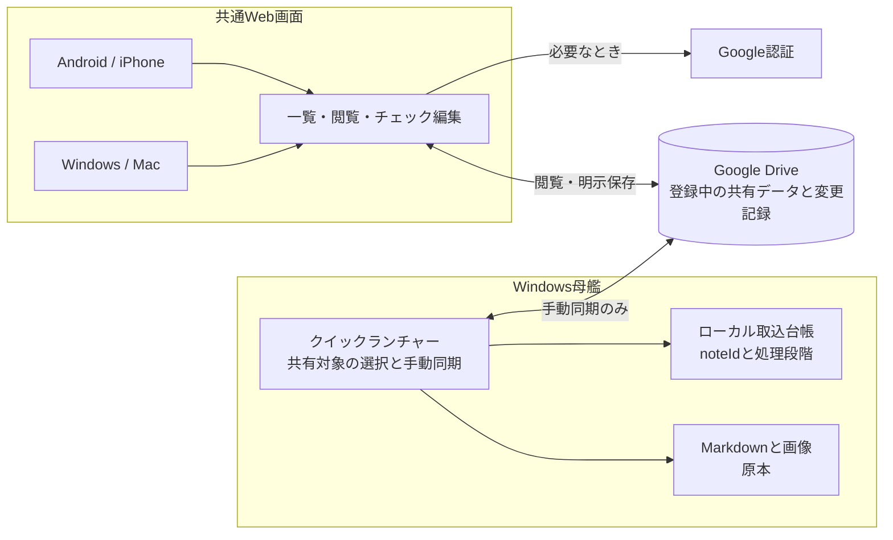
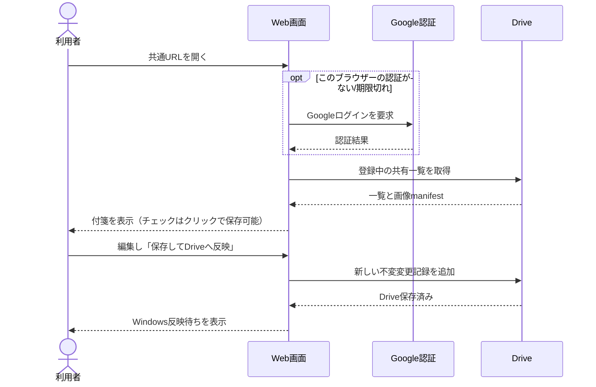
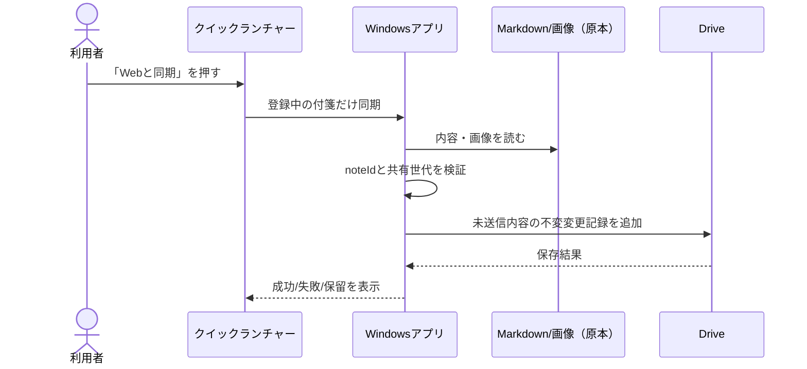
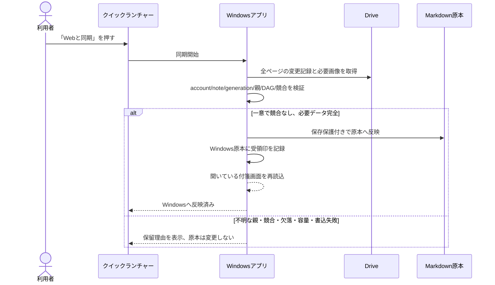
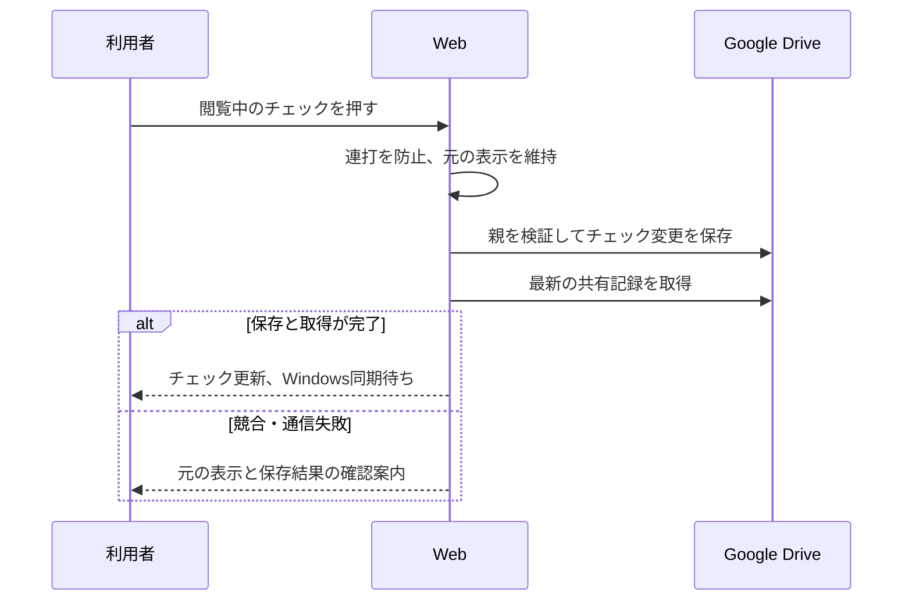
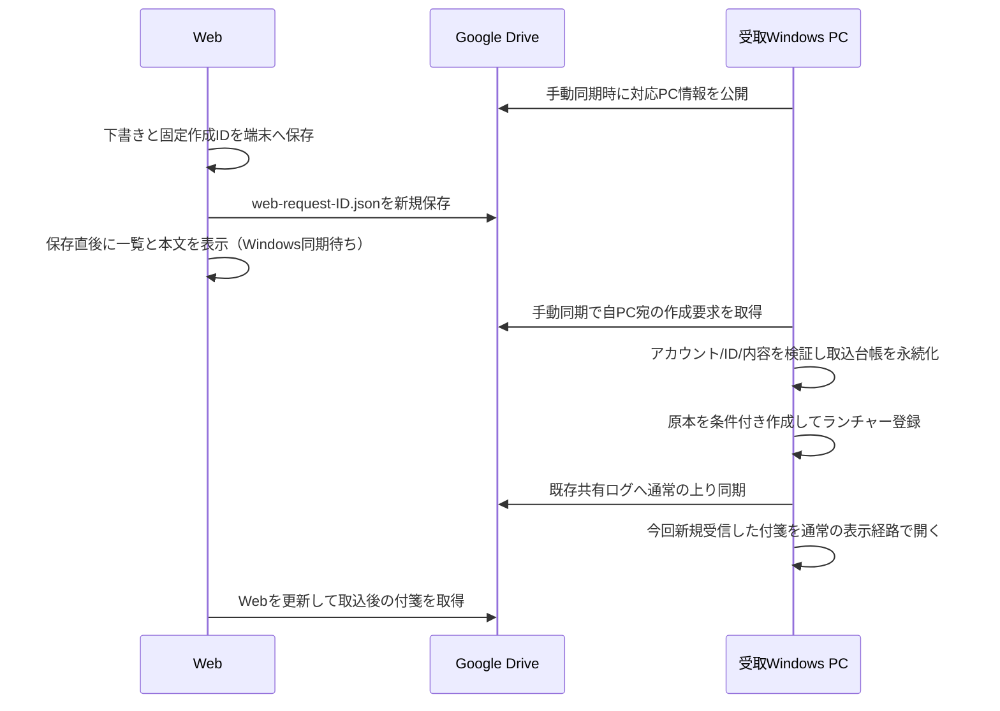
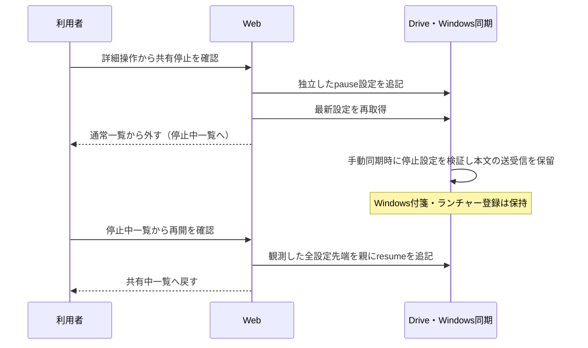
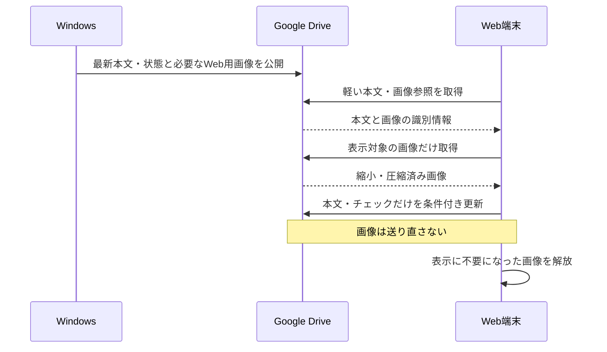

# 013 クイックランチャー付箋 Web共有

## 1 目的・適用範囲

本書は、Windowsのクイックランチャーに登録した付箋を、Google Drive経由でWebブラウザーから閲覧・編集する機能を定義する。既存iPhone受信機能とは別のWeb共有画面 `/shared` を対象とする。

従来方式の共有機能はdevelopへ統合済み。第6章の保存・資源管理方式は改修仕様であり、実装・検証中。仕様への記載を、現行配布版での実装・性能保証とは扱わない。試験の対象と合格条件は第7章に分けて記載する。

表1-1: 本書の構成。

| 章 | 読む目的 |
| --- | --- |
| 2〜3 | 設計方針とシステムの全体像を把握する。 |
| 4 | 利用者ができることと処理の流れを確認する。 |
| 5 | データの識別方法と、原本を守る整合性制約を確認する。 |
| 6 | 性能効率性・資源効率性・容量満足性・信頼性の要求を確認する。 |
| 7 | 検証条件と、確認済み・未確認の範囲を確認する。 |
| 8〜9 | 参照資料と改版履歴を確認する。 |

## 2 設計方針

- WindowsのMarkdownと画像が原本。Google Driveは登録中の付箋をブラウザーで見るための一時置き場。
- iPhone連携の必要枠と予備を先に確保し、Web共有は余った枠で動く補助機能とする。
- 同期は手動。Windowsはクイックランチャーの「Webと同期」を押した時だけ送受信。Webはページを開く/「表示を更新」で取得し、編集後は明示的に保存する。
- Drive保存済みとWindows原本への反映済みは別状態。競合、欠落、未確認の変更を自動上書き・削除しない。

Windowsの共有記録・共有設定・新規作成要求の取得は最大6件の並行読取で行う。元の取得順を保持し、1件でも取得失敗なら一括取得を失敗として扱う。全記録の検証と原本・Driveへの書込は既存の保護付き順序を維持する。同期中は接続・記録取得・付箋確認の段階を表示し、完了時は所要秒数、アプリログには所要ミリ秒を記録する。実際の通信時間は回線と履歴数によるため、固定の完了時間は保証しない。

## 3 システム構成

図3-1: Web共有のシステム構成。

## 4 機能要件・処理シーケンス

本章の保存シーケンスは従来方式（追記型ログ）を示す。閲覧・編集・同期などの機能を維持しつつ、改修方式では第6章に従い固定状態の条件付き更新へ置き換える。従来方式と改修方式を同時に採用する意味ではない。

### 4.1 付箋の閲覧・更新（従来方式）

図4-1: 従来方式の閲覧・更新。

### 4.2 Windowsからの共有・送信（従来方式）

図4-2: 従来方式のWindowsからの送信。

### 4.3 Web変更のWindowsへの取込（従来方式）

図4-3: 従来方式のWindowsへの取込。

### 4.4 本文編集・チェック操作（従来方式）

本文編集は背景色を維持した一つのMarkdown入力欄で行う。チェック・画像参照・コードを別入力欄へ分割しない。「チェック項目を追加」専用ボタンは置かない。編集内容は保存時まで送信せず、取消時は未保存変更を確認する。

閲覧中のチェックは「編集」を開かず押せる。本文の対象チェック記号だけを変え、既存の色・画像manifest・タグを維持した共有編集記録を保存する。保存中はチェック・付箋切替・編集を無効にし、同一画面の連打を抑止する。保存後に最新共有記録を取得してから画面を更新する。保存/取得失敗時は保存成功と表示せず、元の表示と確認案内を残す。他端末との競合は既存の親検証により保存を拒否する。Windowsへの反映は手動同期で行う。

図4-4: 閲覧中のチェック保存。自動試験と実Drive受入の結果は報告書で区別する。

### 4.5 Webでの新規付箋作成（従来方式）

「＋新規」で本文だけ入力し、対応Windows PCを選んで保存する。色は黄色、タイトルは本文の最初の非空行。画像参照・色指定・タグ指定は対象外。確認履歴と今回の改修方式の受入基準は第7章を参照する。

図4-5: Web新規作成の手動同期。

WebはDrive保存が成功した時点で新規付箋を選択して一覧と本文を表示する。再読込も同アカウントの作成要求を取得して同期待ちを保持する。Windowsが同IDの共有履歴を公開した後は通常表示へ切り替え、停止・解除済みを含む既存履歴があれば作成要求から再表示しない。同期待ちの本文・チェック・共有設定は読取専用とし、凍結済み作成要求を変更しない。保存失敗時は一覧へ追加せず、下書きを保持する。

作成要求は共有編集ログと別prefixに置き旧版/iPhoneキューを変えない。対応PC情報は`web-pc-ID.json`、要求はschemaVersion/accountSubject/targetPcId/noteId/markdown。全ページ取得して同ID同内容をまとめ、異内容は拒否する。Windowsの台帳はaccount+noteId+要求hashと固定保存先・完了段階を保持。再送は同じID、完了済み原本を移動/削除しても要求から再作成しない。不完全取込で保存先不明なら再作成せず保留する。

既存付箋の未送信編集も端末へ保存する。同じタブの再読込では自動復元し、別タブ・閉じたタブの下書きは同じアカウント・付箋に限定した一覧から明示的に復元または破棄できる。復元先の保存成功前に元の下書きを削除しない。基準版が変わった場合はそのままの上書きを拒否する。

下書きはアカウント・編集単位のlocalStorageに保存し、タブ内のsessionStorageと保存済み一覧から復元する。送信開始後は要求を凍結し、同内容で再送。状態は「端末下書き」「Drive保存済み・Windows同期待ち」「Windows取込後の共有表示」を区別する。

Windowsは今回新規に取り込んだ付箋だけを同期終了時に表示する。過去に取込済みの要求を再同期しても自動で開き直したり原本を再作成したりしない。表示に失敗した場合は原本保存と区別して同期結果に保留理由を出す。

受取PCがない場合は保存を無効にしてWindows同期を案内する。同期後は「受取PCを再確認」で本文下書きを保持したまま再取得できる。Windows Quick Launcherの「Webを開く」は開発時に`http://localhost:3002/shared`、配布版では`https://ore-no-fusen.vercel.app/shared`を開く。

ランチャーのWeb連携は「同期 → PC／スマホ」を一段で表示する。スマホボタンでQRとURLを開閉し、開発版のQRはOAuth登録済みの固定develop URL、配布版は本番の`https://ore-no-fusen.vercel.app/shared`を使用する。QR生成に失敗してもURLは表示する。

### 4.6 Web共有の停止・再開（従来方式）

画面下端の折りたたみ「詳細操作」に「Web共有を停止」と「共有停止中の付箋」を置く。停止中の一覧では選択した付箋の「Web共有を再開」を表示する。通常の編集領域には停止ボタンを置かない。確認画面はWindowsと同じConfirmDialogを使用する。

停止・再開は本文とランチャー登録から独立した設定で、Windows原本・shortcutタグ・ランチャーの順序/格納状態を変更しない。Web再取得・再起動・通常同期では再開しない。停止中の一覧は最後に共有した内容を読取専用で表示し、停止はDrive上の既存本文/画像の削除やアクセス権変更を意味しない。再開直後は最後の共有内容を表示し、最新のWindows本文は次の手動同期で反映する。

図4-6: ランチャー登録を保ったWeb共有の停止・再開。

設定は別prefix `web-sharing-UUID.json`。schemaVersion=1、scope(accountSubject/noteId/generation)、id、action(pause/resume)、parentsを持つ追記専用記録とする。本文DAGには混ぜない。全ページ取得し、filename/id一致・UUID・所有アカウント・親の同一scope・循環・同ID異内容を検証する。不足/不正時は同期を止め、推測して再開しない。並行操作でpause先端が一つでも残れば停止を優先し、再開は全先端を観測した明示操作だけで行う。履歴は再帰を使わず検証し、正常な停止/再開の蓄積で上限到達による操作不能を起こさない。保存後の再取得に失敗した場合や並行停止が残った場合に再開成功と表示しない。

旧revoke記録は従来の登録解除として保持する。新しい停止操作でrevokeを生成しない。旧版Windowsは新prefixを処理しないため、新機能の送受信停止を実機確認するには修正版Windowsが必要。iPhone経路は変更しない。

### 4.7 旧方式の登録解除（互換性）

第一弾のWeb「共有から外す」は確認後に既存revoke記録を追記し、Web一覧から除く。Windows原本は削除しない。次回Windows同期でshortcut登録だけ外し、解除済みIDを原本と同じ条件付き書込で記録する。台帳保存前の中断でも再適用を識別できる。利用者が後で登録し直した場合は新しい共有IDで公開する。原本削除/アーカイブ要求は未実装。

PC側でランチャー登録を外す操作はローカルで完了し、次回の「Webと同期」でrevoke記録を保存する。Web側の解除はその操作時にDriveへrevokeを保存する。従来の通常同期はgeneration=1を使用し、解除だけで共有世代を増加させる実装ではない。再登録時は新しい共有IDを使う。解除前の遅延変更や参照画像は、未解決なら保全し自動削除しない。

### 4.8 同期フォルダーへのアクセス

設定 → 管理者ツール → 外部サービスの「Web同期フォルダー」から、Google Driveの ore-no-fusen / web-share-temp を直接開ける。同期と同じフォルダー取得処理を使う。未接続・取得失敗時は接続を案内する。

## 5 データ識別・整合性制約

以下のログ形式・親参照の検証は従来方式のデータ契約である。改修時にもアカウント・付箋の識別と原本保護を維持し、保存形式の移行は第6章の条件に従う。

- 既存付箋の共有IDはWindowsが共有開始時にUUIDを発行し、Windows原本のfrontmatterとPC内台帳に保存する。ファイル名が変わってもIDを引き継ぐ。下り同期でもこのIDを保持する。`web_sync_receipt`は取り込み後の古い付箋画面からの自動保存を拒否するためのWindows内印で、共有payloadには含めない。ローカルpathやPC内だけのfrontmatter項目は共有payloadに含めない。
- Windowsの通常保存・名前変更は、読み込んだ原本の完全一致を保存時に再確認してから書く。下り同期が先に保存した場合は古い画面からの保存を拒否し、復旧用下書きへ退避する。同期による再読込は、入力中の未保存本文があるとき画面内容を上書きしない。
- Quick Launcherの同期用登録一覧は列挙/読取失敗をエラーとして扱い、共有解除の判定へ進まない。読めない付箋を「登録から外された」と誤判定しない。
- 付箋複製は新しい付箋なので共有IDを継承しない。壊れたID、重複ID、アカウント/付箋/世代と合わない親IDは拒否または隔離する。
- 変更記録の一意IDは同じ内容の再送だけを冪等に受け付け、同じIDで異なるpayloadは拒否する。
- 変更記録はRust JSONと同じ`{scope:{accountSubject,noteId,generation},operationId,kind,parents,payloadHash,payload,resolvedIds}`形式。`generation`と画像サイズはJavaScriptで正確に扱える`u32`範囲に制限する。JSONの数値表現やキー順に依存させないため、hashはJSON文字列ではなく`ore-no-fusen-share-v1\0`で始まる固定バイナリ形式から計算する。続く順序は、accountSubject文字列、noteId文字列、generation、kind、parents配列、resolvedIds配列、title文字列、markdown文字列、images配列。文字列はUTF-8 byte lengthをu32 big-endianで付け、generation/画像サイズ/countもu32 big-endian、kindは固定1-byte値（edit=1, resolve=2, acknowledge=3, revoke=4）。配列は親ID・解決ID・imageIdのUTF-8 byte順に整列する。Rust文字列と表現差が出ないよう、Webは単独サロゲートを拒否し正しい絵文字ペアを許可する。各画像manifestは空でない一意のimageId、空でないmimeType、1以上のu32 sizeBytes、小文字64桁hexのSHA-256を必須とする。固定テストベクトル: scope=`acct-1/note-1/4`, kind=`edit`, parents=`[root-x]`, title=`Title`, markdown=`Body`, images=`[]` → SHA-256 `cd61431fd0c445347a2aa80ea31f7c4480f28c52bef9285238851ac6f54fd742`。RustとWebはこの値と共有JSON fixtureを検証し、配列順不変性も試験する。`operationId`/`payloadHash`欄自身とDriveの更新時刻/版番号はhash/因果順に含めない。hash不一致は拒否する。
- ACKと解除記録は本文変更ではなく、本文DAGの先端に混ぜない。未取得ページ、親不明、必要画像不足、競合があればWindows原本へ適用しない。

## 6 非機能要件

### 6.1 性能効率性

品質特性の分類は[ISO/IEC 25010:2023の製品品質モデル](https://www.iso.org/standard/78176.html)を参考とする。日本語の見出しは、[IPA掲載のJIS X 25010の品質特性表](https://www.ipa.go.jp/publish/qv6pgp00000011mh-att/000064005.pdf#page=19)にある「時間効率性」「資源効率性」「容量満足性」の表記を使う。本書は規格適合の認証を主張するものではない。

#### 6.1.1 資源効率性（資源利用性）

状態: **2026-10-23の改修仕様。実装・検証中であり、現行配布版の保証ではない。** 本項は今回変更する保存方式を定義する。本文の追記型ログの記述は移行前の方式であり、移行・試験完了時に対応箇所も更新する。

本来の閲覧・編集・同期を軽快に使い続けるための前提として、Drive容量とWeb端末のメモリ・保存領域を有効に使う。容量管理と後片付けはアプリの内部処理で行い、利用者に追加の管理操作を求めない。本項は、それらの本来機能を支える非機能要件として、Drive容量・端末メモリ・保存領域・通信量の資源利用性を定義する。

**(1) 保存先と資源の管理方針**

Web共有画面 `/shared` は、Google Driveをオンラインで閲覧・編集する画面とする。端末へ全付箋を複製して保存する方式にはしない。WindowsのMarkdownと画像が原本であり、Web用に縮小した画像を原本へ上書きしない。利用者にDriveやブラウザー内部の手動整理を求めず、アプリが管理する。

**(2) 保存容量・メモリ・通信量の抑制**

**編集するたびにコピーを増やさず、不要になったデータはアプリが片付ける。** 利用者がDriveのファイルやブラウザー内部のデータを自分で消すことは前提にしない。

表6-1: 容量を増やし続けないための動作。

| 場所 | アプリの動作 |
| --- | --- |
| Driveの本文 | 付箋ごとの同じファイルを更新する。チェックや文字を直すたびに履歴ファイルを追加しない。 |
| Driveの写真 | PCでWeb用に縮小・圧縮する。同じ写真は送り直さない。写真を変更したときは、新しい保存が確定してから不要な旧写真を整理する。 |
| Driveの受渡し・送信途中のデータ | PCへの取込や保存結果を確認してから自動整理する。中断で残った専用ファイルも、現在参照・予約中でないことを確認して回収する。 |
| Web端末の写真・本文 | 必要な分をDriveから取得して表示する。全付箋・全写真を端末へ保存し続けない。表示に不要になった画像とメモリキャッシュを解放する。 |
| Web端末に残った古いコピー | Drive応答をブラウザーの保存対象から外し、過去の対象キャッシュもアプリが精密に削除する。保存が確定した下書きも削除する。 |
| 上限に達した場合 | 先に安全に整理できるものを整理する。足りなければ容量を増やす新規画像送信を保留する。既存表示・本文編集・停止/解除・容量を減らす変更はできる状態を保つ。 |

Driveの整理はPCの「Webと同期」の際に行い、失敗した整理は次回に再試行する。未同期の変更・未送信草稿・原本は容量確保のために削除しない。Google接続情報と未送信草稿は、端末に必要なデータとして保持する。

共有する付箋や写真そのものを追加した分の容量は必要になる。通信断・アプリの未起動中まで物理容量が一定になることは保証せず、**不要な履歴や残骸を放置して増やし続ける運用をしない**。上限の具体値、移行中の旧画像と解除識別記録の扱いは後述する。

表6-2: 保存先ごとの役割と整理責任。

| 保存先 | 保持するもの・整理するもの |
| --- | --- |
| Windows | Markdownと原本画像、同期・取込の台帳。Web用の縮小・圧縮で原本を変更しない。 |
| Google Drive | 付箋ごとの最新本文・共有状態と、参照中のWeb用画像。取り込み済み履歴、処理済み受渡し要求、不要になった専用画像はアプリが自動整理する。未確定変更は消さない。 |
| Web端末のメモリ | 必要な本文と表示対象の画像だけ。一覧取得で全画像を読み込まず、付箋切替・画面離脱時に不要な画像と本文キャッシュを解放する。 |
| Web端末の永続領域 | Google接続情報と未送信草稿。Drive本文・画像の恒久的な複製は作らない。保存成功を確認した草稿だけ削除し、未送信・結果未確認の内容は保持する。 |

**(3) 閲覧・本文更新時の通信量**

本文・停止/解除状態は付箋単位の同じ保存先を条件付き更新する。編集回数に比例する履歴ファイルを作らない。取得した版から他端末が先に更新していた場合は上書きせず、入力内容を保持する。本文やチェックだけを変更するときは、画像の再圧縮・再送信を行わない。

図6-1: Web展開時の閲覧と本文更新。画像の取得と本文の保存を分離する。

**(4) Web用画像の保存・自動回収**

- PCで原本からWeb用プレビューを作る。拡大せず、画像形式に加えて画素数・デコード時メモリも制限する。初期候補は長辺1600px以内、1画像1MiB以内。写真と文字入り画像で画質・可読性を測定して確定する。
- 原本のhashと、Web用画像のhash・サイズ・Drive file IDを分けて管理する。同じ画像が現在も参照中なら再送しない。名前やhashが同じという理由だけで、参照から外れた古いDrive画像を再利用しない。
- 新しい画像IDを状態ファイルへ条件付きで予約した後にだけアップロードする。予約時の版に対する条件付き更新が成功して初めて、新しい本文・画像参照を確定する。
- 予約中の画像を整理対象にしない。停止・解除は予約を保持したまま状態を更新し、進行中の古い確定が上書きすることを防ぐ。予約の取消も条件付き更新で行う。
- 整理は、同期開始時の完全な共有フォルダー一覧→状態取得→同じ版への条件付き更新→対象IDの削除、の順とする。現在参照中・予約中の画像は除外し、条件付き更新に失敗した場合は削除しない。削除失敗や中断は次回PC同期で再試行する。
- 専用画像は付箋IDと状態ファイルの物理IDで管理範囲を分ける。同じ写真を別付箋が使っていても、選択中の付箋の画像参照を直接取得し、他方の整理の影響を受けないようにする。
- 複数PCが初回公開を同時に行って状態ファイルが重複した場合は、統合元を条件付き更新で凍結し、本文・画像の参照・管理範囲・保全証拠を統合先へまとめて保存する。保存内容を再確認してから統合元を削除する。同じ内容は重複表示せず、異なる未確定内容は保持してその付箋を保留する。中断後も保全証拠を使って再開し、既に保全した古い本文を復活させない。
- 旧方式の画像は未確定の旧変更が参照し得るため、単に古い・一覧から見えないという理由で削除しない。移行中の残量と保全対象を把握し、保持している場合は「整理完了」と報告しない。
- 解除済み付箋の復活を防ぐ小さな識別記録は保持する。本文や画像の履歴を保持し続けることとは区別する。期限だけによる解除記録の削除は行わない。

**(5) Web端末の一時データとキャッシュ**

- Drive通信はHTTPキャッシュとService Workerの保存対象から外す。`fetch`の`no-store`だけに依存せず、制御中のService Workerが対応していることを確認してからDrive通信を開始する。
- 更新時は、過去のCacheStorageに残った対象のDrive応答だけを自動削除する。他のサイト資産や既存iPhone受信データのIndexedDBは削除しない。
- 画像取得を中断できるようにし、画面切替後に遅れて完了した画像のObject URLも直ちに解放する。本文のメモリキャッシュもアカウント変更と画面離脱時に破棄する。
- 未送信草稿はごみとして扱わない。アカウント・編集単位・基準版を分け、保存確定した草稿だけ削除する。Service Workerの更新のために未保存内容を失う強制再読込を行わない。

#### 6.1.2 時間効率性

- 一覧表示を、全画像の取得・デコード完了待ちにしない。表示対象の画像だけを必要時に取得する。
- 本文保存の通常経路では、変更対象の保存結果を再確認する。保存のたびに全付箋・全画像を再取得する処理を入れない。
- 同期中は処理名と実際の完了件数/対象件数を表示する。取得・準備・整理・付箋同期を区別し、画像変換などの負荷が画面操作を妨げないようにする。
- 通常の変更なし同期は3秒以内を応答目標とする。旧方式からの開発者専用移行は通常同期と分けて記録し、移行専用機構を複雑化しない。未達の場合は実測値と条件を示す。
- 1回の同期では、共有フォルダーの全ページを取得した一覧を状態・画像・PC登録・新規作成要求の判定で共用する。途中で追加された要求は次回同期へ回す。取得に失敗した不完全な一覧では同期・削除へ進まない。削除対象の実データ再取得と条件付き削除は省略しない。
- PCは完全取得した最新Drive一覧の更新番号が一致する状態記録だけを、同一アカウント・フォルダー・ファイルIDでメモリから再利用する。キャッシュは4MiB/256件以内、アカウント切替で破棄。書込み・削除を試みたIDは結果にかかわらず無効化し、条件付き書込み・保存後確認・画像整理の安全確認は省略しない。ファイルや画像のコピーをディスクへ蓄積しない。
- 同期のHTTPは接続10秒/要求全体30秒を上限とし、結果未確認の書込みを自動再送しない。次回同期で実状態を再取得する。
- PCとiPhoneについて、初回表示、画像表示、チェック保存、PC同期の応答時間を測定する。対象端末・回線・付箋数・画像数と、初回/再表示の条件を記録する。応答時間の数値目標は実測後に確定し、未測定の間は達成済みとしない。

#### 6.1.3 容量満足性

Web用画像の合計128MiBを、整理と新規画像追加保留の初期目安とする。これは付箋別の更新方式におけるアプリ内管理値であり、Googleアカウント全体の空き容量や、別端末の同時追加を含む厳密な物理上限とは扱わない。既存の旧データと送信途中のデータも把握する。

旧方式の原本画像の保持量と、新方式のプレビュー予算は区別する。旧画像の量を理由に、小さいプレビューへの移行を妨げない。差替え中は旧画像と新画像が一時的に共存するため、確定後の参照量とDriveの実際の空き容量を確認する。Windowsへの作成要求は100件を初期目安とし、取込待ちが多い場合は入力下書きを保持してPC同期を案内する。これらも同時要求を含む厳密な全体上限とは扱わない。

上限超過時にも、既存表示・本文編集・共有停止/解除・容量を減らす変更を妨げない。Google Driveの空き容量が不足した場合は新規画像送信を行わず、原本と未送信内容を保持する。容量確保のために未同期変更や利用者の他のDriveファイルを勝手に削除しない。

### 6.2 信頼性

中断・通信失敗・同時更新に対して、原本と未確定変更を保持する。条件付き更新が失敗した場合は、古い本文を新しい版へ無条件に再送しない。

整理の途中で停止しても、確定済み状態と削除待ちを識別し、次回同期で安全に再試行する。画像の保存・参照確定・削除の順序を守り、未確定の画像や未送信草稿を容量確保のために削除しない。これを本機能の障害時の回復性に関する要求とする。

### 6.3 利用状況の確認

Webの閲覧、編集・チェック保存、新規作成要求の保存と、PCの「Webと同期」を計測する。集計単位・成功条件・個人内容を送らない条件・欠測の扱いは[009 会員番号と機能利用分析](./009_MEMBERSHIP#web-usage)に従う。計測対応版の配信後から記録し、過去の使用有無は推定しない。

## 7 検証・受入基準

### 7.1 従来方式の確認記録と制約

以下は従来方式の確認履歴であり、第6章の改修方式の合格根拠ではない。

- 2026-10-21: 固定develop Previewで、iPhoneの接続・付箋表示・Web変更のWindows反映を利用者が確認。同期時間は体感の申告であり、性能の計測値ではない。
- 2026-10-22: Dev MSIX 6.0.0.2（アプリ本体6.0.0）でPC保存と手動Web同期を確認。新しい資源管理方式は含まない。MSIX版とiPhoneの最終通し確認は別の受入条件として残す。
- 2026-10-23時点: 第6章の改修方式は未完成。画像予約・自動回収・旧キャッシュ整理・端末メモリの実測を合格扱いにしない。

対象版、試験条件、画面証拠、確認者、未確認事項は内部の進捗記録で対応付ける。

### 7.2 改修方式の受入基準

- 写真付き付箋の本文・チェックを繰り返し更新しても、Driveの画像ファイル数と画像送信回数が増えない。
- 一覧を開くだけでは写真を取得せず、表示対象だけ取得する。付箋切替を繰り返しても画像URL・キャッシュ・メモリ使用が累積しないことを測定する。
- 予約直後・アップロード途中・確定直後の中断、確定応答消失、同時停止、取消後の遅延アップロード、整理中の同時更新、削除途中失敗を試験する。
- 既存の旧Service Worker、キャッシュの残存、アカウント切替、保存成功/失敗時の草稿保持を試験する。
- 原本hashとプレビューhashの区別、上限超過からの縮小・解除、別付箋の同時追加、文字入り画像の可読性を確認する。
- Astraの実装レビュー、対象自動試験、実Driveでのファイル数・容量確認、MSIXとiPhone実機の画面証拠をそろえる。未確認を合格扱いにして正式リリースしない。

## 8 参照資料

- ISO/IEC 25010:2023, *Systems and software engineering — Systems and software Quality Requirements and Evaluation (SQuaRE) — Product quality model*, Edition 2, 2023-11。[ISO公式](https://www.iso.org/standard/78176.html)。品質分類の参考資料とする。
- IPA『組込みソフトウェア向けコーディング作法ガイド［C言語版］ESCR Ver. 3.0』、冊子13ページ（PDF19ページ）の品質特性表。[IPA掲載PDF](https://www.ipa.go.jp/publish/qv6pgp00000011mh-att/000064005.pdf#page=19)。表はJIS X 25010:2013に基づくもので、2023年版規格の公式日本語訳ではない。本書では対応する日本語用語の参考とする。

画面モックと詳細な操作シーケンスは内部作業資料 `.planning/shared-checklist/DESIGN.md` を参照。実装・試験・Astraレビュー・不具合修正・統合の進捗は `.planning/ai-collab/CURRENT.md` に記録する。これらの内部資料は公開サイトには含めない。

## 9 改版履歴

表9-1: 改版履歴。

| 日付 | 改版内容 |
| --- | --- |
| 2026-10-23 | 文書番号を018から013へ整理。項番と品質用語を統一し、非機能要件を性能効率性・信頼性に分類。資源効率性、時間効率性、容量満足性と受入基準を追加した。保存方式の改修は実装・検証中。 |
