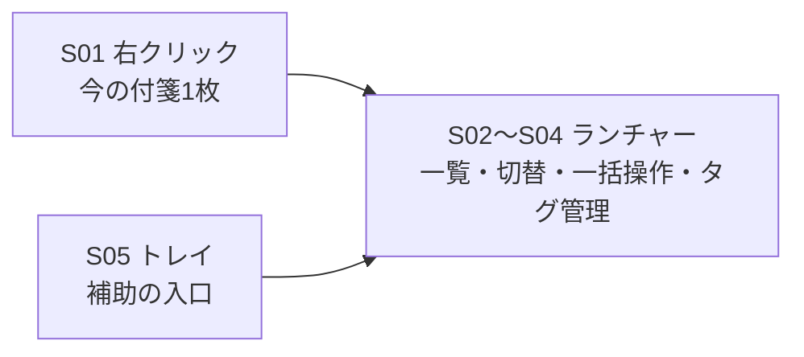
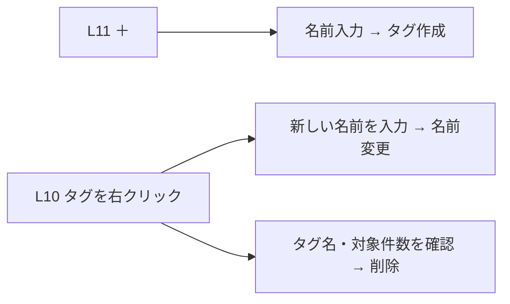

# 014 PC画面・機能割り当て設計

設計案 v0.2 / 2026-11-09

この設計書は **画面 → 配置 → 機能 → 代表ユースケース** の順で読む。利用者が提示した現在のランチャーを基本とし、必要な変更だけを提案する。実装済みという意味ではない。保存・通知の詳細は [002 PC版設計 §11.5](./002_PC.md#_11-5-クイックランチャー) を参照する。

## 1 方針と画面一覧

優先順は **右クリック → ランチャー → トレイ**。右クリックは今触っている付箋1枚の操作、ランチャーは一覧を見ながら複数の付箋を探す・切り替える・まとめて扱う操作、トレイは補助の入口とする。トレイで行ってきた複数付箋の操作を、段階的にランチャーへ割り当てる。

同じ機能に複数の入口があっても、処理と結果は共通にする。既存のトレイ機能を今回まとめて削除しない。

**呼び方の改善案**：「しまう」だけでは行き先と結果が分かりにくいため、機能名に対象を明示する。「ランチャーにしまう」は登録を残して画面から隠す操作、「フォルダーに保管する」は従来の「しまう」でファイルを保管先へ移す操作とする。後者の取り出しは「保管した付箋を戻す」と対応させる。既存画面の短い「格納／取り出す」ボタンは現状の配置を保ち、説明とツールチップでランチャーの操作と分かるようにする案とする。用語だけを変えて処理を入れ替えない。

表 1-1　画面と役割

| 画面ID・画面 | 役割・変更方針 |
|:---|:---|
| S01　付箋の右クリック | 今の付箋1枚を操作する。既存のメニュー構成を基本に保つ。 |
| S02　ランチャー | 登録付箋をすぐ見つけ、画面に出す／格納する。一覧を使う一括操作の主な入口。 |
| S03　タグ管理の小画面 | S02のタグ列から呼び出す、タグ自体の作成・名前変更・削除の入力・確認画面。新設案。 |
| S04　ランチャーの「操作」メニュー | トレイの全体操作を移すための入口。ランチャー上部に小さな「操作」ボタンを置く追加案。 |
| S05　トレイ | ランチャーを表示する、設定、終了などの補助。移行中は従来の入口も残す。 |

図 1-1　右クリック・ランチャー・トレイの役割

### 1.1 画面から消す操作を、次に使う頻度と戻し方で整理する

画面から消えるという結果は共通でも、次に使うまでの時間と戻す手間が異なる。以下の4段階は新しいボタンを4つ並べる意味ではなく、既存機能の目的・行き先・復帰経路を整理する分類案である。

表 1-2　画面から消す4段階と復元方法

| 段階・用途 | 行き先・登録への影響・戻し方 |
|:---|:---|
| レベル1　一時的に隠す | **すぐ戻す。** 別の作業や画面確認の間だけ邪魔にならないよう隠す。ファイルを移さず、ランチャー登録と格納状態は変えない。既存の「全部戻す」で一時非表示を解除する。もともとランチャーへ格納中の付箋は取り出さない。 |
| レベル2　ランチャーにしまう | **繰り返し使う。** 散らばる付箋を画面から隠し、ランチャーの登録行は残す。ファイルを移さず格納状態を保存する。各行の「取り出す」1回で画面へ出し、同じ位置の「格納」でまた隠す。再起動後も登録と格納状態を保つ。 |
| レベル3　フォルダーに保管する | **しばらく使わないが、残しておく。** 仕事の完了・参考資料などを保管先へ移す。普段の画面へ自動で戻さない。既存の保管済み付箋の画面で保存場所・名前・本文を探し、選んで元の付箋置き場へ戻す。本文と参照画像を戻してから表示する。ランチャー格納とは別の移動処理。 |
| レベル4　削除してゴミ箱へ移す | **不要になった。** 通常の画面・一覧から外し、本文等をTrashへ移す。必要なら完全削除前に復旧する。現状はアプリ内の専用復元ボタンではなく、Trashから本文と参照画像を元の場所へ手動で戻す経路。復旧手順の分かりやすさは改善検討対象。 |

**完全削除は別扱い。** レベル4のゴミ箱移動と混同しない。Trashから完全削除したものはアプリの通常操作で戻せない。既存の自動整理設定・バックアップの対象範囲も含めて、既存のデータ管理仕様に従う。今回、新しい完全削除操作をランチャーへ追加しない。

図 1-2　次に使う頻度と復帰方法で分ける4段階

**登録は別の状態として管理する。** 「画面から消す」と「ランチャー登録を解除する」を同じ処理にしない。レベル1・2では登録行を必ず維持する。レベル3でも保管を理由に登録を自動解除しない、という方針を基本とする。登録済み付箋をフォルダーへ移した場合の登録先の追従・保管済み表示・復帰経路は、現行の保存先直下だけの一覧処理とずれがあるため追加設計・検証が必要であり、実装済みとは扱わない。未登録の付箋を保管しただけでは自動登録しない。レベル4は付箋自体を削除する明示操作であり、通常の登録一覧には出さない。

表 1-3　この整理から見える改善候補

| 改善候補 | 理由・扱い |
|:---|:---|
| 「しまう」だけの名称を避ける | レベル2は「ランチャーにしまう」、レベル3は「フォルダーに保管」と行き先を示す。レベル1は「一時非表示」、レベル4は「ゴミ箱へ移す」と区別する。 |
| レベル3の保管済み付箋を戻す入口 | ランチャーの「操作」から既存の保管済み付箋の画面を呼ぶ。普段は使わない入口なので、各行に大きな常時ボタンを増やさない。 |
| 登録済み付箋を保管する場合の整合 | ファイル移動を理由に登録が消えないようにする。既存一覧のスキャン範囲、登録パス、画像付き復帰を調査・設計してから実装する。最初の格納不具合修正の完了条件に紛れ込ませない。 |
| レベル4の復旧方法の案内 | 現状の手動復旧方法と、新しい専用復旧画面の案を区別する。専用画面は現状なし。追加するかはデータ管理の設計で別に検討する。 |

**UC14　オンライン会議の間だけ画面の付箋を見えなくしたい。** レベル1で一時全非表示 → 終了後に全部戻す。会議前から格納していた付箋は格納のままとする。

**UC15　終わった案件の付箋を残して、普段は見ないようにしたい。** レベル3で案件フォルダーに保管 → 後日、保管済み付箋の画面で検索 → 必要な付箋だけ戻す。日々使う付箋のレベル2とは使い分ける。

**UC16　不要な付箋を削除したが、間違いだった。** レベル4のTrashに残っていることを確認 → 既存の復旧手順で本文と画像を戻す。完全削除後も戻せるという案内はしない。

## 2 S01 付箋の右クリック

### 2.1 画面と配置

図 2-1　各入口の配置と役割（構造を示す仕様図・現在の画面そのものではない）

### 2.2 配置する機能

表 2-1　右クリックの機能割り当て

| 配置ID・場所 | 機能と現状／改善案 |
|:---|:---|
| R01　上部 | 新規メモ、複製、保存フォルダーを開く。現状維持。対象が今の付箋か新しい付箋かをメニュー名で区別する。 |
| R02　見た目 | 色、透明度、文字サイズ。現状維持。今の付箋だけに適用する。 |
| R03　登録 | ランチャーに登録／登録解除。現状あり。登録時に画面から隠さない。 |
| R04　タグ | この付箋へのタグの付け外し。現状あり。タグ自体の作成・全体削除の既存入口も、移行中は残してS03と共通の入力・確認・保存処理につなぐ。新たな名前変更を含め、管理の主な入口はS03へ寄せる。 |
| R05　付箋の処理 | アラーム、iPhoneに表示、結晶化（QA・用語・手順）、フォルダーに保管する（従来の「しまう」）、削除。現状維持。種類・設定による既存の表示条件を保つ。 |
| R06　アプリ操作・案内 | 全文検索、整列、整列を元に戻す、設定、使い方、開発者とのやりとり。既存入口は残す。複数付箋の主な入口はS02・S04へ寄せる。 |

### 2.3 代表ユースケース

**UC01　今書いている付箋を、後ですぐ見つけたい。**

付箋を右クリック → R03「ランチャーに登録」 → S02の登録一覧に追加される。画面の付箋、本文、画像はそのまま。保存できなければ成功表示をせず、入力内容を残して知らせる。

**UC02　今の付箋だけに「仕事」を付けたい。**

右クリック → R04で「仕事」にチェックを付ける → その付箋だけを更新する。他の付箋やランチャー登録を変更しない。これはタグ自体の管理とは別の操作である。

## 3 S02 ランチャー

### 3.1 画面と配置

図 3-1　既存ランチャーを基本にした配置案

既存の4タブ、タグ列、登録一覧／格納した付箋、検索欄、各行の格納ボタン、同期・PC／スマホを基本に保つ。追加する常時表示の入口は、タグ列の「＋」と上部の小さな「操作」ボタンに絞る案とする。メニュー内で済むものを大きなボタンで並べない。

### 3.2 配置する機能

未登録・使用0件のタグの表示とL09〜L11の一括登録・格納・タグ管理は「ランチャー」タブに割り当てる。QA・用語集・手順のタブへ通常付箋の一括登録・格納をそのまま適用しない。他タブのタグはその一覧の絞り込みとして維持する。

表 3-1　ランチャーの機能割り当て

| 配置ID・場所 | 機能と現状／改善案 |
|:---|:---|
| L01　上部4タブ | ランチャー、QA、用語集、手順を切り替える。現状維持。 |
| L02　タグ列 | 一覧をタグで絞る。現状維持。タグを押すだけでは、画面の付箋を出したり隠したりしない。未登録だけのタグ、使用0件のタグも選べるようにする。右クリックしたタグが一括操作の対象となり、現在の選択タグは変えない。 |
| L03　登録一覧／格納した付箋 | 現状の切替を残す。「登録一覧」は表示・非表示にかかわらず登録済みを表示。「格納した付箋」は格納中を確認する表示。格納完了による自動切替はしない。 |
| L04　検索欄 | 選択タブの名前・タグを絞り込む。現状維持。本文を探す全文検索とは別。 |
| L05　各行の名前 | クリック・Enterで画面に出す。すでに表示済みなら同じ窓を手前に出す。登録は残す。 |
| L06　各行の既存ボタン | 「格納」⇄「取り出す」の1ボタン切替。登録と順序を保ち、画面上の表示だけを切り替える。既存機能の不具合修正対象。 |
| L07　行の↑↓・右クリック | 手動の並び替え、名前変更。現状維持と格納後の動作修正。隠れている付箋も同じ登録順で扱う。 |
| L08　各行の× | 通常付箋は登録解除。隠れていれば画面へ戻してから解除し、表示失敗なら登録を残す。QA・用語・手順の×は既存のゴミ箱移動であり、通常付箋の登録解除と区別する。 |
| L09　タグの右クリック→まとめて登録して隠す | 「このタグをまとめて登録して隠す」。常設ボタンは置かない。未登録分も登録してから対象を隠す。検索で見えている分だけに限定しない。既存機能の修正対象。 |
| L10　タグの右クリック→まとめて登録・管理 | L09と同じメニューへ「このタグをまとめて登録」を並べる。登録だけを行い、各付箋の表示状態は変えない。タグ名変更・削除の入口もまとめる。 |
| L11　タグ列末尾の＋ | S03のタグ作成へ。新設案。付箋に付けなくてもタグ自体を作れる。 |
| L12　同期・PC／スマホ | 既存の同期・連携を維持。画面整理や登録解除とは別の操作。今回の配置整理で送信対象や同期方式を変えない。 |
| L13　上部の小さい「操作」 | S04を表示する追加案。トレイで行ってきた全体操作の移し先。 |
| L14　ピン・窓右上の× | 最前面切替とランチャー窓を閉じる操作。Esc・Ctrl+Pも従来どおり。付箋の登録・格納状態を変更しない。 |

### 3.3 代表ユースケース

**UC03　画面に散らばった「仕事」の付箋を片付けたい。**

L02の「仕事」を右クリック → L09「このタグをまとめて登録して隠す」→ 未登録分もランチャーへ登録し、対象を画面から隠す。登録一覧と既存の順序は残る。保存失敗した付箋は元の表示状態へ戻し、失敗を知らせる。ファイルをタグフォルダーへ移す処理は呼ばない。

**UC04　片付けた付箋を使い、終わったらまた画面をすっきりさせたい。**

登録一覧で付箋を探す → L06「取り出す」→ 画面に出る。同じ位置のボタンが「格納」になる → 押すと隠れる。繰り返しても登録も順序も消えない。窓がなければ生成・表示の成功を確認してから格納を解除する。

**UC05　同じタグの付箋を、表示したまままとめて登録したい。**

L02のタグを右クリック → L10「このタグをまとめて登録」→ 未登録分だけ追加する。画面に出ている付箋を隠さず、格納中の付箋も勝手に出さない。複数タグから同じ付箋を登録しても重複しない。

**UC06　「格納した付箋」が0件になった。**

格納中だけの表示では、取り出した付箋が表示対象から外れる。L03の「登録一覧」に戻ると、その付箋は残っている。登録0件とは扱わない。空表示には登録一覧へ戻れる案内を付ける改善案とする。

## 4 S03 タグ自体の管理

### 4.1 画面と配置

タグ列の＋で「タグを追加」、タグの右クリックで「まとめて登録」「まとめて登録して隠す」「名前変更」「削除」を呼び出す。大きな管理タブを増やさず、小さい入力・確認画面を使う。付箋への付け外しはS01のR04に残す。

図 4-1　タグ管理の小画面と配置案

図 4-2　タグ管理の入口と小画面

表 4-1　タグ管理の機能割り当て

| 配置ID・小画面 | 機能・保存条件 |
|:---|:---|
| G01　タグ追加 | 名前入力、作成、キャンセル。使用0件でも作成・維持できるタグ台帳を新設する。空白名・同名・システムタグ名は拒否する。 |
| G02　名前変更 | 旧名を示し、新名を入力する。同じタグを使う現在の保存先の付箋へ反映する。無断で別タグと統合しない。途中失敗は記録し、同じ変更の再試行で残りを更新できるようにする。 |
| G03　削除確認 | 「『test』を削除し、○件の付箋から外します。付箋は削除しません」と示す。確認後に全対象から外す。キャンセルなら変更しない。 |
| G04　処理結果 | 成功・失敗件数と再試行の入口。全対象から外れるまで削除完了とせず、未完了の台帳と対象を保持する。古い画面保存から旧タグを復活させない。 |

ユーザータグだけを管理する。「すべて」「未分類」、`shortcut`・`qa`・`term`・`recipe` 等は削除・名前変更できない。対象は現在の保存先の通常付箋、未登録・格納中・保管済み・QA等を含む。ゴミ箱と別の保存先は変更しない。本文・画像・ランチャー登録・格納状態・順序は維持する。

### 4.2 代表ユースケース

**UC07　まだ付箋に付けない「旅行」タグを作っておきたい。**

L11の＋ → G01へ「旅行」を入力 → 作成。タグ列に表示され、使用0件でも再起動後に残る。付箋は作成・変更しない。

**UC08　「test」を「調査」に直したい。**

「test」を右クリック → G02 → 「調査」を入力 → 同じタグの名前と使用付箋のタグ名を更新する。すでに独立した「調査」がある場合は統合せず知らせる。失敗した場合は処理結果から同じ変更を再試行できる。再試行時は変更済みの付箋と追加された付箋も再走査する。移動・削除などで完了できない場合は「再試行を終了」で変更済み内容を維持し、未完了パスと進捗を台帳に保全して他のタグ操作を再開できる。終了は変更完了や元に戻す操作ではない。

**UC09　「test」タグ自体を削除したい。**

「test」を右クリック → G03の対象件数を確認 → 削除。全対象からタグだけを外す。付箋の本文と画像、ランチャーの登録行、格納状態は残る。1件でも失敗したら全件成功とは表示しない。

## 5 S04 複数付箋の操作メニュー

### 5.1 画面と配置

ランチャー上部の小さな「操作」ボタンから一覧を開く案。行ごとのボタンとタグ単位操作を増やしすぎず、アプリ全体の操作だけを集める。未実装の移行案であり、最初の格納不具合修正と一括で実装しない。

表 5-1　トレイからの移行候補

| 配置ID・項目 | 現状と提案・混同しない意味 |
|:---|:---|
| A01　新規メモ | 現在はトレイ・右クリック等。ランチャーにも入口を追加する候補。既存の作成処理を使う。 |
| A02　全文検索 | 現在はトレイ・右クリック。既存検索画面を呼び出す候補。L04の名前・タグ検索と区別する。 |
| A03　保管した付箋を戻す | 現在はトレイ。既存の保管済み付箋の取り出し画面を開く候補。ランチャーの格納一覧では代用しない。 |
| A04　タグで整列／整列を元に戻す | 現在はトレイ・右クリック。既存整列処理へつなぐ候補。画面上の窓の配置を変え、登録一覧の手動順は変えない。 |
| A05　一時的に全非表示／全部戻す | 現在はトレイ。既存機能の入口を移す候補。ランチャーへの一括登録・格納とは別。格納済みの付箋を勝手に取り出さない条件を守る。 |
| A06　画面上の付箋をタグで絞る／解除 | 現在はトレイの「タグで絞り込む」。利用者があまり使っていないため削除候補とし、ランチャーへ移す案は取り下げる。L02の一覧絞り込みとは別機能。現段階で実装を削除せず、必要性を評価する。 |
| A07　設定 | 現在の設定画面を開く補助入口。設定内容をランチャー内へ作り直さない。 |

### 5.2 代表ユースケース

**UC10　付箋をタグ別に整列して、気に入らなければ戻したい。**

L13「操作」→ A04「タグで整列」→ 画面上の対象が整列する。同じメニューの「整列を元に戻す」で復元する。ランチャーの登録順と格納状態は変えない。

**UC11　本文に書いた言葉から付箋を探したい。**

L13「操作」→ A02「全文検索」→ 既存検索画面で探す。L04に本文検索を混ぜず、名前・タグだけで見つからない場合の入口を分ける。

**UC13　一時的に全付箋を隠してから戻したい。**

A05「一時的に全非表示」→「全部戻す」。一時的に隠した対象は戻るが、もともとランチャーへ格納していた付箋は隠れたままとする。登録・格納状態・順序は変えない。

## 6 S05 トレイ

### 6.1 画面・配置・機能

既存のメニュー順と機能を移行中は維持する。S04で代わりに使えることを確認したものから、日常操作の案内をランチャー中心へ変える。機能の削除と主な入口の変更は別の判断とする。

表 6-1　補助としてのトレイ

| 配置ID・項目 | 役割 |
|:---|:---|
| T01　クイックランチャーを開く | ランチャーを見失ったときの補助入口として残す。 |
| T02　既存の新規・検索・取り出し・整列・全表示・タグ絞り込み | 移行確認が済むまで残す。同じ機能は同じ処理を使う。 |
| T03　設定・終了 | アプリ全体の補助操作。付箋や登録の削除とは区別する。 |

### 6.2 代表ユースケース

**UC12　ランチャーを閉じてしまい、もう一度表示したい。**

トレイのT01、または既存のCtrl+P等でランチャーを表示する。登録・手動順・格納状態は変えない。トレイの全体操作を毎回経由する必要はない。

## 7 改善点と実施順序

移す前に、その機能を残す必要があるかを判断する。使われていない機能を、新しい場所へそのまま増やさない。A06の削除は検討中の候補であり、実装済み・削除確定とは扱わない。

表 7-1　現状からの改善順序

| 段階 | 対象・完了条件 |
|:---|:---|
| 1　既存動作の修正 | L06・L07・L09。登録して格納→取り出す→再格納→並び替え→再起動でも登録・本文・順序を維持する。Windows実機の組合せ試験を行う。 |
| 2　タグ単位の登録とタグ自体の管理 | L10・L11・G01〜G04。未使用タグの永続化、名前変更、全付箋からの削除、途中失敗・再試行・編集中の本文保護を確認する。 |
| 3　複数操作の入口を移行 | L13・A01〜A05・A07。必要な操作だけを共通処理で呼び、全表示と格納、一覧絞り込みと画面絞り込み、全文検索と名前検索を混同しない。トレイの代わりとして使って確認する。 |
| 4　利用結果に応じて整理 | 必要な操作がランチャーで完結することを確かめてから、トレイの案内・重複を整理する。使っていないA06は移行せず削除候補とする。削除する場合は既存の画面絞り込み状態を解除して付箋が見えないまま残ることを防ぎ、ランチャー格納状態は変えない。今のランチャーを全面的に作り直さない。 |

## 8 仕様と検証の対応

UC01〜UC16を操作試験の単位にし、画面ID・配置ID・対象付箋・実行前後・保存結果・失敗時の結果を記録する。ブラウザーの模擬API試験とWindows実機での保存・窓表示の成功を区別する。設計図、ビルド成功、コードレビューだけで実機合格としない。

表 8-1　改版履歴

| 版・日付 | 内容 |
|:---|:---|
| 0.1 / 2026-11-07 | 既存機能をソースで確認し、画面・配置・機能・代表ユースケースによる割り当て案を作成。現状維持・不具合修正・追加案・移行候補を分離。 |
