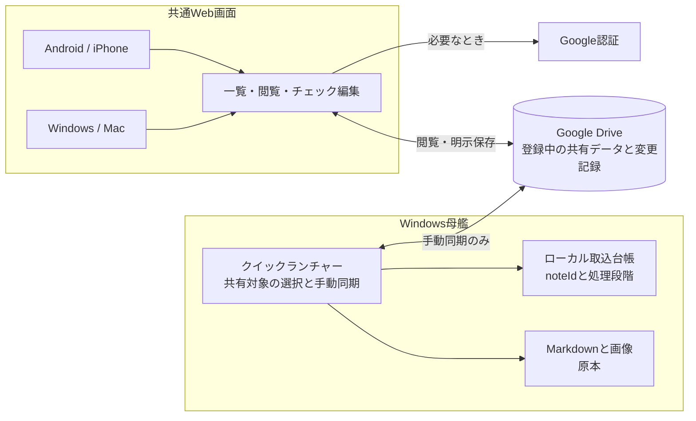
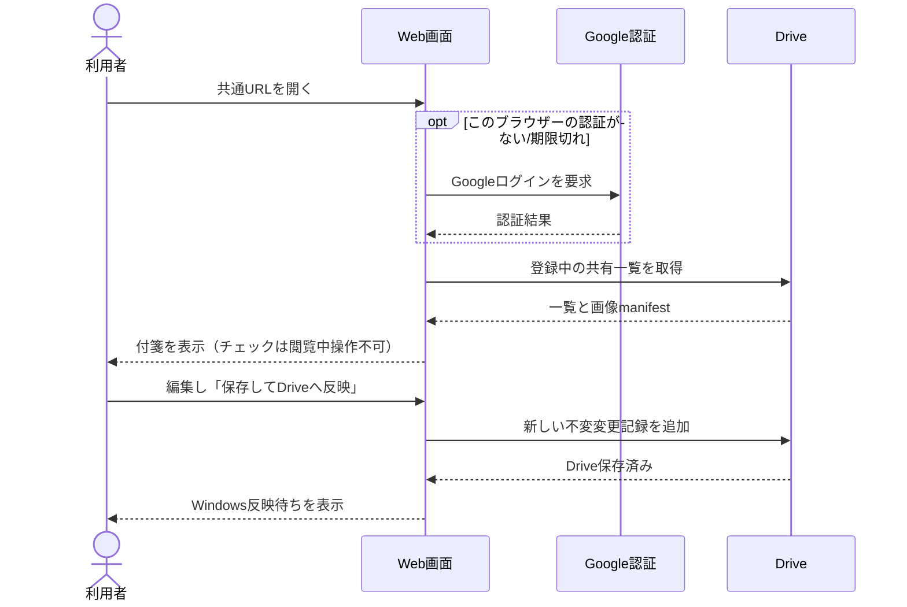
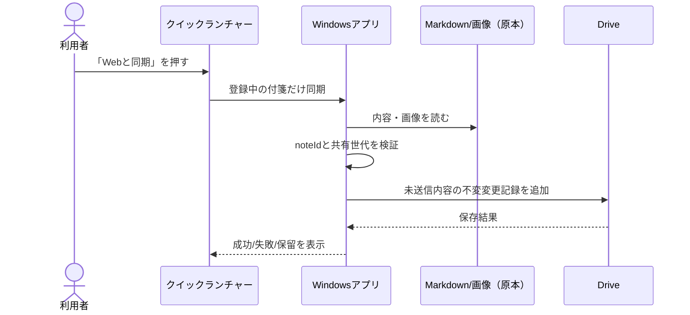
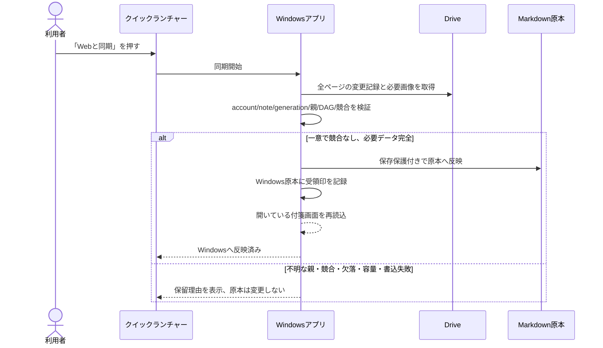

# 018 クイックランチャー付箋 Web共有

状態: コード実装・対象部品試験・Next製品ビルド完了。Astra再レビュー中。実Drive/実端末の通し確認とdevelop統合は未完了。製品利用できる状態とはまだ判定していない。

## 価値観

- WindowsのMarkdownと画像が原本。Google Driveは登録中の付箋をブラウザーで見るための一時置き場。
- iPhone連携の必要枠と予備を先に確保し、Web共有は余った枠で動く補助機能とする。
- 同期は手動。Windowsはクイックランチャーの「Webと同期」を押した時だけ送受信。Webはページを開く/「表示を更新」で取得し、編集後は明示的に保存する。
- Drive保存済みとWindows原本への反映済みは別状態。競合、欠落、未確認の変更を自動上書き・削除しない。

## 全体構成

## 機能シーケンス

### 1. Webで閲覧・更新

### 2. Windowsから共有・送信

### 3. Web変更をWindowsへ取り込む

### 4. Webから新しい付箋を作る（計画・未実装）

現行画面で追加できるのはチェックリストの行です。Webから新しい付箋を作り、Windows原本として保存・Quick Launcherへ登録する流れは未実装で、配信前に別途追加する必要があります。Windows原本を維持するため、Windowsで確認・登録する手順を設計してから実装します。

### 5. 登録解除

解除操作自体はローカルのみ。次回の「Webと同期」で共有世代を進める解除記録を保存し、通常のWeb一覧から隠す。旧世代の遅延変更や参照画像は未解決なら隔離保全し、自動削除しない。

## IDと安全条件

- 既存付箋の共有IDはWindowsが共有開始時にUUIDを発行し、Windows原本のfrontmatterとPC内台帳に保存する。ファイル名が変わってもIDを引き継ぐ。下り同期でもこのIDを保持する。`web_sync_receipt`は取り込み後の古い付箋画面からの自動保存を拒否するためのWindows内印で、共有payloadには含めない。ローカルpathやPC内だけのfrontmatter項目は共有payloadに含めない。
- Windowsの通常保存・名前変更は、読み込んだ原本の完全一致を保存時に再確認してから書く。下り同期が先に保存した場合は古い画面からの保存を拒否し、復旧用下書きへ退避する。同期による再読込は、入力中の未保存本文があるとき画面内容を上書きしない。
- Quick Launcherの同期用登録一覧は列挙/読取失敗をエラーとして扱い、共有解除の判定へ進まない。読めない付箋を「登録から外された」と誤判定しない。
- 付箋複製は新しい付箋なので共有IDを継承しない。壊れたID、重複ID、アカウント/付箋/世代と合わない親IDは拒否または隔離する。
- 変更記録の一意IDは同じ内容の再送だけを冪等に受け付け、同じIDで異なるpayloadは拒否する。
- 変更記録はRust JSONと同じ`{scope:{accountSubject,noteId,generation},operationId,kind,parents,payloadHash,payload,resolvedIds}`形式。`generation`と画像サイズはJavaScriptで正確に扱える`u32`範囲に制限する。JSONの数値表現やキー順に依存させないため、hashはJSON文字列ではなく`ore-no-fusen-share-v1\0`で始まる固定バイナリ形式から計算する。続く順序は、accountSubject文字列、noteId文字列、generation、kind、parents配列、resolvedIds配列、title文字列、markdown文字列、images配列。文字列はUTF-8 byte lengthをu32 big-endianで付け、generation/画像サイズ/countもu32 big-endian、kindは固定1-byte値（edit=1, resolve=2, acknowledge=3, revoke=4）。配列は親ID・解決ID・imageIdのUTF-8 byte順に整列する。Rust文字列と表現差が出ないよう、Webは単独サロゲートを拒否し正しい絵文字ペアを許可する。各画像manifestは空でない一意のimageId、空でないmimeType、1以上のu32 sizeBytes、小文字64桁hexのSHA-256を必須とする。固定テストベクトル: scope=`acct-1/note-1/4`, kind=`edit`, parents=`[root-x]`, title=`Title`, markdown=`Body`, images=`[]` → SHA-256 `cd61431fd0c445347a2aa80ea31f7c4480f28c52bef9285238851ac6f54fd742`。RustとWebはこの値と共有JSON fixtureを検証し、配列順不変性も試験する。`operationId`/`payloadHash`欄自身とDriveの更新時刻/版番号はhash/因果順に含めない。hash不一致は拒否する。
- ACKと解除記録は本文変更ではなく、本文DAGの先端に混ぜない。未取得ページ、親不明、必要画像不足、競合があればWindows原本へ適用しない。
- 今回のコード確認: `npx tsc --noEmit`、Next製品ビルド、Web画面/共有/画像のVitest 45件、Rust共有契約等38件、および同期一覧読取失敗・ID保持・Windows条件付き保存の対象試験に合格。全Rust suiteは別途、Windows sandbox上の既存ファイル移動テストでOS error 5が発生し、全件合格ではない。
- 今回の作業では、実Driveへの保存/読取とWindows・スマホの製品画面をつないだ通し試験は実施していない。過去の専用検証フォルダーの架空データ試験と混同しない。応答消失再送、長期オフライン、欠落画像/容量上限、iPhone枠優先後のunits、Windows再起動を含む取込/ACK試験、各端末実機も未完了。これらは利用者向け配信とWindows原本への反映を有効にする前の停止条件。

## 計画との対応

画面モックと詳細な操作シーケンスは[共通付箋チェック計画](../.planning/shared-checklist/DESIGN.md)を参照。実装・試験・Astraレビュー・不具合修正・統合の進捗は[CURRENT.md](../.planning/ai-collab/CURRENT.md)に記録する。
