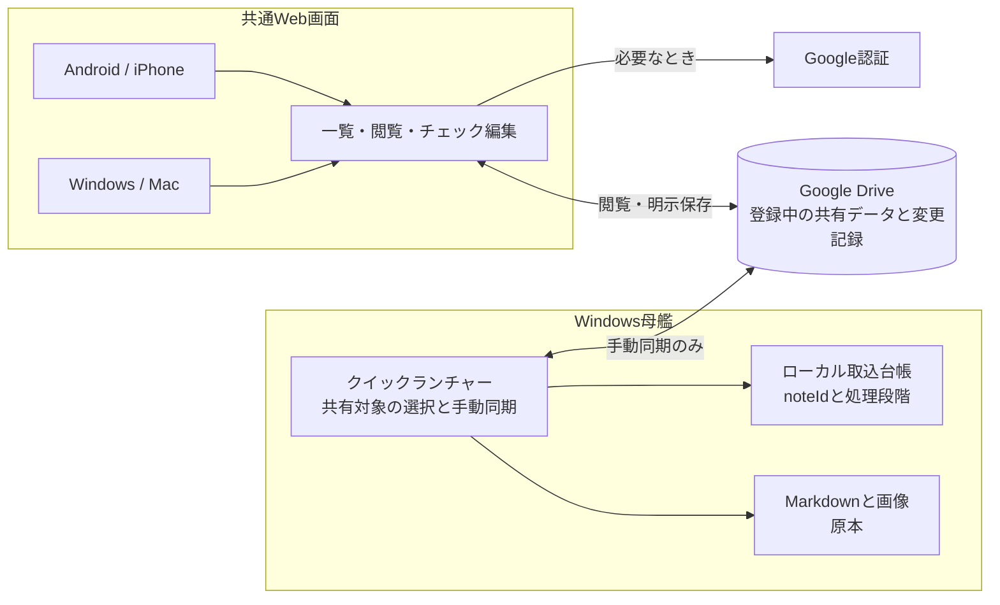
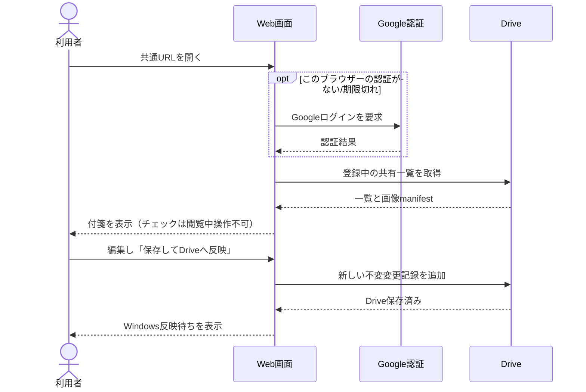
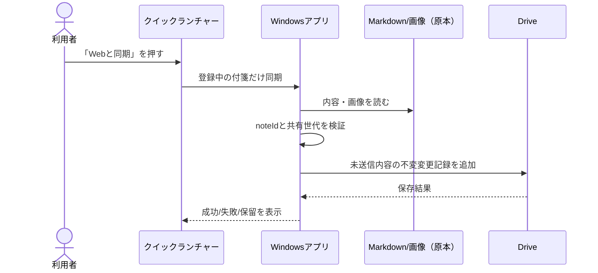
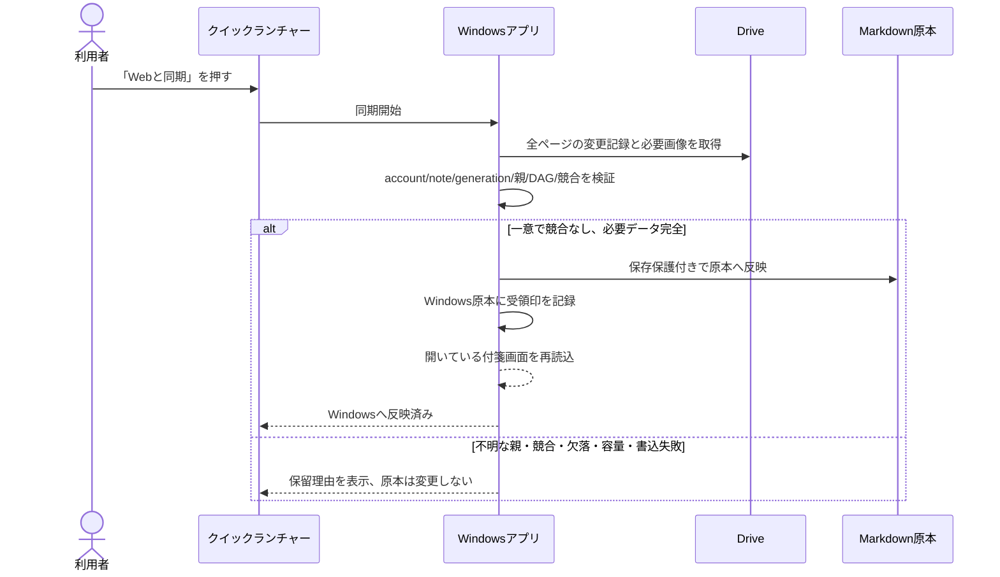
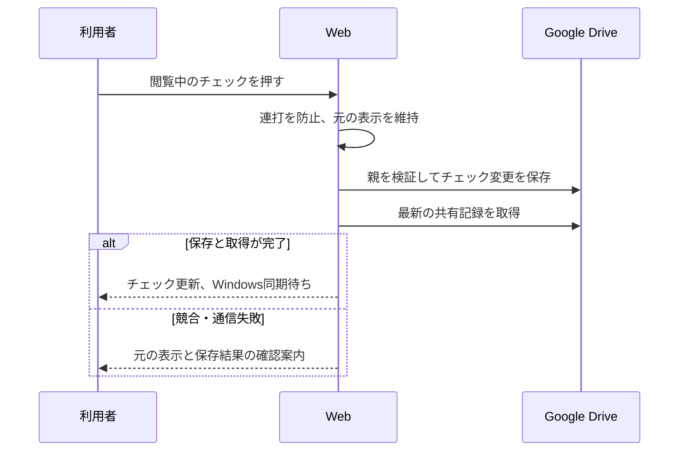
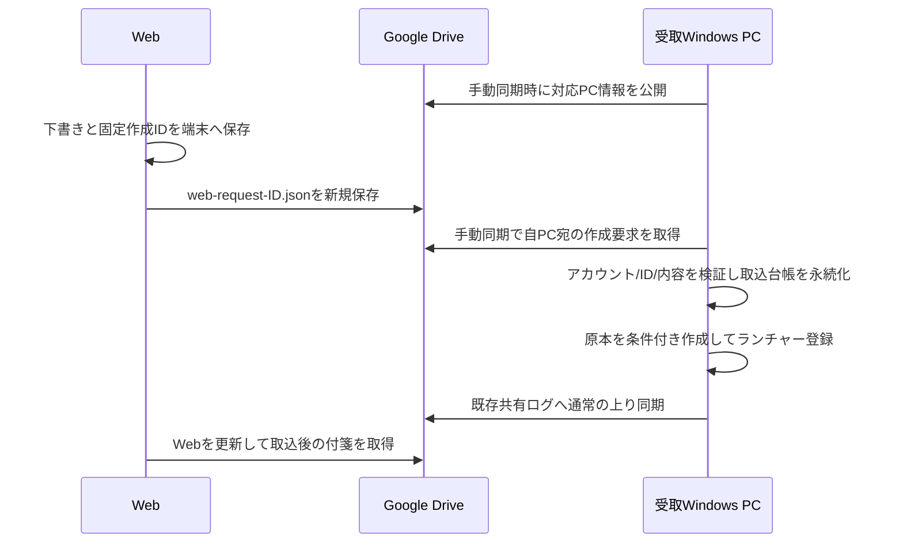
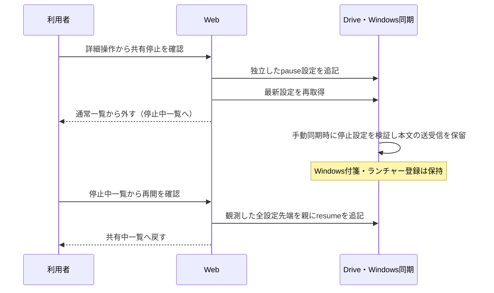

# 018 クイックランチャー付箋 Web共有

状態: コード実装・対象部品試験・Next製品ビルド完了。Astra再レビュー中。実Drive/実端末の通し確認とdevelop統合は未完了。製品利用できる状態とはまだ判定していない。

## 価値観

- WindowsのMarkdownと画像が原本。Google Driveは登録中の付箋をブラウザーで見るための一時置き場。
- iPhone連携の必要枠と予備を先に確保し、Web共有は余った枠で動く補助機能とする。
- 同期は手動。Windowsはクイックランチャーの「Webと同期」を押した時だけ送受信。Webはページを開く/「表示を更新」で取得し、編集後は明示的に保存する。
- Drive保存済みとWindows原本への反映済みは別状態。競合、欠落、未確認の変更を自動上書き・削除しない。

## 全体構成

## 機能シーケンス

### 1. Webで閲覧・更新

### 2. Windowsから共有・送信

### 3. Web変更をWindowsへ取り込む

### 本文編集と閲覧中のチェック操作（2026-10-19・実接続受入中）

本文編集は背景色を維持した一つのMarkdown入力欄で行う。チェック・画像参照・コードを別入力欄へ分割しない。「チェック項目を追加」専用ボタンは置かない。編集内容は保存時まで送信せず、取消時は未保存変更を確認する。

閲覧中のチェックは「編集」を開かず押せる。本文の対象チェック記号だけを変え、既存の色・画像manifest・タグを維持した共有編集記録を保存する。保存中はチェック・付箋切替・編集を無効にし、同一画面の連打を抑止する。保存後に最新共有記録を取得してから画面を更新する。保存/取得失敗時は保存成功と表示せず、元の表示と確認案内を残す。他端末との競合は既存の親検証により保存を拒否する。Windowsへの反映は手動同期で行う。

図: 閲覧中のチェック保存。自動試験と実Drive受入の結果は報告書で区別する。

### 4. Webから新しい付箋を作る（第一弾コード実装・受入試験中）

第一弾のコード実装: 「＋新規」で本文だけ入力し、対応Windows PCを選んで保存する。色は黄色、タイトルは本文の最初の非空行。画像参照・色指定・タグ指定は対象外。実Drive往復の受入試験は未完了で、配信完了とは扱わない。

図4: 最小新規作成の手動同期。

作成要求は共有編集ログと別prefixに置き旧版/iPhoneキューを変えない。対応PC情報は`web-pc-ID.json`、要求はschemaVersion/accountSubject/targetPcId/noteId/markdown。全ページ取得して同ID同内容をまとめ、異内容は拒否する。Windowsの台帳はaccount+noteId+要求hashと固定保存先・完了段階を保持。再送は同じID、完了済み原本を移動/削除しても要求から再作成しない。不完全取込で保存先不明なら再作成せず保留する。

下書きはアカウント・編集単位のlocalStorageに保存し、タブ内のsessionStorageと保存済み一覧から復元する。送信開始後は要求を凍結し、同内容で再送。状態は「端末下書き」「Drive保存済み・Windows同期待ち」「Windows取込後の共有表示」を区別する。

受取PCがない場合は保存を無効にしてWindows同期を案内する。同期後は「受取PCを再確認」で本文下書きを保持したまま再取得できる。Windows Quick Launcherの「Webを開く」は開発時に`http://localhost:3002/shared`、配布版では`https://ore-no-fusen.vercel.app/shared`を開く。

### 5. Web共有の停止・再開（詳細操作）

画面下端の折りたたみ「詳細操作」に「Web共有を停止」と「共有停止中の付箋」を置く。停止中の一覧では選択した付箋の「Web共有を再開」を表示する。通常の編集領域には停止ボタンを置かない。確認画面はWindowsと同じConfirmDialogを使用する。

停止・再開は本文とランチャー登録から独立した設定で、Windows原本・shortcutタグ・ランチャーの順序/格納状態を変更しない。Web再取得・再起動・通常同期では再開しない。停止中の一覧は最後に共有した内容を読取専用で表示し、停止はDrive上の既存本文/画像の削除やアクセス権変更を意味しない。再開直後は最後の共有内容を表示し、最新のWindows本文は次の手動同期で反映する。

図5: ランチャー登録を保ったWeb共有の停止・再開。

設定は別prefix `web-sharing-UUID.json`。schemaVersion=1、scope(accountSubject/noteId/generation)、id、action(pause/resume)、parentsを持つ追記専用記録とする。本文DAGには混ぜない。全ページ取得し、filename/id一致・UUID・所有アカウント・親の同一scope・循環・同ID異内容を検証する。不足/不正時は同期を止め、推測して再開しない。並行操作でpause先端が一つでも残れば停止を優先し、再開は全先端を観測した明示操作だけで行う。履歴は再帰を使わず検証し、正常な停止/再開の蓄積で上限到達による操作不能を起こさない。保存後の再取得に失敗した場合や並行停止が残った場合に再開成功と表示しない。

旧revoke記録は従来の登録解除として保持する。新しい停止操作でrevokeを生成しない。旧版Windowsは新prefixを処理しないため、新機能の送受信停止を実機確認するには修正版Windowsが必要。iPhone経路は変更しない。

### 5.1 旧方式の登録解除（互換用）

第一弾のWeb「共有から外す」は確認後に既存revoke記録を追記し、Web一覧から除く。Windows原本は削除しない。次回Windows同期でshortcut登録だけ外し、解除済みIDを原本と同じ条件付き書込で記録する。台帳保存前の中断でも再適用を識別できる。利用者が後で登録し直した場合は新しい共有IDで公開する。原本削除/アーカイブ要求は未実装。

解除操作自体はローカルのみ。次回の「Webと同期」で共有世代を進める解除記録を保存し、通常のWeb一覧から隠す。旧世代の遅延変更や参照画像は未解決なら隔離保全し、自動削除しない。

## IDと安全条件

- 既存付箋の共有IDはWindowsが共有開始時にUUIDを発行し、Windows原本のfrontmatterとPC内台帳に保存する。ファイル名が変わってもIDを引き継ぐ。下り同期でもこのIDを保持する。`web_sync_receipt`は取り込み後の古い付箋画面からの自動保存を拒否するためのWindows内印で、共有payloadには含めない。ローカルpathやPC内だけのfrontmatter項目は共有payloadに含めない。
- Windowsの通常保存・名前変更は、読み込んだ原本の完全一致を保存時に再確認してから書く。下り同期が先に保存した場合は古い画面からの保存を拒否し、復旧用下書きへ退避する。同期による再読込は、入力中の未保存本文があるとき画面内容を上書きしない。
- Quick Launcherの同期用登録一覧は列挙/読取失敗をエラーとして扱い、共有解除の判定へ進まない。読めない付箋を「登録から外された」と誤判定しない。
- 付箋複製は新しい付箋なので共有IDを継承しない。壊れたID、重複ID、アカウント/付箋/世代と合わない親IDは拒否または隔離する。
- 変更記録の一意IDは同じ内容の再送だけを冪等に受け付け、同じIDで異なるpayloadは拒否する。
- 変更記録はRust JSONと同じ`{scope:{accountSubject,noteId,generation},operationId,kind,parents,payloadHash,payload,resolvedIds}`形式。`generation`と画像サイズはJavaScriptで正確に扱える`u32`範囲に制限する。JSONの数値表現やキー順に依存させないため、hashはJSON文字列ではなく`ore-no-fusen-share-v1\0`で始まる固定バイナリ形式から計算する。続く順序は、accountSubject文字列、noteId文字列、generation、kind、parents配列、resolvedIds配列、title文字列、markdown文字列、images配列。文字列はUTF-8 byte lengthをu32 big-endianで付け、generation/画像サイズ/countもu32 big-endian、kindは固定1-byte値（edit=1, resolve=2, acknowledge=3, revoke=4）。配列は親ID・解決ID・imageIdのUTF-8 byte順に整列する。Rust文字列と表現差が出ないよう、Webは単独サロゲートを拒否し正しい絵文字ペアを許可する。各画像manifestは空でない一意のimageId、空でないmimeType、1以上のu32 sizeBytes、小文字64桁hexのSHA-256を必須とする。固定テストベクトル: scope=`acct-1/note-1/4`, kind=`edit`, parents=`[root-x]`, title=`Title`, markdown=`Body`, images=`[]` → SHA-256 `cd61431fd0c445347a2aa80ea31f7c4480f28c52bef9285238851ac6f54fd742`。RustとWebはこの値と共有JSON fixtureを検証し、配列順不変性も試験する。`operationId`/`payloadHash`欄自身とDriveの更新時刻/版番号はhash/因果順に含めない。hash不一致は拒否する。
- ACKと解除記録は本文変更ではなく、本文DAGの先端に混ぜない。未取得ページ、親不明、必要画像不足、競合があればWindows原本へ適用しない。
- 今回のコード確認: `npx tsc --noEmit`、Next製品ビルド、Web画面/共有/画像のVitest 45件、Rust共有契約等38件、および同期一覧読取失敗・ID保持・Windows条件付き保存の対象試験に合格。全Rust suiteは別途、Windows sandbox上の既存ファイル移動テストでOS error 5が発生し、全件合格ではない。
- 今回の作業では、実Driveへの保存/読取とWindows・スマホの製品画面をつないだ通し試験は実施していない。過去の専用検証フォルダーの架空データ試験と混同しない。応答消失再送、長期オフライン、欠落画像/容量上限、iPhone枠優先後のunits、Windows再起動を含む取込/ACK試験、各端末実機も未完了。これらは利用者向け配信とWindows原本への反映を有効にする前の停止条件。

## 計画との対応

画面モックと詳細な操作シーケンスは内部作業資料 `.planning/shared-checklist/DESIGN.md` を参照。実装・試験・Astraレビュー・不具合修正・統合の進捗は `.planning/ai-collab/CURRENT.md` に記録する。これらの内部資料は公開サイトには含めない。
