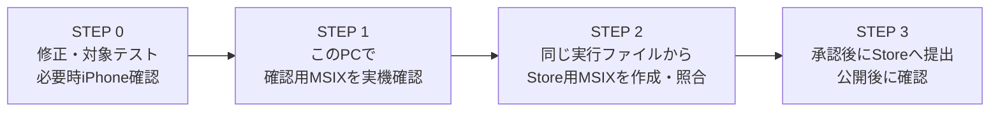
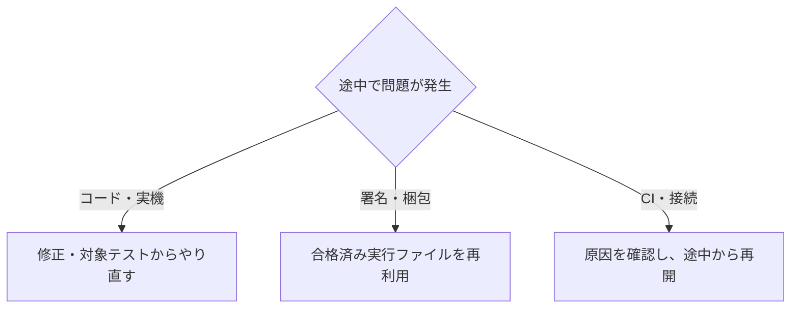

# リリース手順

図1-1：PCアプリをStoreへ届ける流れ。

図1-1では、PCで実機確認した実行ファイルをStore提出用に再利用します。同じ作業は目的なく繰り返しません。GitHubは変更履歴と自動検査、利用者は実機確認と申請承認、Storeは認定と配布を担当します。

表1-1：リリース手順（例：「2-3」で現在地を伝える）

| 番号 | すること | 完了の目印 |
|---|---|---|
| 0-1 | 修正し、対象テスト・PC確認を行う | 変更箇所が正常 |
| 0-2 | developのPRと統合後CIを確認する | 最新headの全適用CI成功・競合なし |
| 0-3 | PWA変更時、PreviewでiPhoneを確認する | SW版・変更箇所・必要な送受信と通知が正常 |
| 1-1 | 最新develop・版番号5ファイルを確認し、候補を固定する | 候補と統合後CIを確認 |
| 1-2 | 必要なバックアップを保全し、実行ファイルを一度作る | 確認用の実行ファイルが完成 |
| 1-3 | 同じ実行ファイルから確認用MSIXを作り、PCに導入する | インストール・起動が成功 |
| 1-4 | 利用者がPCで実機確認する | 既存データ・保存・再起動・変更箇所が正常 |
| 2-1 | 合格済み実行ファイルからStore用MSIXを作る | 提出用MSIXが完成 |
| 2-2 | 名前・発行者・版・x64・未署名と中身を確認する | 実行ファイルと同梱リソースのSHA256が一致 |
| 2-3 | 提出用MSIXを固定先に保存する | 保存先は表の下に記載 |
| 2-4 | main宛てPRをマージし、統合後を確認する | 最新headの全適用CI成功・競合なし・候補tree一致 |
| 2-5 | main→develop同期PRをマージし、統合後を確認する | 全適用CI成功・候補tree一致 |
| 3-1 | [Partner Center](https://partner.microsoft.com/ja-jp/dashboard/products/9N4MW0V2MVVG/overview)の下書きを確認し、MSIXをアップロードする | ファイル名・版・X64・Validatedを確認 |
| 3-2 | 日英の変更内容とStoreの登録情報・公開設定を確認する | 意図した内容で保存済み |
| 3-3 | 本人の明示承認後、認定へ送信する | 申請番号・認定中を確認 |
| 3-4 | 公開後、Storeから更新して起動する | 版番号・起動が正常 |
| 別経路 | 文書・LP・マニュアルのみを変更する | 表示・リンクと対象CIを確認。Store用MSIXは不要。公開資料は[更新手順](PUBLIC_GUIDE_MAINTENANCE.md)を確認 |

2-3の保存先：`D:\Users\uck\Documents\俺の付箋-Store提出\<バージョン>\ore-no-fusen.msix`。3-2では価格・説明・画像・プライバシー・年齢区分・Capabilityも確認します。
表1-1のSTEP 1に合格した実行ファイルをSTEP 2で再利用します。Store側の認定や公開にかかる時間は保証できません。

図1-2：失敗時の戻り先。

図1-2のとおり、コードを変えた場合は影響する検査と実機確認をやり直します。CIの失敗・未完了・キャンセルは成功扱いしません。申請を再開するときは対象版・固定パス・申請番号・保存済み画面を確認し、重複申請を避けます。提出物・証拠と未完了作業を保全してから作業場所を整理します。

**現行設定の注意：** GitHubはPR等でも別のMSIXを作って導入・起動しており、PC実機確認と重複しています。この重複をなくす設定変更は未完了です。現在は適用されるCIを確認し、GitHubの検査用MSIXをStoreへ提出しません。
