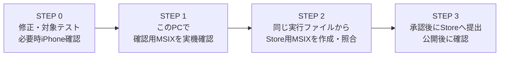
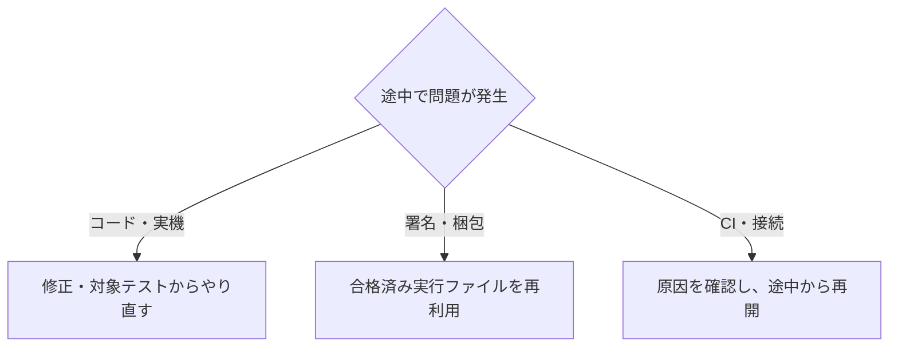

# リリース手順

図1-1：PCアプリをStoreへ届ける流れ。

図1-1では、PCで実機確認した実行ファイルをStore提出用に再利用します。同じ作業は目的なく繰り返しません。GitHubは変更履歴と自動検査、利用者は実機確認と申請承認、Storeは認定と配布を担当します。

表1-1：リリース手順

| 順番 | すること・完了条件 |
|---|---|
| 0 修正・確認 | 変更箇所を対象テスト・PCで確認し、develop宛てPRの最新headで全適用CI成功・競合なしを確認して統合。統合後CIを確認する。PWA変更時はdevelop統合後のPreviewでiPhoneのSW版・変更箇所・必要な送受信と通知を確認する。 |
| 1 PC実機確認 | 最新develop・統合後CIと版番号5ファイルを確認し、候補を固定。必要なバックアップを保全して実行ファイルを一度作る。同じファイルから開発署名MSIXを作り、利用者がインストール・起動・既存データ・保存・再起動・変更箇所を確認する。 |
| 2 Store用を準備 | 合格済み実行ファイルから未署名のStore用MSIXを作る。名前・発行者・版番号・x64・未署名と、実行ファイル／同梱リソースのSHA256一致を確認し、`D:\Users\uck\Documents\俺の付箋-Store提出\<バージョン>\ore-no-fusen.msix`に保存する。main宛てPRとmain→develop同期PRはそれぞれ最新headの全適用CI成功・競合なしを確認してマージし、各統合後CIと候補treeの一致を確認する。 |
| 3 Storeへ提出 | [Partner Centerの製品概要](https://partner.microsoft.com/ja-jp/dashboard/products/9N4MW0V2MVVG/overview)で下書きを確認し、固定先のMSIXをアップロード。ファイル名・版番号・X64・Validatedを確認。日本語・英語の変更内容と価格・説明・画像・プライバシー・年齢区分・Capability・公開設定を確認する。本人の明示承認後に認定へ送信し、申請番号と認定中を確認。公開後、Storeから更新して版番号・起動を確認する。 |
| 文書・LP・公開マニュアルのみ | 表示・リンクと対象CIを確認し、PRで反映。マニュアル・漫画は[公開資料の更新手順](PUBLIC_GUIDE_MAINTENANCE.md)で公開範囲を確認する。Store用MSIXは不要。 |

表1-1のSTEP 1に合格した実行ファイルをSTEP 2で再利用します。Store側の認定や公開にかかる時間は保証できません。

図1-2：失敗時の戻り先。

図1-2のとおり、コードを変えた場合は影響する検査と実機確認をやり直します。CIの失敗・未完了・キャンセルは成功扱いしません。申請を再開するときは対象版・固定パス・申請番号・保存済み画面を確認し、重複申請を避けます。提出物・証拠と未完了作業を保全してから作業場所を整理します。

**現行設定の注意：** GitHubはPR等でも別のMSIXを作って導入・起動しており、PC実機確認と重複しています。この重複をなくす設定変更は未完了です。現在は適用されるCIを確認し、GitHubの検査用MSIXをStoreへ提出しません。
