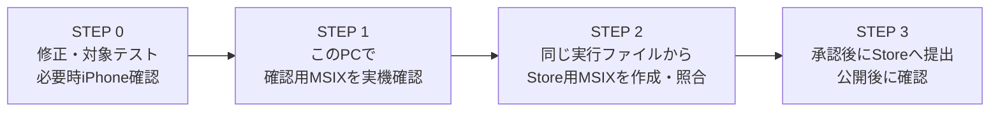
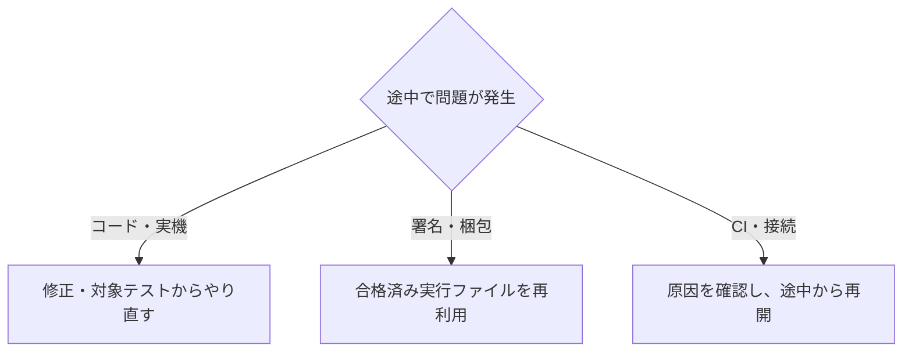

# リリース手順

図1-1：PCアプリをStoreへ届ける流れ。

図1-1では、PCで実機確認した実行ファイルをStore提出用に再利用します。同じ作業は目的なく繰り返しません。GitHubは変更履歴と自動検査、利用者は実機確認と申請承認、Storeは認定と配布を担当します。

表1-1：工程と作成物（例：現在地「1-5」）

| STEP | 工程 | 作るもの・行うこと | 完了の目印 |
|---|---|---|---|
| 0 修正・確認 | 0-1 | 版番号を含む修正・対象テスト | PCで動作確認 |
| STEP 0 | 0-2 | developのPR | 全適用CI成功・統合後CI確認 |
| STEP 0 | 0-3 | PWA変更時：iPhoneでPreview確認 | 作成なし・対象動作が正常 |
| 1 PC実機 | 1-1 | 候補固定・必要なバックアップ | 版番号・保存を確認 |
| STEP 1 | 1-2 | 本番実行ファイルを1回作成 | 確認用と提出用の共通元 |
| STEP 1 | 1-3 | 確認用MSIXを作成 | 開発署名済み |
| STEP 1 | 1-4 | 確認用MSIXを導入 | PCで起動 |
| STEP 1 | 1-5 | 利用者が実機確認 | 既存データ・起動・保存・再起動・変更箇所が正常 |
| 2 Store準備 | 2-1 | 同じ実行ファイルからStore用MSIXを作成 | 未署名の提出ファイル |
| STEP 2 | 2-2 | 版・形式・中身を確認 | 作成なし・SHA256一致 |
| STEP 2 | 2-3 | main宛てPR・develop同期PR | 各CI成功・統合後CIと候補一致 |
| 3 Store提出 | 3-1 | 提出ファイルを固定先へ保存 | 下記の保存先に存在 |
| STEP 3 | 3-2 | MSIXをStoreへアップロード | 版・X64・Validatedを確認 |
| STEP 3 | 3-3 | 日英の変更内容を登録し、本人承認後に申請 | 日英報告・申請番号・認定中を確認 |
| STEP 3 | 3-4 | 公開後、Storeから更新 | 作成なし・版番号と起動が正常 |
| 文書のみ | — | 文書の変更とPR | 作成なし・表示と対象CIを確認 |

3-1の保存先：`D:\Users\uck\Documents\俺の付箋-Store提出\<バージョン>\ore-no-fusen.msix`。Store手続きは[Partner Center](https://partner.microsoft.com/ja-jp/dashboard/products/9N4MW0V2MVVG/overview)。公開マニュアルは[更新手順](PUBLIC_GUIDE_MAINTENANCE.md)に従います。

基本フォルダーの「リリースマシン.bat」から①でSTEP 1を実施し、本人の実機合格後に②でSTEP 2・3-1を実施します。リリースマシンは2-3のPR確認に先立って3-1の固定先保存を行います。PR待ちではマージ後に②を押して再開します。PRは最新headの全適用CI・競合なしを確認し、Create a merge commitで統合します。PWAのSW版・送受信・通知、提出物の名前・発行者・版・x64・未署名、Storeの価格・画像・プライバシー・公開設定など、変更対象と既存設定も確認します。
表1-1のSTEP 1に合格した実行ファイルをSTEP 2で再利用します。Store側の認定や公開にかかる時間は保証できません。

図1-2：失敗時の戻り先。

図1-2のとおり、コードを変えた場合は影響する検査と実機確認をやり直します。CIの失敗・未完了・キャンセルは成功扱いしません。申請を再開するときは対象版・固定パス・申請番号・保存済み画面を確認し、重複申請を避けます。提出物・証拠と未完了作業を保全してから作業場所を整理します。

**現行設定の注意：** GitHubはPR等でも別のMSIXを作って導入・起動しており、PC実機確認と重複しています。この重複をなくす設定変更は未完了です。現在は適用されるCIを確認し、GitHubの検査用MSIXをStoreへ提出しません。
