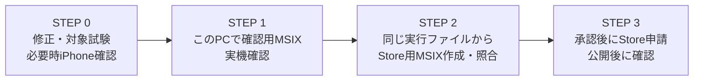
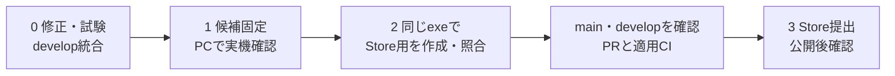

# リリース手順

## 1. 全体像

図1-1：PCアプリをMicrosoft Storeへ届ける代表的な流れ。

図1-1では、実機で確認した実行ファイルをStore提出用に再利用します。手順は必要な確認を一度ずつ行い、同じものを目的なく作り直しません。コードを変更した場合は影響する確認をやり直します。

表1-1：登場する人・場所と役割

| 人・場所 | 役割 |
|---|---|
| 利用者 | PC・必要時iPhoneで実機確認し、Store申請を承認する |
| このPC・Codex | 修正、試験、実行ファイルとMSIXの作成、照合を行う |
| GitHub | 変更履歴、PR、自動検査とmain・developの整合を確認する |
| Vercel・iPhone | 必要に応じてPreviewと実機を確認する |
| Partner Center・Store | 提出物を検証・認定し、アプリを配布する |

表1-1のPCで確認した実行ファイルをStore用にも使用します。GitHubの検査成功だけでPC実機確認を省略しません。

## 2. PCアプリのリリース

図2-1：PCアプリの作業順序。

表2-1：図2-1の実施手順

| 工程 | 手順と次へ進む条件 |
|---|---|
| STEP 0 | 変更内容・対象範囲を確認し、対象試験と必要なPC実機確認を行う。独立ブランチからdevelop宛てPRを作り、最新headの全適用CI成功・競合なしを確認して統合し、統合後CIを確認する。PWA変更時は節3のiPhone確認も行う。 |
| STEP 1 | 最新develop・統合後CIと版番号5ファイルを確認し、候補を固定する。データ・未保存変更を確認し必要なバックアップを保全した後、このPCで本番実行ファイルを1回作る。その実行ファイルから開発署名MSIXを作り、導入・起動する。利用者が起動、既存データ、保存、再起動、変更箇所と影響範囲を確認する。画像変更時は画像の保存・複製、iPhone連携変更時は送受信等も確認する。 |
| STEP 2 | 合格済みの同じ実行ファイルからStore用の未署名MSIXを作り、名前・発行者・版番号・x64・未署名と実行ファイル／同梱リソースのSHA256一致を確認する。リリースPRをmainへ作り、最新headの全適用CI成功・競合なし・保護条件を確認してマージする。main統合後CI・候補tree一致を確認し、main→develop同期PRも同様に全適用CI後マージし、統合後CI・tree一致を確認する。基本フォルダーをfast-forwardする。 |
| STEP 3 | 固定保存先を確認し、節4に従ってPartner Centerに申請を準備する。ユーザーが最終送信を明示承認した後、認定へ送信する。認定・公開後、Storeから更新して版番号・起動を確認する。 |

表2-1のSTEP 1でコードに問題があった場合はSTEP 0に戻ります。署名や梱包だけに問題があった場合は、合格済み実行ファイルを保全して該当工程だけやり直します。

**現行CIの注意：** 現在のGitHub設定はPR等で別の確認用MSIXをビルド・導入・起動します。これはPCでのMSIX実機確認と重複し、短縮対象です。設定変更は未適用のため、現時点では全適用CIを待ち、未実施・失敗・キャンセルを成功扱いしません。GitHubの検査用MSIXはStore提出物ではありません。

## 3. 変更対象別の確認

表3-1：アプリ以外の変更

| 変更対象 | 手順 |
|---|---|
| iPhone PWA・Service Worker | 対象試験とdevelop PR・統合後CIの後、Vercel Previewを確認。PWA/SW変更時は`worker/index.js`のSW_VERSIONを更新し、iPhoneで版表示・変更箇所・必要なPC送受信・通知を確認。本番配信は対象と公開条件を確認する。 |
| 設計書・LP・README | 表示・リンク・対象CIを確認し、developとmainへPRで反映する。文書だけのためにStore用MSIXは作らない。 |
| 公開マニュアル・漫画 | 開発側の公開原稿を確認し、許可された資料だけを公開リポジトリへ反映する。[公開資料の更新手順](PUBLIC_GUIDE_MAINTENANCE.md)で公開範囲・ビルド・未ログイン表示を確認する。 |

表3-1のiPhoneとPCの両方を変更した場合、両方の確認を行います。設計書やソースを公開資料へ混ぜません。

## 4. Storeへの提出

図4-1：Store提出と公開後の確認。

表4-1：図4-1の手順

| 順 | 行うこと |
|---|---|
| 1 | `D:\Users\uck\Documents\俺の付箋-Store提出\<バージョン>\ore-no-fusen.msix`を保存し、PCで確認した実行ファイルとの一致を確認する。 |
| 2 | [Partner Centerの製品概要](https://partner.microsoft.com/ja-jp/dashboard/products/9N4MW0V2MVVG/overview)で既存の下書きを確認し、なければ更新を開始する。サインイン・MFA等で本人操作が必要なら引き継ぐ。 |
| 3 | 固定先のMSIXをアップロードし、ファイル名・版番号・X64・Validatedを確認して保存する。待機中の再アップロードや申請の重複作成はしない。 |
| 4 | 日本語・英語の「このバージョンの最新情報」を今回の内容に更新。価格、説明、画像、プライバシー、年齢区分、Capability、公開設定も確認する。 |
| 5 | 製品・版・ファイル・送信先を示して本人の明示承認を受け、「送信して認定を受ける」を実行する。申請番号と認定中を確認する。 |
| 6 | 認定・公開後にStoreから更新し、Storeの「開く」から版番号と起動を確認する。 |

表4-1の再開時は対象版・固定パス・申請番号・最後に保存した画面・残作業を照合します。公開設定によっては認定後に自動公開されます。Microsoft側の処理・審査時間は保証できません。

## 5. 停止と再開

表5-1：問題が起きたときの戻り先

| 状況 | 対応 |
|---|---|
| コード・実機操作の不具合 | 修正して対象試験・PR・CIをやり直し、新しい実行ファイルとMSIXで確認する。 |
| 署名・梱包だけの不具合 | 合格済み実行ファイルを保全し、原因の工程からやり直す。 |
| CI失敗・未完了・キャンセル | ログを保全して原因を解決し、最新headの全適用CI成功を確認する。 |
| リリースマシンで停止 | state.jsonとcommands.logを確認し、既存の提出物・検査結果を照合して必要な工程から再開する。 |

完了後は提出物・必要な証拠を保全し、未保存変更と実行中プロセスを確認して完了した作業場所を整理します。未完了の別作業は保持します。旧5.0.0のGitHub Release移行資産は勝手に削除せず、5.1.0以降の正式配布はStoreで行います。
