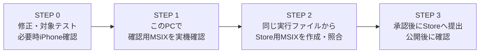
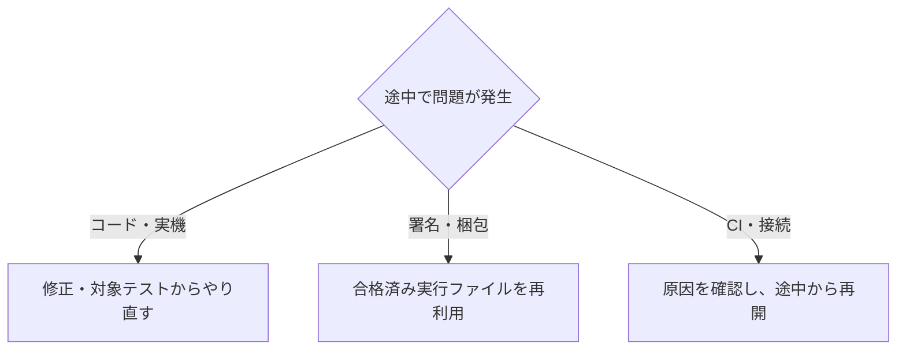

# リリース手順

図1-1：PCアプリをStoreへ届ける流れ。

図1-1では、PCで実機確認した実行ファイルをStore提出用に再利用します。同じ作業は目的なく繰り返しません。GitHubは変更履歴と自動検査、利用者は実機確認と申請承認、Storeは認定と配布を担当します。

表1-1：リリース手順（例：現在地「2-4」）

| 工程 | 番号 | すること | 終わりの目印 |
|---|---|---|---|
| 0 修正 | 0-1 | 修正・対象テスト | PCで動作確認 |
|  | 0-2 | developへ反映 | PR・統合後CI成功 |
|  | 0-3 | iPhoneを確認 | PWA変更時のみ、Previewで確認 |
| 1 実機 | 1-1 | 候補を固定・バックアップ | developと版番号を確認 |
|  | 1-2 | 実行ファイルを作る | 一度だけ作成 |
|  | 1-3 | 確認用MSIXを作り、導入 | PCで起動 |
|  | 1-4 | 利用者が実機確認 | 保存・再起動・変更箇所が正常 |
| 2 準備 | 2-1 | Store用MSIXを作る | 合格済み実行ファイルを使用 |
|  | 2-2 | 版・形式・中身を確認 | 未署名・SHA256一致 |
|  | 2-3 | 提出用を固定先へ保存 | 下記の保存先に存在 |
|  | 2-4 | mainへ反映 | PR・統合後CI成功、候補と一致 |
|  | 2-5 | developを同期 | PR・統合後CI成功、候補と一致 |
| 3 提出 | 3-1 | MSIXをStoreへアップロード | 版・X64・Validatedを確認 |
|  | 3-2 | 日英の変更内容・公開設定を確認 | 今回の内容を保存 |
|  | 3-3 | 本人承認後に認定へ送信 | 申請番号・認定中を確認 |
|  | 3-4 | 公開後、Storeから更新 | 版番号・起動が正常 |
| 文書のみ | — | 表示・リンクを確認してPR | Store用MSIXは不要 |

2-3の保存先：`D:\Users\uck\Documents\俺の付箋-Store提出\<バージョン>\ore-no-fusen.msix`。3-1は[Partner Center](https://partner.microsoft.com/ja-jp/dashboard/products/9N4MW0V2MVVG/overview)で行います。公開マニュアルは[更新手順](PUBLIC_GUIDE_MAINTENANCE.md)に従います。
0-3はSW版・変更箇所・必要な送受信と通知を確認します。1-4は既存データも確認します。2-2は名前・発行者・版・x64・未署名と同梱リソースを確認します。PRは最新headの全適用CI成功・競合なしを確認してマージします。3-2は価格・説明・画像・プライバシー・年齢区分・Capabilityも確認します。

表1-1のSTEP 1に合格した実行ファイルをSTEP 2で再利用します。Store側の認定や公開にかかる時間は保証できません。

図1-2：失敗時の戻り先。

図1-2のとおり、コードを変えた場合は影響する検査と実機確認をやり直します。CIの失敗・未完了・キャンセルは成功扱いしません。申請を再開するときは対象版・固定パス・申請番号・保存済み画面を確認し、重複申請を避けます。提出物・証拠と未完了作業を保全してから作業場所を整理します。

**現行設定の注意：** GitHubはPR等でも別のMSIXを作って導入・起動しており、PC実機確認と重複しています。この重複をなくす設定変更は未完了です。現在は適用されるCIを確認し、GitHubの検査用MSIXをStoreへ提出しません。
