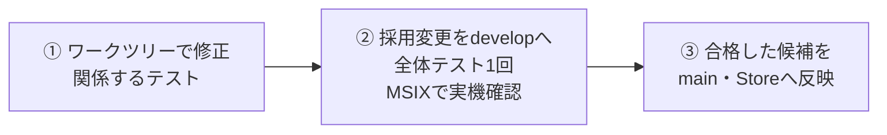
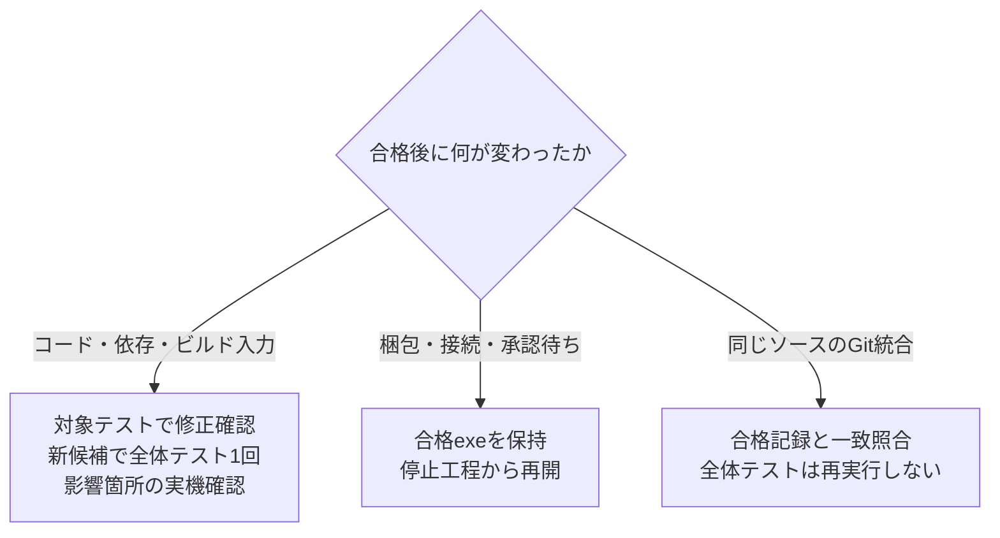

# リリース手順

2026-11-15改定。通常修正は対象テスト、全体テストは採用変更をまとめたリリース候補で1回。検査分担の正本は[対象テストの選び方](TEST_SELECTION_POLICY.md)。

> **移行状況：手順を先に改定しています。** CI・hook・リリースマシンはまだ旧方式です。機能別選択・候補合格の引継ぎ・mainへの一方向統合を実装し検証するまでは、現在要求されるチェックを無効化・無視して進めません。以下の回数削減は移行完了後の運用です。既に認定中の6.2.2を作り直しません。

図1-1：開発から公開までの3工程。

## STEP 1：ワークツリーで開発・対象テスト

1. 最新developから日本語名の作業ワークツリーと `codex/<作業名>` ブランチを作る。関連作業の適切な既存ツリーがあれば使う。
2. 変更機能と影響する機能を特定し、単体テスト・境界/失敗・関係する画面操作を確認する。通常修正では全体テストを行わない。
3. develop宛てPRで対象テストの成功と競合なしを確認して統合する。同一入力の検査をPC/PR/統合後で無目的に繰り返さない。
4. 通常developへ反映し、必要な変更箇所を確認する。資料・未保存変更・実行プロセスを保全し、完了ツリー/作業ブランチを整理する。

## STEP 2：まとめて確認する

1. 全ワークツリーとopen PRを一覧化し「今回採用・次回・未完了」に分ける。採用分をdevelopへ統合する。未完了を勝手に取り込んだり削除したりしない。
2. 依存更新、既知の失敗、版番号、日英の変更内容をここで整理する。候補固定後に無関係な修正や依存更新を足さない。
3. developの候補SHA・ソース全体・依存lock・設定を固定し、**この統合済み候補で全体テストを1回**実行する。全単体・Rust・必要な型/ビルド・E2E/安全系・関連文書検査を含む。候補の不具合は解消してから合格にする。
4. 原本/設定を必要な範囲で保全し、本番exeをこのPCで1回ビルドする。確認用Dev MSIXへ梱包・署名・導入する。AIが起動・保存・再起動・今回の変更と連携を実機確認する。
5. iPhone等の端末固有項目は変更の影響がある場合だけ、develop Previewの版を明記してまとめて本人に依頼する。既に合格した項目は、対象箇所の変更がなければ再依頼しない。AIが実施できる確認は先に済ませる。
6. 候補・全体テスト結果・exe/resourcesのSHA256・実機結果を一組の合格記録として保全する。

PWA配信更新時は `lib/pwa-version.mjs` の `PWA_VERSION` を上げる。画面とService Workerが参照する版を一致させ、Preview反映後に対象版で動作確認する。SW版だけで新旧を判断しない。

## STEP 3：同じ候補をmain・Storeへ反映する

1. 合格した同じexe/resourcesから未署名x64 Store用MSIXを作成する。名前・発行者・版・形式と内部ファイルの一致を確認し、固定先へ保存する。再コンパイルしない。
2. 合格候補をmain宛てPRで反映する。PRと反映後のソース・設定・成果物を合格記録と自動照合する。**照合は同じリリース処理内の工程であり、全体テストを追加で実行する理由にしない。** 環境差・配信先だけは確認する。
3. mainだけで版やコードを追加変更しない。履歴方式の移行後は、main→developへ戻すだけのPRを毎回の工程にしない。mainへの緊急修正は対象変更をdevelopにも戻して確認する。旧リリースマシンの祖先条件・同期PRは、対応実装前に省略しない。
4. Partner Centerで既存申請を確認し、MSIXをアップロードする。版・X64・Validatedを確認する。価格・画像・プライバシー・公開条件を保持し、日英の変更内容を登録する。
5. 具体的な提出物・変更内容・公開条件を本人へ提示し、承認後に認定申請する。本人が送信した場合は状態を確認し、重複送信しない。
6. 公開後、Store経由の更新・版・起動を確認する。これは開発用MSIXと配布経路が違うため残す。提出物と証拠を保全し、正式リリース用ツリーを整理する。

固定先：`D:\Users\uck\Documents\俺の付箋-Store提出\<バージョン>\ore-no-fusen.msix`。
[Partner Center](https://partner.microsoft.com/ja-jp/dashboard/products/9N4MW0V2MVVG/overview)。公開マニュアルは[更新手順](PUBLIC_GUIDE_MAINTENANCE.md)を参照する。GitHubでMSIXを再作成しない。

## 合格後にやり直す条件

図1-2：変更内容で再確認の範囲を決める。

候補の入力が変われば以前の全体合格を新候補へ流用しない。失敗/取消/未確認は合格にしない。記録追記・承認待ち・同じtreeの履歴変更だけで合格済み機能を試し直さない。候補照合の証拠が欠けた場合は停止して復旧し、黙って省略しない。

## 6.2で比較した場合

表1-1：回数の比較（新方式は試算）

|数える範囲|今回の実績|新手順の目標|
|---|---|---|
|アプリ等のTest起動|66回（文書/失敗/取消/再利用含む）|対象41回＋候補全体1回＝42回|
|main反映前後の一致確認|別の全体CIにもなっていた|上の候補合格を引き継ぐ処理内で自動照合|
|配布スクリプト検査|独立12回|関係する対象テスト/リリース処理に含める|
|Dependabot更新処理|14回|開発中の独立処理。リリースの追加14工程にはしない|

66回の内訳は修正PR更新45回（うちリリース/履歴PR4回）とpush後21回。修正内容・更新回数を同じとして対象41回を残し、リリース全体1回に集約した計算。依存問題を含む修正をすべて候補固定前に済ませ、以後変更しない前提。固定後に修正が必要なら、その新候補の全体テストは別途必要。92という旧合計は補助処理も含むため、全体テスト92回→1回という意味ではない。41回の各テストケース数・所要時間は対象選択実装後に計測する。

最終6.2.2のTest6起動の経過合計は49.18分（11.68＋3.28＋9.08＋11.45＋10.97＋2.72）。新手順なら全体約12分＋照合等の余裕で**約15〜20分が目安**。最終候補の自動検査工程だけの見積もりであり、修正中の41回・MSIX作成/導入・人の実機確認・Store審査・開発全体の時間を含まない。runner課金分やトークン削減率ではなく、移行後の実測値でもない。
