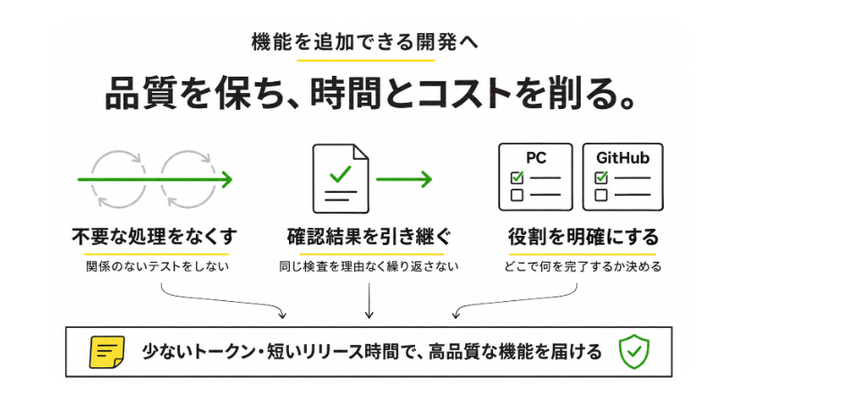
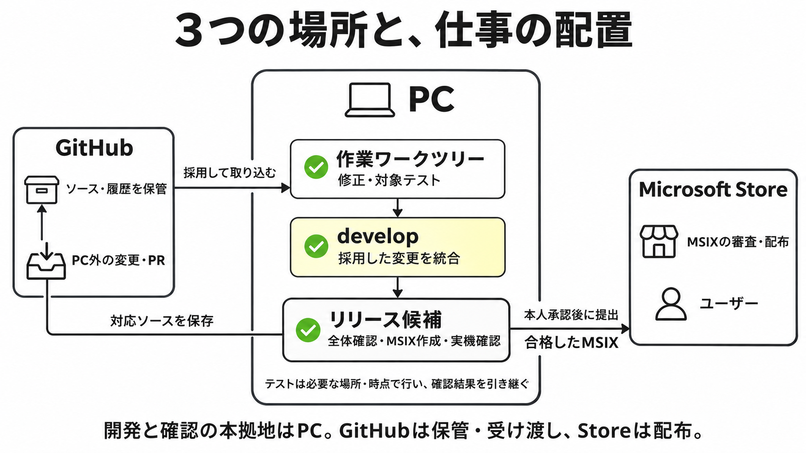
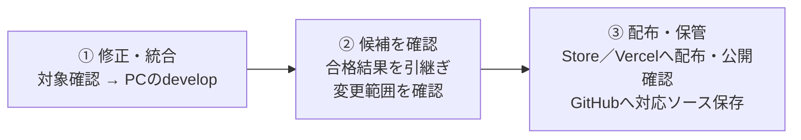

# リリース手順

2026-11-16改定。PCを開発・統合・配布物作成の本拠地とし、方針、役割、流れ、詳細手順の順に定義する。

## 1. 方針

必要な理由：不要な処理と再確認が、時間・トークン・開発の余力を消費している。 
決めること：品質を守り、無駄な処理・時間・コストを削減する。

すべての役割と手順は、この方針のために決める。

## 2. 役割定義

必要な理由：PCとGitHubの仕事が曖昧だと、往復と重複検査が起きる。 
決めること：PCは開発・確認、GitHubは保管・受け渡し、StoreはPC版配布、VercelはiPhone PWA・Web配信。

開発と確認の本拠地はPC。GitHubは保管・受け渡し、StoreはPC版配布、VercelはiPhone PWA・Web配信。

## 3. 流れの概要

必要な理由：作業の現在地と、次へ進む順序を見失わないため。 
決めること：①修正・統合 → ②候補確認 → ③配布・保管の順で進める。

図3-1：PCで修正・確認し、Store／Vercelへ届ける3工程。

## 4. 詳細手順

必要な理由：各工程の担当場所と完了条件を揃え、抜けとやり直しを防ぐため。 
決めること：どこで何を行い、何を確認して次へ進むか。

### ① 修正・統合

|番号|場所|実施・完了条件|
|---|---|---|
|1-1|PC・作業用|最新developから日本語名のワークツリーと作業枝。適切な既存ツリーは再利用。|
|1-2|PC・作業用|変更と影響範囲の対象確認。文書は内容・表示・リンク。通常修正で全体テストをしない。|
|1-3|PC・develop|PC内修正は直接統合。PC外修正はPRで選び、作業用へ取込・対象確認後に統合。競合を解消。|
|1-4|PC・常設|既存の起動方法で変更箇所を確認。資料・未保存変更・プロセスを確認／保全後、完了ツリーと枝を削除。|

### ② 候補確認

|番号|場所|実施・完了条件|
|---|---|---|
|2-1|PC・develop|作業ツリーと外部PRを採用／次回／未完了に分類。採用分だけ統合。|
|2-2|PC・候補|依存・既知の失敗・版番号・日英変更内容を整理。SHA・ソース・lock・設定を固定。|
|2-3|PC・候補|固定候補の確認結果を保存し、同じソース・依存・環境の合格を引き継ぐ。検証合格済みのPWAを本番へ配信するだけなら全体試験を再実行しない。変更がある場合は検査選択表で影響範囲だけ追加確認する。PC版の新しい固定リリース候補は全体確認1回。|
|2-4|PC版変更時|原本と設定を保全。exeを1回ビルドし、Dev MSIXを梱包・署名・導入。起動・保存・再起動・変更と連携を実機確認。|
|2-5|iPhone等|影響する端末項目だけ本人に一括依頼。Previewの版を明記。未変更の合格項目は再依頼しない。AIで可能な確認は先に実施。|
|2-6|PC・保全先|候補SHA・検査結果・配布物の識別情報（PC版はexe/resourcesのSHA256）・実機結果を一組で保全。不明・欠落は停止して記録を復旧。|
|2-7|PWA変更時|PWA_VERSIONを更新。画面・SWの版を一致させ、対象Preview版で確認。|

検証環境だけで終了するのは、本人が明示した場合に限る。通常の修正依頼は必要な本番配信と確認までを同じ案件として扱う。採用時に対象機能・配信先・候補SHA・検証版・本番版・未完了工程をCURRENTに記録する。

### ③ 配布・保管

|停止した理由|再開する場所|
|---|---|
|梱包・接続・承認待ち|合格exeと結果を保持し、停止した工程から再開|

|番号|場所|実施・完了条件|
|---|---|---|
|3-1|PC版配布時|同じ合格exe/resourcesで未署名x64 Store MSIXを作成。名前・発行者・版・形式・内部一致を確認。再コンパイルしない。|
|3-2|GitHub|合格候補と同じソースをmainへ保存。一致と配信先の差だけ確認。mainだけで変更しない。緊急修正はdevelopにも反映。|
|3-3|PC版・Partner Center|既存申請にMSIXを登録。版・X64・Validated、日英変更内容を確認。価格・画像・公開条件を保持。|
|3-4|PC版・本人|提出物・変更内容・公開条件を確認し承認。その後申請。本人送信済みなら状態確認のみ。|
|3-5|Store・PC|公開後、Store経由の更新・版・起動を確認。提出物と証拠を保全し、完了リリースツリーを削除。|
|3-6|Vercel・iPhone PWA|PWA/Web変更を含む場合は、合格PreviewのソースSHA・PWA版・対象機能をCURRENTへ記録し、同じ実行ソースを本番環境設定で配信する。main保存やStore提出だけでPWA配信完了にしない。変更なしの場合も比較元と差分なしの根拠を残す。|
|3-7|Vercel本番|本番URL・deployment ID・ソースSHA・画面とService WorkerのPWA版を照合する。Preview版と不一致・配信失敗なら未完了として保持する。旧deploymentと復帰手順を保全する。|
|3-8|iPhone・完了判定|変更した操作を本番で確認する。Preview合格は候補の合格、本番の操作成功は配信確認として区別して記録する。データ消去やPWA再インストールを更新手順にせず、既存データを保持して更新確認する。本人確認待ちは未完了のまま残す。|

候補確定後に修正・実機合格が追加された場合、その修正を含む本番配信案件をCURRENTとACTIVEに残す。「develop統合・Preview合格・作業ツリー整理」だけで案件全体を完了にしない。採用した変更ごとに配信先（Store／Vercel）と到達版を対応させ、すべての対象の公開確認が揃ってからリリース完了を報告する。

## 5. 保存先・リンク

必要な理由：提出物や申請先を探し直したり、別の版を選んだりしないため。 
決めること：使用する提出物の保存先と、申請・関連手順の入口。

|用途|場所|
|---|---|
|Store提出物|`D:\Users\uck\Documents\俺の付箋-Store提出\<バージョン>\ore-no-fusen.msix`|
|Store申請|[Partner Center](https://partner.microsoft.com/ja-jp/dashboard/products/9N4MW0V2MVVG/overview)|
|対象テストの選択|[検査方針](TEST_SELECTION_POLICY.md)|
|公開マニュアル|[更新手順](PUBLIC_GUIDE_MAINTENANCE.md)|
