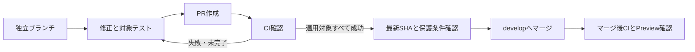
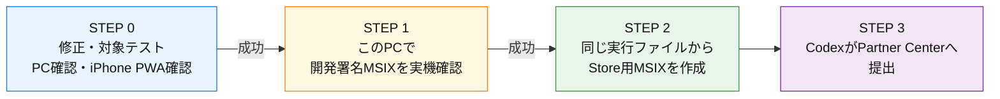
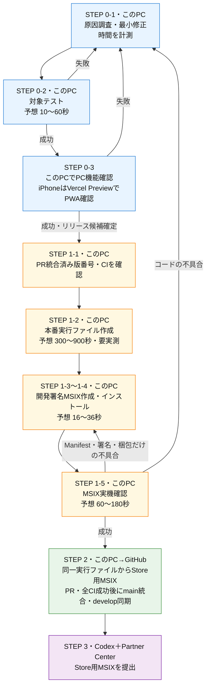

# リリース手順

## 作業開始ゲート（毎回必須）

リリースに関する操作を始める前に、作業者は必ずこの手順書を最初から確認する。

1. 現在のSTEP番号、実施場所、入力ファイル、出力先を確認する。
2. ユーザーへの進捗報告は、この手順書のSTEP番号で統一する。
3. 手順にない保存場所、URL、ビルド方法、テスト方法をその場で作らない。
4. 新しい決定が必要になった場合は、実行前にこの手順書へ保存場所と具体的手順を追記する。
5. 同じ成果物が既に存在する場合は、実行中プロセス、保存先、完了状態を確認し、未完了の場合だけ再実行する。

通常のアプリ開発とMicrosoft Store公開は、次の4ステップで運用する。**通常公開の前に、このPCで開発署名したMSIXを実機確認する。**

GitHub Release、Gitタグ、Winget公開、GitHub ActionsからのMicrosoft Store自動提出は行わない。旧利用者の移行のため、GitHub Release `v5.0.0` の資産だけは保持する。

## AIが使えない場合：リリースマシン

トークン上限などでCodexを含むAIが使えない場合は、**「画面でポン！リリースマシン」**を使い、利用者がこのPCでリリース準備を進める。**版番号を含む修正・テスト・必要な確認を終え、PRとCIを経てdevelopへマージ済み（STEP 0完了）の状態から開始する。あとはMSIXを作り、リリース前の実機確認をする段階で使う。**

基本フォルダーの **`リリースマシン.bat`** をダブルクリックする。デスクトップにはこのファイルへのショートカットを置いてよい。Node.jsのローカルサーバーと既定ブラウザが起動し、`http://127.0.0.1:3099` の画面を開く。起動用ウィンドウは処理が終わるまで閉じない。終了は処理完了後に同ウィンドウでCtrl+C。GitHub CLI（gh）の正規リポジトリへの読み書き権限と本人ログイン、Node.js 24以上、既存のnpm依存・Rust・Windows SDK・Google Driveビルド環境が必要で、事前検査に不合格なら処理を停止する。

実装は `scripts/release-machine/` に置く。新たな版を実際にリリースする前の検証では、`node scripts/release-machine/server.mjs --read-only --browser` で表示確認専用画面（port 3100、リリース操作は無効）を開ける。単体・隔離Git試験は `node --test scripts/release-machine/engine.test.mjs`、画面試験は `node --test scripts/release-machine/ui.test.mjs` で行う。MSIX梱包・検証変更の実SDK試験は `node --test scripts/release-machine/msix.test.mjs` で行い、署名・インストール・公開pushは行わない。

1つ目のボタンを押す前に付箋アプリを終了し、大切なデータをバックアップする。Dev MSIXはStore版と別IDだが、付箋保存先を共有する場合がある。開始時に基本フォルダーと正式リリースの未保存変更・ステージ済み変更、origin/mainが候補developの祖先であること・最新developの統合後CI成功、実行中アプリ/ビルドを検査する。関係ない変更を自動削除したり、別作業のプロセスを終了したりしない。

操作は実行ボタン2つと、固定の実機確認チェック1つを基本とする。

1. **「確認用MSIXを作って起動」**：STEP 1-1〜1-4の版番号・CI検査・正式リリース候補ブランチの準備・本番ビルド・開発署名MSIX作成・インストール・起動を行う。
2. **実機確認（STEP 1-5）**：利用者が起動・保存・再起動と今回修正した箇所・影響範囲を確認し、「実機で確認しました。問題ありません」にチェックする。確認項目をAIが毎回生成する仕組みは設けない。不合格なら本書の失敗時フローへ戻る。
3. **「Store用MSIX作成・PR確認」**：STEP 2とSTEP 3-1を行う。合格した同じexeからStore用MSIXを作成し、形式と内部exeの一致を検証、固定提出先へ保存、リリース作業ブランチだけをpushしてmain宛てPRを作る。画面のリンク先で全CI成功後にCreate a merge commitでマージし、同じボタンで再開する。main統合後CI・候補ソース一致確認後、main→develop同期PRも同様にマージ・再開する。同期後CI成功・同一ソース確認・ローカルdevelopのfast-forward後に提出フォルダーを開く。保護解除や直接pushはしない。

画面には現在の工程・完了状況・停止理由を表示する。各ボタンから実際に呼び出すシェル・スクリプト・作業順を確認でき、実行ログには作業場所・実行コマンド・結果・停止箇所を保存する。手動で引き継ぐ場合はログと本書を照合し、未完了の工程から再開する。

### ビルド前の対話待ち確認

初回のDev証明書が準備できていない場合、リリースマシンは重いビルド前に停止する。利用者が見えるPowerShellで `./packaging/msix/test-msix.ps1 -PrepareCertificateOnly` を実行し、Windowsの信頼確認を自分で判断した後、同じ工程から再開する。非対話処理で確認ダイアログを待ち続けない。通常コマンド2分・Build35分の上限を超えた場合も、合格済み成果物を確認して途中から再開する。Tauriフロントはコピー側でAPIを除外し、原本を移動しない。詳細・CI工程上限・生成物復旧は [自動化運用](AUTOMATION_OPERATIONS.md) を参照する。

### 記録・再開・手動復旧

- ログと保全成果物は基本フォルダーの `my/release-machine/runs/<実行ID>/` に保存する。`commands.log` は実行場所・コマンド・結果、`timings.jsonl` は各試行の開始・終了・秒数、`state.json` は版番号・コミット・工程状態・SHA256・実機合格記録である。工程別時間の原記録とし、本書の実測時間表へ転記するときはこの記録を使う。現在の実行状態は `my/release-machine/active.json`。公開版の集計・試行詳細表への転記はリリース完了時に行う。
- 本番ビルドは正式リリース候補の専用作業ブランチで1回実行し、exe/resourcesを実行ID配下の `build-<ID>/` へ保全する。`test-msix.ps1 -SkipBuild -NoInstall -ReleaseDirectory <保全先> -DevPackageVersion <X.Y.Z.1>` で開発署名MSIXを作る。確認用Dev MSIXのパッケージ番号は、同じアプリ版を再確認するとき既存Dev版を更新できるよう `X.Y.Z.1` とする。Store提出用マニフェストと実行ファイルは引き続き `X.Y.Z.0` / `X.Y.Z` のまま。`scripts/release-machine/windows.ps1 -Action Install` でDevパッケージ番号と保全exeを照合して起動する。アプリの先行アンインストールは行わない。
- リリース画面の「現在」は `origin/main:package.json` の版番号を使う。候補版番号5ファイルは先に独立ブランチで更新し、develop宛てPRの全CI成功・統合と統合後CI成功を必須とする。ツールは基本フォルダーの版番号を変更・コミットしない。
- STEP 2は `build-msix.ps1 -ReleaseDirectory <保全先>` と `validate-msix.ps1 -PackagePath <作成MSIX> -ExpectedVersion <X.Y.Z.0> -ExpectedReleaseDirectory <保全先>` を呼ぶ。既存の指定なしの手動コマンドも従来どおり利用できる。SHA256が違う提出物は上書きしない。
- 停止した場合は同じボタンで再試行する。PR待ちではURLを開き、最新headの全適用対象CI成功とマージ可能状態を確認してCreate a merge commitでマージする。未完了・失敗・キャンセルではマージしない。成功したMSIX作成・検証・保存は繰り返さない。CLIのチェック一覧、統合後push CI、候補と統合結果のGit tree一致を再開時に検査する。ソース・保全exe・提出物が違う場合は停止する。
- 手動引継ぎはcommands.logとstate.jsonの実際のパス・候補SHA・PR番号を使用する。旧方式の途中記録（protocolなし）は自動再開しない。記録・exe・MSIXを保全し、PR方式での同一ソース確認から手動で引き継ぐ。active.jsonを上書きして合格を流用しない。reset --hard、git add -A、強制pushは禁止する。
- main PRのマージコミットとdevelop同期PRのマージコミットは異なる。両者のtreeが実機合格した候補と一致することを検証し、同じSHAを直接pushして揃える運用には戻さない。並行する別変更があれば停止してSTEP 0から候補を確認し直す。
- 正式リリース・ワークツリーはSTEP 3-4まで保持する。公開後の成果物保全と片付けは本書の既存手順どおり行う。

ツールの完了は「Store提出準備完了」を意味する。AIが使えない場合のSTEP 3-2〜3-4は、利用者が[store-submission.md](./store-submission.md)と本書に従って、Partner Centerへのアップロード・認定申請・公開後のStore更新確認を行う。

### リリース手順とツールは一緒に更新する

**リリース手順を変更するときは、リリースマシンも同じ変更に合わせて修正する。** 本書を正本とし、工程順・呼出スクリプト・引数・保存先・検証条件・実機確認ゲート・失敗時の再開方法・画面の作業説明を照合する。手順書だけ、またはツールだけを更新して完了扱いにしない。未実装の間は構想設計案も合わせて更新する。

変更後は対象工程の成功・失敗時の停止とログ表示を確認し、手動手順と同じ結果になることを確かめる。整合確認が終わるまではツールによるリリースを行わず、本書の手動手順を使用する。更新・確認結果はCURRENT.mdへ記録する。

## 通常開発のブランチ運用（すべての開発で必須）

機能追加、不具合修正、文書変更は、次の手順で`develop`へ統合する。通常開発の統合とMicrosoft Storeへの正式リリースは別工程として扱う。

### 必須の統合手順（2026-10-25改定）

通常開発は独立ブランチとPRを使用する。ローカルdevelopへの先行統合や直接pushを標準手順にしない。文書だけの変更もPRを通す。詳細は[CI運用規則](CI_MERGE_POLICY.md)を正本とする。

1. 最新developから日本語名の一時ワークツリーとcodex/<作業名>を作る。関連する既存作業場所を優先し、未保存変更を保護する。
2. 修正、対象テスト、型検査、必要な実機確認を行う。
3. 作業ブランチをpushし、develop宛てのPRを作成する。
4. PRの最新head SHAと現在のbase SHAを記録し、CI結果を確認する。
5. 失敗・未完了・キャンセルがあれば原因を調べて修正し、同じ確認を繰り返す。無関係な失敗も無視しない。
6. CI gateとすべての適用対象チェックの成功を確認する。
7. head SHAが変わっていないこと、baseへの追随、競合なし、保護条件充足、未解決の失敗なしを最終確認する。
8. GitHub上でdevelopへマージし、常設developを通常のfast-forwardで更新する。
9. マージコミットのCIと必要なPreview反映を確認する。未保存変更・資料・プロセスを確認/保全し、完了したローカル作業場所を片付ける。リモートブランチ削除は別判断とする。



*通常開発はPRの最新コミットに対するCI合格後にdevelopへ統合する。*

mainへの統合はSTEP 1〜3の別途リリース判断に従う。CI運用改善だけでは再リリースしない。正式自動化の権限は必要最小限とし、失敗したテストを回避するための例外には使わない。ブランチ保護導入後に直接pushが拒否される旧リリースツールは、保護を解除せず実行を停止し、同じソースのPR・CI確認経路を整えてから利用する。リリースマシンは保護されたPR経路を使用する。CI成功・Create a merge commitでマージ・統合後CI成功が揃うまで提出準備完了にしない。

### 作業フォルダーの数と終了時の片付け

基本フォルダーはリポジトリのルート1個とし、通常はdevelopを開く。機能追加・不具合修正は、最新developから作った日本語名の一時ワークツリーで行う。同じ目的の既存ワークツリーを再利用し、完了後は検証、develop統合、必要な資料の保全、作業用ワークツリー/ブランチ削除まで実施する。資料保管のためだけに作業フォルダーを残さない。

正式リリース時はmainを開く専用ワークツリーを一時追加してよい。機能開発とリリースが並行する間は、基本・機能開発・正式リリースの3個となる。リリース用はStore公開/更新確認（STEP 3-4）までを保持条件とし、機能開発用はその機能の検証/統合完了までとする。すべて完了したら必ず基本フォルダー1個に戻す。未完了の別作業は削除しない。

削除前に未保存変更と実行中プロセスを確認し、必要な資料を基本フォルダーのmy/保全へ移す。Store提出物は従来どおりDocuments\俺の付箋-Store提出\<バージョン>に保持する。合格済みexeと開発署名MSIXの再利用が必要ならmy/保全/正式リリース-<バージョン>-<日付>/へコピーし、元ファイルとSHA256一致を確認する。再梱包が必要な場合は元コミットのmainを一時作業場所へ開き、保全した合格済みexeを元のsrc-tauri/target/releaseへ戻して既存梱包手順から再開する。コードが変わっていれば従来どおり再ビルド/検証する。

CURRENT.mdへ各ワークツリーの目的・現在地・削除条件を記録し、終了報告では残存数と理由を示す。

### 実施場所の定義

| 表記 | 実施場所・役割 |
|---|---|
| このPC | ローカル`develop`で通常開発し、正式リリース時は確認済みの同じコミットから正式リリース候補ブランチを用意する。そのブランチからTauri本番実行ファイルとMSIXを作成・確認し、Store提出物を`Documents\俺の付箋-Store提出\<バージョン>\`へ保存する |
| GitHub develop | 確認対象ソースを保管し、Vercel Previewへのデプロイ元になる。アプリを実行する場所ではない |
| Vercel Preview | GitHub developの内容を公開するiPhone PWAの確認環境 |
| iPhone | Vercel PreviewからインストールしたPWA、通知、PCとの送受信を実機確認する |
| GitHub main | `origin/main`。実機合格した候補と同じtreeをPR経由で保管する。CI用MSIXの検証は行うが、そのexeをStore提出物へ置き換えない |
| Partner Center | 完成したStore用MSIXをアップロードしてMicrosoft Storeへ申請する |

### ローカルとGitHubの位置関係


*Store提出exeはこのPCの合格済み成果物を保持する。GitHubのCI用ビルドと提出物を混同しない。main/developへの直接pushは行わない。*

### Codexの役割分担

| Codex | 担当範囲 | 主な作業 |
|---|---|---|
| VS Code版Codex | STEP 0〜2 | ソース修正、対象テスト、実機確認用ビルド、開発署名MSIX確認、Store用MSIX作成、`main`・`develop`反映 |
| Windows版Codex | STEP 3 | サインイン済みブラウザでPartner Centerを操作し、MSIXアップロード、日本語・英語のリリースノート更新、申請内容確認、認定提出、公開状態確認 |

通常はVS Code版CodexがSTEP 0〜2を完了し、固定保存先のStore用MSIXと実施結果をWindows版Codexへ引き継ぐ。Partner Centerの画面操作が必要なSTEP 3はWindows版Codexで行う。Windows版CodexだけでSTEP 0から一貫して作業できる場合は、同じ手順書と同じSTEP番号に従って全工程を実施してよい。

VS Code版CodexからWindows版Codexへの引き継ぎでは、少なくとも次を伝える。

- 対象バージョン
- Store用MSIXの絶対パス
- STEP 0〜2の完了状況
- 日本語・英語のリリースノートに記載する実際の変更内容

### 概要図



### 詳細図（失敗時の戻り先）



## STEP 0：原因調査・修正

1. **STEP 0-1**：最新developから独立ブランチ・日本語名ワークツリーで最小修正を行う。必要ならmain→develop同期PRを先に作成し、全CI成功・統合後CI成功を確認する。
2. **STEP 0-2**：対象テスト・型検査を行い、develop宛てPRを作成する。全適用対象CI成功・最新SHA・マージ可能状態を確認して統合する。
3. **STEP 0-3**：統合後CIを確認し、PC機能は既存開発環境、PWAはdevelopのVercel PreviewとiPhoneで確認する。失敗は独立ブランチ・PRで修正する。
4. 版番号更新も独立ブランチで下記固定コマンドを実行し、同じPR/CI経路でdevelopへ統合する。仕様・手順を更新する。通常開発はここで完了し、正式リリース依頼があるときだけSTEP 1へ進む。

## STEP 1：このPCの正式リリース候補でMSIXを作成・実機確認

STEP 0で版番号を含めてPR統合・CI確認済みの最新developを、`codex/release-v<版>-<実行ID末尾>`の専用ワークツリーへ開く。mainと基本フォルダーのソースは変更しない。origin/mainが候補の祖先でなければ、STEP 0の同期PRからやり直す。

1. **STEP 1-1**：版番号5ファイル・最新develop・統合後CI成功を検査して候補を固定する。
2. **STEP 1-2**：このPCで本番実行ファイルを1回作成する。現時点の予想は300〜900秒であり、実測値を必ず記録する。
3. **STEP 1-3**：STEP 1-2の実行ファイルから開発署名MSIXを作成する。梱包・署名の実測目安は約6秒。
4. **STEP 1-4**：MSIXをインストールして起動する。予想は10〜30秒。
5. **STEP 1-5**：不具合の再現手順と影響範囲を実機確認する。予想は60〜180秒。

MSIX固有の修正は、アプリを終了してからこのPCで次を実行し、開発署名MSIXを作成・インストール・起動する。

```powershell
.\packaging\msix\test-msix.ps1
```

STEP 0の版番号更新PRでは、独立ブランチ上で次を実行する。5ファイルを一括更新し、現在以下の版番号や不正な形式を拒否する。

```powershell
node scripts/set-release-version.mjs <X.Y.Z>
```

Store版とはパッケージIDと署名が異なるが、同じTauri実行コードとMSIX環境で、起動、保存、画像、同期をStore提出前に確認できる。Google Drive連携を確認する場合は、本番と同じ`GDRIVE_CLIENT_ID`と`GDRIVE_CLIENT_SECRET`をビルド時に使用する。

STEP 1-5で失敗した場合は、原因により戻り先を分ける。

- コードの不具合：STEP 0-1へ戻る。コード変更後はSTEP 1-2で新しい実行ファイルを作る。
- Manifest・署名・梱包だけの不具合：STEP 1-3へ戻り、合格済みの実行ファイルを再利用する。
- 再試行では、成功・失敗にかかわらず別の試行として時間を記録する。

リリースしない通常作業は、STEP 0で完了である。

### 工程別の予想時間

| 工程 | 実施場所 | 内容 | 予想時間 | 根拠 |
|---|---|---|---:|---|
| STEP 0-1 | このPC | 原因調査・最小修正 | 不具合による | 毎回実測して蓄積する |
| STEP 0-2 | このPC | 対象テスト | 10〜60秒 | 次回以降に実測更新する |
| STEP 0-3 | このPC | PC機能を開発環境で確認 | 30〜120秒 | 操作時間を含む |
| STEP 0-3 | Vercel Preview＋iPhone | iPhone PWA、通知、PCとの送受信を確認 | 操作による | GitHub developのデプロイ完了後に行う |
| STEP 1-1 | このPC | 検証済み版番号・CI・候補を確認 | 状況による | CI待ちを別記する |
| STEP 1-2 | このPC | 本番実行ファイル作成 | 300〜900秒 | 未計測。最優先で実測する |
| STEP 1-3 | このPC | 開発署名MSIX作成 | 約6秒 | MSIX梱包の実測値 |
| STEP 1-4 | このPC | インストール・起動 | 10〜30秒 | 次回以降に実測更新する |
| STEP 1-5 | このPC | MSIX実機確認 | 60〜180秒 | 操作時間を含む |
| STEP 2-1 | このPC | Store用MSIX作成 | 約6秒 | 同じ実行ファイルを再利用する |
| STEP 2-2 | このPC | Store用形式確認 | 約2秒 | 5項目の形式確認 |
| STEP 2-3 | GitHub main/develop | PR統合・同期・統合後CI・tree照合 | CI待ちによる | 旧push時間を流用しない |
| STEP 3 | Partner Center | Store用MSIXをアップロード・申請 | 通信・審査による | Microsoft側の処理時間を含む |

### 実測時間の記録

公開バージョンごとに1行を追加し、直前バージョンとの差分を確認する。時間は不具合修正・PWA実機確認・Microsoft審査を除く、版設定からGitHub反映までのMSIXリリース工程を集計する。

| 日付 | バージョン | 結果 | リリース工程 | 前回比 | 内訳（秒） | 備考 |
|---|---|---|---:|---:|---|---|
| 26-08-11 | 5.1.4 | 申請完了 | 320秒（5分20秒）＋実機操作 | 約30分→5分20秒（約82%短縮） | 版設定1、exe作成273、Dev MSIX 7、導入7、Store MSIX 6、検証1、GitHub反映25 | 合格済みexeを再利用。前回値は約30分の概算 |
| 26-08-16 | 5.1.5 | 認定申請完了 | 546秒（9分6秒）＋実機操作 | 5.1.4比226秒増加 | exe・Dev MSIX・導入253、Store MSIX 6、検証2、pre-commit 275、develop push 5.3、main push 4.8 | 旧自動起動の再登録防止。合格済みexeをStore用MSIXへ再利用。Submission 14をCodexが申請し、認定中を確認。全テストhookが増加要因 |
| 26-08-30 | 5.2.0 | 公開完了 | 1,138秒（18分58秒）＋実機・申請操作 | 5.1.5比592秒増加 | 版設定3、誤ったフロント単体ビルド301、exe作成337、Dev MSIX・導入16、Store MSIX 7、検証3、pre-commit・統合455、GitHub反映16 | 折りたたみ機能と匿名利用状況集計。合格exeをStore用MSIXへ再利用し、Submission 16を送信。26-08-31にPartner Centerで製品更新・Store入手可能を確認 |
| 26-09-02 | 5.2.1 | STEP 2完了 | 727秒（12分7秒）＋実機操作 | 5.2.0比411秒短縮 | pre-commit・コミット331、exe・Dev MSIX・導入387、Store MSIX・検証・固定保存8 | 折りたたみ・アラームを含む完全複製を実機確認。Store申請とmain反映は未実施 |
| 26-09-06 | 5.2.2 | STEP 2完了 | 計測済み489秒＋版設定・実機・GitHub反映 | 5.2.1の合計とは計測範囲が異なるため比較なし | exe・Dev MSIX・導入481、Store MSIX・検証8 | しまった付箋の選択復元、位置・大きさ保持、一覧即時更新を実機確認。5.2.2.0、x64、未署名、合格exe一致。版設定スクリプト新設時間とGitHub反映時間は未計測 |
| 26-10-05 | 5.5.1 | STEP 3申請準備 | 計測済み609秒＋版設定・実機・GitHub反映 | 完了版とは計測範囲が異なるため比較なし | exe作成592、Dev MSIX10、導入7 | 5.5.1.0。実機exeとStore用MSIX内部exe一致。Store梱包5.6秒、検証2.1秒。実機の画像描き込み即時表示成功、PC→iPhoneと再送通知はユーザー確認。その他未照合項目はCURRENTに明記しユーザーのリリース指示を優先。main/develop 6f35705反映済み、Submission 22パッケージValidated |

各試行の詳細は「補足」の「詳細試行ログ」に残す。記録が3件以上たまった工程は、直近3件の中央値を次回の予想時間にする。

### 通常作業の確認

| 確認項目 | 実施条件 |
|---|---|
| 対象テスト・型検査 | 常に実施する |
| `cargo check --locked` | Rustを確認する場合。通常修正で依存を更新しない |
| PC実機確認 | Tauri、付箋、保存、同期、ショートカットなどを変更した場合。MSIX固有の変更は開発署名MSIXで確認する |
| iPhone実機確認 | PWA、Service Worker、iPhone同期を変更した場合 |
| SW_VERSION更新 | PWA / Service Workerを変更した場合 |

`Cargo.toml` / `Cargo.lock` は通常の機能修正では変更しない。依存ライブラリを更新する場合は、機能修正と混ぜず、理由・対象・影響範囲を分けて確認する。

### アプリ本体に影響しない変更

LP、README、`docs/`だけの変更も、まず`develop`で確認する。確認後はmain宛てPRを作り、全CI成功後に統合する。旧Do Non-App Releaseの直接push方式は使わない。StoreリリースのSTEP 1〜3は不要である。

## STEP 2：合格した実行ファイルからStore提出用MSIXを作る

STEP 1-5で合格した実行ファイルを、そのままStore提出用MSIXへ梱包する。GitHub上で同じ実行ファイルを再コンパイルしない。

1. **STEP 2-1**：STEP 1-2の実行ファイルから、Store用ID・未署名のMSIXを作る。予想は約6秒。
2. **STEP 2-2**：名前、発行者、バージョン、x64、未署名の5項目を確認する。予想は約2秒。
3. **STEP 2-3**：リリース作業ブランチ→mainのPRを全CI成功後にCreate a merge commitでマージする。統合後CIと候補tree一致を確認し、main→develop同期PRも全CI成功後にCreate a merge commitでマージする。同期後CI・tree一致を確認し、基本フォルダーdevelopをfast-forwardする。PR待ちではツールを再実行してもMSIXは作り直さない。

STEP 2の自動化は、次の条件をすべて満たすこと。

- STEP 1-5で合格した実行ファイルとStore提出物の実行ファイルが同一である。
- STEP 2ではNext.js・Rust・Tauri実行ファイルを再ビルドしない。
- 合格済みStore提出exeを再ビルドしない。GitHubのPR・統合後CIは省略しない。
- 各工程の開始・終了・秒数を実測時間表へ記録する。

版番号は次の5ファイルへ自動反映される。手で変更しない。

| ファイル | 版番号 |
|---|---|
| `package.json` / `package-lock.json` | `X.Y.Z` |
| `src-tauri/Cargo.toml` / `src-tauri/Cargo.lock` | `X.Y.Z` |
| `packaging/msix/AppxManifest.xml` | `X.Y.Z.0` |

## STEP 3：CodexがMicrosoft Storeへ申請

1. **STEP 3-1（このPC）**：STEP 2で作成した`ore-no-fusen.msix`を、`D:\Users\uck\Documents\俺の付箋-Store提出\<バージョン>\ore-no-fusen.msix`へ準備する。一時フォルダやリポジトリ内には置かない。
2. **STEP 3-2（Codex＋Partner Center）**：ユーザーがCodexへStore申請を依頼する。Codexはこの手順書と`store-submission.md`を全文確認し、サインイン済みのブラウザで「俺の付箋」の新しい更新申請を作成して、固定保存先の`ore-no-fusen.msix`をアップロードする。アップロード後にファイル名、Version、Architecture、検証成功を画面で確認して保存する。
3. **STEP 3-3（Codex＋Partner Center）**：Codexは日本語・英語の「このバージョンの最新情報」を今回の版番号と実際の変更内容に更新する。あわせて既存の説明、画像、プライバシー、年齢区分、Capabilityの説明、公開設定が「変更なし」または意図した内容であることを確認する。外部公開申請を開始する直前にユーザーの明示承認を受けてから「送信して認定を受ける」を実行し、申請番号と「認定中」を確認して報告する。
4. **STEP 3-4（Microsoft Store＋このPC）**：認定・公開後、Storeからインストールまたは更新し、バージョンと起動を確認する。

CodexがPartner Centerを操作できない場合だけ、ユーザーが同じ手順を手動で行う。サインイン、MFA、CAPTCHAなど本人操作が必要な画面ではCodexは操作を止め、該当画面を開いたままユーザーへ引き継ぎ、完了後に再開する。

Partner Centerでの画面操作と確認項目は、[store-submission.md](./store-submission.md)を参照する。

## 補足

### バージョン番号

`MAJOR.MINOR.PATCH`形式を使う。

| 種別 | 用途 | 例 |
|---|---|---|
| PATCH | バグ修正 | `5.0.0` → `5.0.1` |
| MINOR | 後方互換のある機能追加 | `5.0.0` → `5.1.0` |
| MAJOR | 互換性のない大きな変更 | `5.0.0` → `6.0.0` |

### PWA / Service Worker

PWAまたはService Workerを変更した場合だけ、`worker/index.js`の`SW_VERSION`を`本体バージョン-pwa.N`形式で更新する。画面右下の`SW`表示で反映を確認する。

### 5.0.0からStore版への移行

GitHub Release `v5.0.0` の`latest.json`、MSI、NSIS、署名ファイルは、旧版利用者が5.0.0へ更新するために残す。5.1.0以降はGitHub Releaseを新規作成せず、Microsoft Store版だけを正式配布する。

### 詳細試行ログ

失敗した試行も削除せず、次回の予想時間と改善判断に使う。

| 日付 | バージョン | 試行 | 結果・失敗工程 | 0-1 | 0-2 | 0-3 | 1-1 | 1-2 | 1-3 | 1-4 | 1-5 | 2-1 | 2-2 | 2-3 | 合計秒 | 改善メモ |
|---|---|---:|---|---:|---:|---:|---:|---:|---:|---:|---:|---:|---:|---:|---:|---|
| 26-08-11 | 5.1.4-pwa.1 | 1 | 0-3失敗 |  |  | 506 | - | - | - | - | - | - | - | - | 506 | 同一通知が3件表示。復帰イベント3種の同時実行を特定 |
| 26-08-11 | 5.1.4-pwa.1 | 2 | 0-3成功 |  |  | 604 | - | - | - | - | - | - | - | - | 604 | Vercel完了12:51:10から実機確認完了まで。通知1件、SW版数も確認 |
| 26-08-11 | 5.1.4-pwa.6 | 3 | 0-3失敗・MSIX優先へ切替 |  |  |  | - | - | - | - | - | - | - | - |  | iPhoneでtouchendとlocation.assign開始を記録したが遷移なし。PWAリンク修正を保留し、ユーザー判断でMSIX作成を優先 |
| 26-08-11 | 5.1.4 | 1 | 1-5失敗 |  |  | - | 1 | 273 | 9 | 8 |  | - | - | - | 291 | 開発MSIX作成時にStartupTask拡張を削除しており、設定画面で確認不能。本番exeは合格として再利用 |
| 26-08-11 | 5.1.4 | 2 | 1-5失敗 | - | - | - | - | - | 7 | 7 |  | - | - | - | 14 | StartupTaskは登録できたがStore版とDev版が同名表示となり識別不能 |
| 26-08-11 | 5.1.4 | 3 | STEP 1成功 | - | - | - | - | - | 7 | 7 | 成功 | - | - | - | 14+操作 | Dev表示名をOre No Fusen Devへ固定。ボタンでWindows設定を開き、旧debug・Store版を無効化後の再起動でDev版の自動起動に成功 |
| 26-08-11 | 5.1.4 | 4 | STEP 2成功 | - | - | - | - | - | - | - | - | 6 | 1 | 25 | 32 | 合格済みexeを再ビルドせずStore用MSIXへ梱包。5項目とexeのSHA-256一致を確認し、同じソースをdevelop/mainへ反映 |
| 26-08-16 | 5.1.5 | 1 | 1-5失敗 |  |  |  |  | 603（1-3〜1-4込み） | - | - | 失敗 | - | - | - | 603 | MSIXレジストリ仮想化により実HKCU Runを削除できないことを実機で特定 |
| 26-08-16 | 5.1.5 | 2 | STEP 1・2成功 | - | 69 | - | - | 253（1-3〜1-4込み） | - | - | 成功 | 6 | 2 | 285 | 615+操作 | 共有`auto_start`をfalseへ移行。Dev実機・Store形式5項目・exe SHA-256一致、pre-commit全検証38件成功・5件skip、develop/main反映を確認 |
| 26-08-30 | 5.2.0 | 1 | STEP 1・2成功 | - | 547件・E2E 38件成功 | ユーザー確認成功 | 3 | 638（誤ったフロント単体301を含む） | 7 | 9 | 成功 | 7 | 3 | 471（pre-commit455を含む） | 1,138+操作 | 5.2.0.0、x64、未署名、Store用MSIX内exeのSHA-256一致。`main`・`develop`とも`9232742` |
| 26-09-02 | 5.2.1 | 1 | STEP 1・2成功 | - | 554件・E2E 38件成功 | ユーザー確認成功 | - | 387（1-3〜1-4込み） | - | - | 成功 | 8 | 同時実施 | 未実施 | 727+操作 | pre-commit・コミット331秒。5.2.1.0、x64、未署名、Store用MSIX staging exeのSHA-256一致。固定提出先へ保存 |
| 26-09-06 | 5.2.2 | 1 | 1-1失敗・安全停止 | - | - | - | 未計測 | - | - | - | - | - | - | - | 未計測 | package-lockの正規表現一致数判定を誤り、書込み前に停止。5ファイルは未変更 |
| 26-09-06 | 5.2.2 | 2 | 1-1失敗・安全停止 | - | - | - | 未計測 | - | - | - | - | - | - | - | 未計測 | Cargo.lockの対象パターン不一致で書込み前に停止。5ファイルは未変更 |
| 26-09-06 | 5.2.2 | 3 | STEP 1・2成功 | - | 対象7件・TypeScript・直前全581件成功 | ユーザー確認成功 | 未計測 | 481（1-3〜1-4込み） | - | - | 成功 | 8 | 同時実施 | 未計測 | 489+操作 | 5.2.2.0、x64、未署名、Store MSIXと合格exe一致。固定提出先へ保存。main/develop `04b1c8d` |

## 更新履歴

| No. | 日付 | 内容 |
|---:|---|---|
| 16 | 26-07-27 | Store手動提出へ切替。タグ・GitHub Release・Winget・自動Store提出を廃止し、5.0.0の移行用資産だけを保持した。 |
| 17 | 26-07-28 | 事前検証・版確定・MSIX作成を、版番号を一度だけ入力する単一ワークフローへ統合した。 |
| 18 | 26-07-28 | 開発・Store公開の運用をSTEP 1〜3へ整理し、旧手順と未実装案を削除した。 |
| 19 | 26-08-03 | 通常公開前の必須ゲートとしてパッケージフライトを追加。Store署名済みMSIXで画像保存・画像付き複製・既存データ・更新を最終確認してから公開する4ステップ運用へ変更した。 |
| 20 | 26-08-03 | Store MSIX作成の通常目標を10分以内とし、Node系検証とRust releaseテストの並列化、同一run内でのRust成果物再利用を明記した。5.1.1の緊急例外も記録した。 |
| 21 | 26-08-10 | パッケージフライトを必須手順から外し、開発署名MSIXをこのPCで作成・実機確認してからStoreへ通常申請する3ステップ運用へ変更した。 |
| 22 | 26-08-10 | STEP 0〜3の失敗時フローと工程別時間記録を追加し、実機確認済み実行ファイルをStore用MSIXへ再利用して重複ビルドしない手順へ変更した。 |
| 23 | 26-08-11 | リリース時間をバージョンごとに1行で比較する集計表を追加し、試行ごとの記録を詳細試行ログへ移動した。 |
| 24 | 26-08-16 | STEP 3をCodexによるPartner Center申請へ変更し、アップロード確認、日本語・英語のリリースノート更新、ユーザー承認、認定中の確認、本人操作が必要な場合の引き継ぎを明記した。 |
| 25 | 26-08-16 | VS Code版CodexをSTEP 0〜2、Windows版CodexをSTEP 3の担当とし、Store申請時の引き継ぎ項目を明記した。 |
| 26 | 26-09-06 | STEP 1-1でこのPCから5つの版番号ファイルだけを安全に一括更新する固定コマンドを追加した。 |
| 27 | 26-09-21 | 通常開発をこのPCのローカル作業ブランチで行い、ローカル確認後に`develop`へ統合して`develop`だけをpushする固定運用を追加した。リモート機能ブランチ・Pull Requestは明示依頼時だけとし、STEP 0でのMSIX CI調査を禁止した。`main`は正式リリース専用とした。 |
| 28 | 26-10-10 | AIが使えない場合のリリースマシン利用方針（develop統合・確認済みから開始、2ボタンと実機確認、手動引継ぎ）と、手順変更時にツールも同時更新する規則を追加。現時点では画面設計・未実装と明記。 |

画面は上から順に2つの操作を縦に配置する。開始可否・現在の工程を上部に表示し、停止理由の詳細、実行コマンド・ログ、利用前提は折りたたんで確認する。提出先は完了後に表示する。

再試行を押した直後は再開要求を表示し、処理中は回転表示と経過秒数を示す。実行中は前回のエラーを停止状態として表示せず、新たな失敗時に再表示する。画面更新の読み取り専用Gitコマンドには --no-optional-locks を指定し、コミット処理のindex更新と競合しないようにする。

提出準備完了後は版番号を完了した版に固定し、①②のボタンを「完了」表示で無効にする。画面を開き直しても同じ完了状態を表示し、次の操作がMicrosoft Store（Partner Center）への提出であることを案内する。


### 2026-10-25 保護されたリリース経路
main/developの直接pushを廃止し、版番号PR・リリースPR・同期PRの各CIと候補tree照合を必須化した。リリースマシンの①は検証済み候補の作成、②はStore MSIX保全とPR確認・再開を担当する。Ver.6.0の再リリースは行わない。
